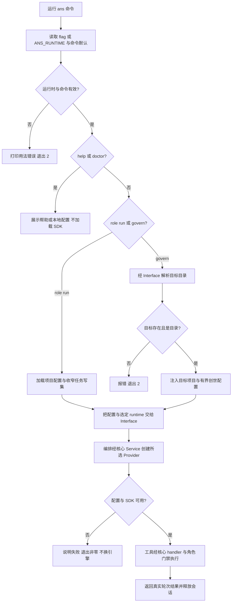

# CLI 选择受治理运行时

用户从命令行执行一个角色任务或发起治理对话时，可以选择 demo、Pi、Codex 或 Claude。选择会到达对应引擎；依赖或配置缺失会明确失败，程序不会自行换一个引擎。装配只负责入口与配置交接，角色授权和模型工具的处理分别由编排与运行时核心负责。

例如：`node --env-file=.env bin/ans.js role run 编排 --task T-1 --runtime codex`。环境配置见 [README](../../../../README.md) 和 [占位符示例](../../../../.env.example)。未指定选择时，role run 用无模型的 demo，govern 用 Pi；显式 `--runtime` 优先于 `ANS_RUNTIME`。

demo 的原装配演示替身只演示权限判定，不落盘。真实引擎均通过 Interface→Pipeline→Service→Provider，入口没有直接创建下层对象。CLI 默认没有 shell gate，因此不注册 run_shell。govern 的客户确认沿用编排终端通道；拒绝、EOF 或中止都不会授予写权。运行时加载失败与超时不会被改写成完成。

仓库无 `.ans` 时，回退角色表引用原六个角色及运行时核心/Codex/Claude 三个已接受角色的真实卡和边界。演示任务写集仍是 `src/interface/cli/run.ts`，新增角色登记不扩大写权限。外来空目录的 govern 不把本仓库角色表当作该目录角色表。

Codex 的实际运输是固定 CLI app-server 的实验动态 ANS 代理，原生 MCP 和其它旁路先关闭并验证；Claude 使用官方 Agent SDK 的进程内 MCP。Claude 上游工具等待有约 24.8 天硬上限，ANS 回放不等于原生上下文已恢复。在线模型轮次和桌面最终接线不在本角色冒烟的证明范围。

主要入口是 `src/index.ts::main`。`main(argv,env?,{runtimeOptions}?)` 的可选第三参沿 Interface 公开输入传配置；本角色无网络测试用正常 providerFactories 注入假引擎，执行实际 Service/门禁 handlers，另用实际 bin 验证缺配置和依赖错误及 SDK 懒加载。详细原证据见[装配记录](../change/2026-10-14_change_multi-runtime-assembly.md)。

| 日期 | 类型 | 状态 | 变化 | 详细文档 |
| --- | --- | --- | --- | --- |
| 2026-10-14 | 设计 | 已实施 | 固定依赖，入口选择交给 Interface | [设计](../design/2026-10-14_design_multi-runtime-assembly.md) |
| 2026-10-14 | 修改 | 自有冒烟已验证 | 两个命令支持四运行时，保留命令默认与 demo | [原始结果](../change/2026-10-14_change_multi-runtime-assembly.md) |
