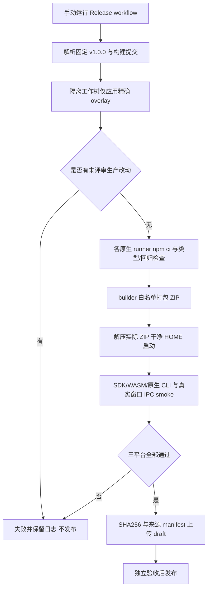

# 桌面运行包构建与发布

维护者需要从已确认的版本生成能直接启动的 macOS/Windows ZIP，同时明确包内源码和本地凭据的边界。客户已授权基于 v1.0.0 增加必要打包适配，既有 tag 保持不变。

用户解压 ZIP 即可启动，不依赖另装 Node。配置入口沿用桌面设置；打包模式的 `.env` 由窗口属主统一切换到用户数据目录。包内不带开发机 `.env`、`.ans` 或会话记录，原生第三方 CLI 与 WASM 仍作为生产依赖随包。

源码为固定 tag 加明确 overlay，`release-prepare.mjs` 拒绝未知生产源码变更；`release-verify.mjs` 必须执行解压后的程序，验证真实运行时模块、CLI 版本和窗口/preload/IPC。每个平台 manifest 记录 source/overlay/actualTree、锁文件 hash、架构和实际 smoke。失败时不会上传该平台产物，后续发布 job 依赖全部 build 成功。默认 draft，客户授权的发布动作仍需独立测试与验收完成后进行。

实现与三平台原生 CI 已验证：run `38728387848`、source `83445eb` + overlay `c3d1066`，实际 tree `15427e074c23ad1d4b52d0b191f57fe3bdeb5167`。macOS 两架构均为 1401 项中 1400 通过/0 失败/1 平台跳过，Windows 为 1399 通过/0 失败/2 平台跳过；三份实际解压程序及 SDK/WASM/原生 CLI/7 项窗口检查均通过。集合来源和 SHA 校验已通过，12 项分发资产已公开发布；root 已在未登录页面确认可下载，GitHub 保存的三份 ZIP SHA256 与 CI3 manifest 逐项一致。

Windows 内置受限来源文档阅读依照 r2 保持不支持；摘要和执行记录仍可查看，可由操作者使用系统编辑器查看文件，不增加不存在的一键打开入口。

[下载页面](https://github.com/wangzhongren/ans-studio/releases/tag/v1.0.0)与三平台 CI/Release 的实际状态见[本次变更](../change/2026-10-15_change_v1-release-packaging.md)，不得将本机 arm64 构建或 owner 冒烟代替 Windows/x64 实测。
