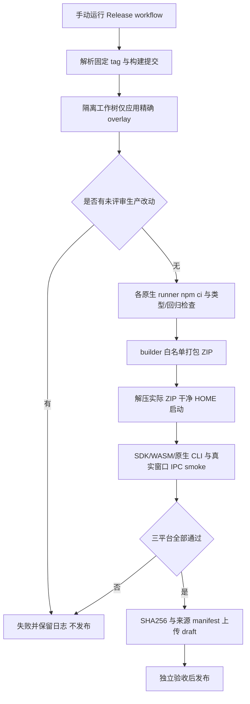

# 桌面运行包构建与发布

维护者需要从已确认的版本生成能直接启动的 macOS/Windows ZIP，同时明确包内源码和本地凭据的边界。客户已授权基于 v1.0.0 增加必要打包适配，既有 tag 保持不变；v1.0.0～v1.4.0 沿用同一机制：冻结 tag（v1.1.0＝`e4556cc`、v1.2.0＝`ecca2d3`、v1.3.0＝`16963ee`、v1.4.0＝`83eec7e`）＋后置打包 overlay，此前各 tag 与证据均保持不动。

用户解压 ZIP 即可启动，不依赖另装 Node。配置入口沿用桌面设置；打包模式的 `.env` 由窗口属主统一切换到用户数据目录。包内不带开发机 `.env`、`.ans` 或会话记录，原生第三方 CLI 与 WASM 仍作为生产依赖随包。

源码为固定 tag 加明确 overlay，`release-prepare.mjs` 拒绝未知生产源码变更；`release-verify.mjs` 必须执行解压后的程序，验证真实运行时模块、CLI 版本和窗口/preload/IPC。每个平台 manifest 记录 source/overlay/actualTree、锁文件 hash、架构和实际 smoke。失败时不会上传该平台产物，后续发布 job 依赖全部 build 成功。默认 draft，客户授权的发布动作仍需独立测试与验收完成后进行。

实现与三平台原生 CI 已验证：run `38728387848`、source `83445eb` + overlay `c3d1066`，实际 tree `15427e074c23ad1d4b52d0b191f57fe3bdeb5167`。macOS 两架构均为 1401 项中 1400 通过/0 失败/1 平台跳过，Windows 为 1399 通过/0 失败/2 平台跳过；三份实际解压程序及 SDK/WASM/原生 CLI/7 项窗口检查均通过。集合来源和 SHA 校验已通过，12 项分发资产已公开发布；root 已在未登录页面确认可下载，GitHub 保存的三份 ZIP SHA256 与 CI3 manifest 逐项一致。

## v1.1.0 配方（2026-10-16，已发布）

客户指示「发布新运行包」；机制原样沿用（冻结 tag ＋ 精确 overlay，默认 draft、独立验收后公开）。冻结源＝`e4556cc`（含 F 批次八项真机修复、su 免审批预授权、G-1/G-2 批次），tag `v1.1.0` 已在本仓成立（annotated，2026-10-16 创建、解析回 `e4556cc`）；后置 overlay 仅打包/版本/发布面：policy 指 v1.1.0、白名单**收敛为精确集合**（`package.json`/`package-lock.json`/`release.yml` ＋ `src/common/装配/`、`test/装配/`，另含发布前检查经评审精确纳入的单文件 `test/runtime-core/shell-exec-timeout.test.ts`（Windows 平台断言小修，单文件、不开目录），v1.0.0 遗留的生产白名单整批移除、此后未知 `app/`·`src/` 变更 fail-closed）、版本 1.1.0（package/lock，工件名随之 `ANS-Studio-1.1.0-*`）、workflow `source_ref` 默认/concurrency/发布段改 v1.1.0、README 下载表 1.1.0。本地验证：typecheck 0 错、`test/装配/` 71/71（发布前检查复跑）；机制在临时 clone 预演通过（prepare 产出 `sourceRef v1.1.0`＋7 文件 overlay、错误 ref 明确拒绝；其后经评审增列 1 个测试文件，实际 overlay 将选 8 文件）；本机 mac arm64 模拟构建树打包＋解压实跑通过（`version=1.1.0`、7 项 UI/IPC/配置检查、SDK/WASM 加载、Codex 0.162.1、Claude 2.1.299），ZIP SHA256 `efc147b5…`。**macOS x64 与 Windows x64 必须由 CI 原生 runner 实测；overlay 提交、CI 触发与发布尚未执行。**（此为配方收尾时状态。）详见[本次变更](../change/2026-10-16_change_v1.1-release-packaging.md)；随后已收口，见下段。

后续（已收口）：发布前 CI 实测发现 Windows 平台 `test/runtime-core/shell-exec-timeout.test.ts` 三断言假定 Unix 信号名语义（产品行为无缺陷），该文件经评审按精确路径纳入 overlay（selected 7→8）；修复后重跑 run `38860421363` 四 job 全绿并生成 draft，root 独立验收（12 项资产、SHA 逐项一致）后于 2026-10-16T06:27:14Z 公开发布。详见[测试角色 v1.1.0 发布验收](../../../测试/docs/change/2026-10-16_change_v1.1-release-verification.md)。

## v1.2.0 配方（2026-10-16，已发布）

客户指示「发布」；机制原样沿用（冻结 tag ＋ 精确 overlay，默认 draft、独立验收后公开）。冻结源＝`ecca2d3`（含 v3 界面收敛、U1 贴底修复、收束静默 30 秒、自检台同步），tag `v1.2.0` 由 root 打（annotated、指向 `ecca2d3`）。后置 overlay **回到纯打包面**——policy 指 v1.2.0，白名单＝`package.json`/`package-lock.json`/`release.yml` ＋ `src/common/装配/`、`test/装配/`；v1.1.0 的 runtime-core 测试文件条目**移除**（其平台小修已含于冻结 tag；`app/`·`src/` 未知变更 fail-closed 不变）。发布前 CI 检查另经评审**精确增列 2 个单文件**（均单文件、不开目录）：`src/provider/codex/session.ts`（Windows EBUSY 清理竞态的生产修复，overlay-2；先例 v1.0.0）与 `test/测试/kanban-fixes-verify/f1-timeout.test.ts`（macos-15-intel 慢 runner 时序健壮化，overlay-3 归因更正后；该 run 全绿的 `test/runtime-core/shell-exec-timeout.test.ts` 曾因归因错误列入、核实后已移出白名单，其硬化对与 `fixtures.ts` 随发布后 main 批次）；未列名 `test/` 文件一律 excluded。版本 1.1.0→1.2.0（工件名随之 `ANS-Studio-1.2.0-*`）、workflow `source_ref` 默认/concurrency `release-v1.2.0`/发布段 → v1.2.0、README 下载表 → v1.2.0（另补 v1.1.0 历史验收链接、保留 v1.0.0 链接）。本地验证：typecheck 0 错、`test/装配/` 71/71（发布前检查三轮追加后复跑 73/73）、全量 1678/1677/0/1（1 平台跳过）；机制在临时 clone 预演通过（prepare 产出 `sourceRef v1.2.0`＋selected 恰 6 文件、错误 ref 明确拒绝）；本机 mac arm64 模拟构建树打包＋解压实跑通过（`version=1.2.0`、7 项 UI/IPC/配置检查、SDK/WASM 加载、Codex 0.162.1、Claude 2.1.299），ZIP SHA256 `4291d00c…`。**macOS x64 与 Windows x64 必须由 CI 原生 runner 实测。**（后续：overlay-1/2 已提交、CI 已触发——run 38879484184（Windows EBUSY）经 overlay-2 修复；run 38881759770 macos-15-intel 两条红经归因更正为 `test/测试/kanban-fixes-verify/f1-timeout.test.ts` 的镜像用例（同 run 的 runtime-core 文件 7/7 绿、其条目已移出白名单），f1-timeout 健壮化已随 overlay-3 按精确路径列入。）详见[本次变更](../change/2026-10-16_change_v1.2-release-packaging.md)。

后续（已收口）：overlay-3 后 run `38894559186` 四 job 全绿并生成 draft，root 独立验收（12 项资产、SHA 逐项一致、未登录页面核验）后于 2026-10-16T11:47:07Z 公开发布。详见[测试角色 v1.2.0 发布验收](../../../测试/docs/change/2026-10-16_change_v1.2-release-verification.md)。

## v1.3.0 配方（2026-10-16，待构建/未发布）

客户指示「发布新运行包」；机制原样沿用（冻结 tag ＋ 精确 overlay，默认 draft、独立验收后公开）。冻结源＝`16963ee`（已推送；**源内已含全部产品代码**：G-3 联网搜索＋工具行折叠、G-4 V1 技能安装/V2 外来 MCP 安装、G-5 推理强度、全部修复），tag `v1.3.0` 已在本仓成立（annotated、解析回 `16963ee`）。后置 overlay **重置回基础打包面**——policy 指 v1.3.0，白名单＝`package.json`/`package-lock.json`/`release.yml` ＋ `src/common/装配/`、`test/装配/`；v1.2.0 两项一次性条目（`src/provider/codex/session.ts`、`test/测试/kanban-fixes-verify/f1-timeout.test.ts`）随冻结源吸收**整批移除**；`app/`·`src/` 未知变更 fail-closed 不变。首跑 Windows CI 后 **overlay-2** 按精确路径增列 7 条（codex `session.ts` win32 有界上界修复＋6 测试平台真值分支；selected 6→13；单文件、不开目录）；第四跑后再经 **overlay-5** 增列 1 条（`test/桌面应用/session-rebuild-race.test.ts`——夹具时序脆性修复、产品零改；selected 13→14）。版本 1.2.0→1.3.0（工件名随之 `ANS-Studio-1.3.0-*`；lock 仅根两处版本字段、零依赖变动——pi-mcp 声明已在 tag 内）、workflow `source_ref` 默认/concurrency `release-v1.3.0`/发布段 → v1.3.0、README 下载表 → v1.3.0（补 v1.2.0 发布验收链接、保留 v1.1.0/v1.0.0）。本地验证：typecheck 0 错（ans-cli@1.3.0）、`test/装配/` 71/71（overlay-2 后 72/72）、全量 2110/2109/0/1（overlay-2 后 2111/2110/0/1）；复算 tag→工作区落盘形态 selected **恰 13**（overlay-2 后）、零 `app/`·`src/` 触发；机制在临时 clone 预演通过（tag 解析 `16963ee`→模拟 overlay 提交→prepare 退出 0、`overlayPaths` 恰 13、`actualTree dc618f40…`；真实仓库未污染）。**本机 arm64 打包冒烟未做（不在本次派发清单）；macOS x64 与 Windows x64 必须由 CI 原生 runner 实测；overlay 提交、CI 触发与发布尚未执行。**详见[本次变更](../change/2026-10-16_change_v1.3-release-packaging.md)（含[证据目录](../change/2026-10-16-release-packaging-v1.3-evidence/)）。

Windows 内置受限来源文档阅读依照 r2 保持不支持；摘要和执行记录仍可查看，可由操作者使用系统编辑器查看文件，不增加不存在的一键打开入口。

[下载页面](https://github.com/wangzhongren/ans-studio/releases/tag/v1.3.0)与三平台 CI/Release 的实际状态见[本次变更](../change/2026-10-16_change_v1.3-release-packaging.md)（历史版本见[装配 v1.2.0 记录](../change/2026-10-16_change_v1.2-release-packaging.md)、[装配 v1.1.0 记录](../change/2026-10-16_change_v1.1-release-packaging.md)与[测试角色 v1.1.0 发布验收](../../../测试/docs/change/2026-10-16_change_v1.1-release-verification.md)），不得将本机 arm64 构建或 owner 冒烟代替 Windows/x64 实测。

## v1.4.0 配方（2026-10-20，待构建/未发布）

客户指示「发布吧」；机制原样沿用（冻结 tag ＋ 精确 overlay，默认 draft、独立验收后公开）。冻结源＝`83eec7e`（当前 main，`v1.3.0-45`；**源内已含全部产品代码**：`flow_get` / `flow_step_update` / `flow_step_supersede` 流程文件方法化、Lead / 主理 兼任工作流管理者、重启自动续跑、聊天 pane 加载占位、验收重派/收口、角色卡写后门控、artifact 补登、排队 UI 清理、shell/UI 修复），tag `v1.4.0` 已由 root 创建并解析回该提交。后置 overlay **重置回基础打包面**——policy 指 v1.4.0，白名单＝`package.json`/`package-lock.json`/`release.yml` ＋ `src/common/装配/`、`test/装配/`；v1.3.0 的 8 条一次性条目（`src/provider/codex/session.ts`、6 个平台真值测试文件与 `test/桌面应用/session-rebuild-race.test.ts`）随冻结源吸收**整批移除**，回到 fail-closed/excluded；`app/`·`src/` 未知变更 fail-closed 不变。**overlay-2（首跑 CI run 39389502551 三平台 Regression tests 失败）**：按精确路径增列 1 项产品修复（`src/common/编排/shell-command-guard.ts`——Windows 盘符/UNC 路径反斜杠被当 POSIX 转义消费，`grep -r foo D:\...\source` 漏判 allow）＋4 项测试/夹具修复（`test/编排/shell-command-guard.test.ts`、`test/编排/flow-service.test.ts`、`test/桌面应用/interface.test.ts`、`test/桌面应用/runtime-resolution.test.ts`），单文件不开目录、断言不放宽；同目录未列名文件仍 fail-closed/excluded。**overlay-3（第二轮 CI run 39391972925 Windows 单条红）**：`test/装配/multi-runtime.test.ts` 夹具 `spawnSync` 超时按平台有界调整（`SPAWN_TIMEOUT_MS`：win32 30s / 其他 10s；同文件 4 处统一使用，有界、不取消超时），断言（signal null/status 1/错误文案/密钥不泄漏）未放宽；无新增 policy 路径（`test/装配/` 已在目录白名单）。版本 1.3.0→1.4.0（工件名随之 `ANS-Studio-1.4.0-*`；lock 仅根两处版本字段、零依赖变动）、workflow `source_ref` 默认/concurrency `release-v1.4.0`/发布段 → v1.4.0、README 下载表 → v1.4.0（补 v1.3.0 发布验收链接、保留 v1.2.0/v1.1.0/v1.0.0）。本地验证：typecheck 0 错（ans-cli@1.4.0）、`test/装配/` 82/82、`test/装配/multi-runtime.test.ts` 13/13；复算 tag→工作区落盘形态 selected 恰为 **12 文件**（基础集 6 + overlay-2 精确 5 + overlay-3 的 `test/装配/multi-runtime.test.ts`，完整清单与预演输出见[本次变更](../change/2026-10-20_change_v1.4-release-packaging.md)）、零 `app/`·`src/` 未列名触发；机制在临时 clone 预演通过（tag 解析 `83eec7e`→模拟 overlay 提交→prepare 退出 0、`overlayPaths` 恰 12、`actualTree 07d210ee800c4f19a279b2bc0f3cb3d4dd9e8463`；真实仓库未污染）。**overlay-2/overlay-3 尚未在 CI 复跑，不得声称已通过；本机 arm64 打包冒烟未做（不在本次派发清单）；macOS x64 与 Windows x64 必须由 CI 原生 runner 实测；overlay 提交、CI 触发与发布尚未执行。**详见[本次变更](../change/2026-10-20_change_v1.4-release-packaging.md)（含[证据目录](../change/2026-10-20-release-packaging-v1.4-evidence/)）。
