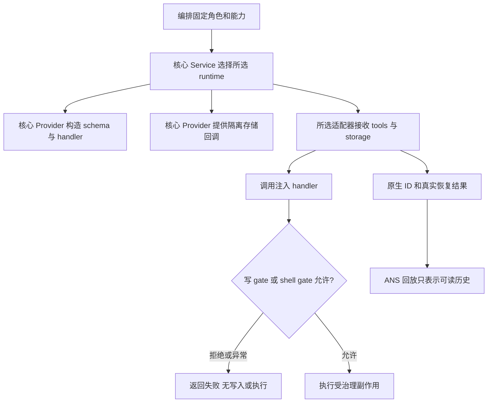

# 同一套工具和会话记录供三种引擎使用

客户从 CLI 或桌面选择 Codex、Claude、Pi 时，写文件仍应先由 ANS 判断是否允许。核心负责保持这条工具路径相同，并把可读历史和真正的模型会话恢复分开。此文细化已经确认并授意开发的 [ANS-RUNTIME-V2 revision 1](../../../项目管理/docs/design/2026-10-14_design_multi-runtime-integration.md)，没有额外选装，也不扩张本角色边界。

## 流程与关键选择

Model 接收现有 Pi 公共类型，保留旧结构兼容；附加工具描述、工具执行、工厂注入与会话持久化契约。Service 是唯一组合入口，向各 Provider 注入工具数组和存储回调。适配器不得导入核心工具或私有 common。SDK 原生 ID、恢复结果来自适配器；核心存储绝不从回放推断 resumed。

核心迁移现有 SDK 无关工具与必要 helper；原子写、路径原语和凭据键名单继续引用项目管理的单一共享实现。schema 迁移现有说明与 sequential 提示，并修正 write_file/edit_file 的必需字段，使参数定义与 handler 一致。Pi 的生产重复实现由 Pi 属主后续移除或改兼容 facade。临时并存窗口仅为迁移阶段。

持久化时，目录为 `.ans/sessions/<role>/<runtime>/`，ANS 索引/回放置于该目录自己的 `ans/`，适配器原生目录为 `native/`。只在第一次保存时创建 ANS 目录；读取不存在目录返回空。会话索引保存角色、runtime、原生 ID 与真实恢复状态。原生恢复失败时可记 `recovered` 和原因，但不会记 `resumed`。

Service 默认按所选 runtime 懒加载对应公开 Provider 工厂；可注入 `providerFactories`，让真实工具 handler 和存储在无 SDK、无账号情况下验证。工厂失败直接上抛，不能切换引擎。旧 Pi 配置与 demo 形状由迁移属主保持兼容；本角色不改他们的入口。

## 独立影响评估

公共类型迁移影响 Pi、编排、桌面窗口；它们必须更新导入并重新测试，旧证据不能替代新结果。Codex/Claude 依赖此处冻结的 `RuntimeProviderOptions`，不需要复制工具治理代码。装配需安装各适配器核实的 SDK。项目管理需扩展现有 `RuntimeKind` 与秘密键集合，核心只读这些共享组件。

核心五个精确源码文件与 private common/test/docs 足够实施。Service/Provider 的既有根文件公开入口继续沿用仓库惯例；三段式重构不在本次授权内，新增 `abstract/impl/public/` 目录不在白名单内，不进行全仓整理。公共入口声明于 api-spec。没有需要越界修改的路径。

## Mutation Contract 与验证

允许改 `src/model/runtime.ts`、`src/service/runtime/session.ts`、`src/provider/runtime/{tools,schema,session-store}.ts`、`src/common/runtime-core/**`、`test/runtime-core/**` 和本角色已列出的文档。其他源文件、构建配置、真实 `.env`、提交及网络模型轮次不在本角色任务内。

先冻结 Model/schema/tool/storage API 并通知项目管理，然后实现 Provider，最后验证 Service 组合。精确命令为 `node --test "test/runtime-core/**/*.test.ts"` 与 `npx tsc --noEmit`。Model/schema 覆盖必需字段、optional、未知工具；工具覆盖 gate deny/throw 零副作用、真实 write/edit、shell deny/allow、交互中止与拒绝、报告派发结论回执；store 覆盖角色/runtime 隔离、懒创建、回放/原生恢复分离与重启读取；Service 覆盖所选工厂、注入能力、失败上抛与可重复轮次。

当前为待实现、待测试；实际功能和证据最终更新到 [核心功能](../feature/runtime-core.md) 与 change 记录。
