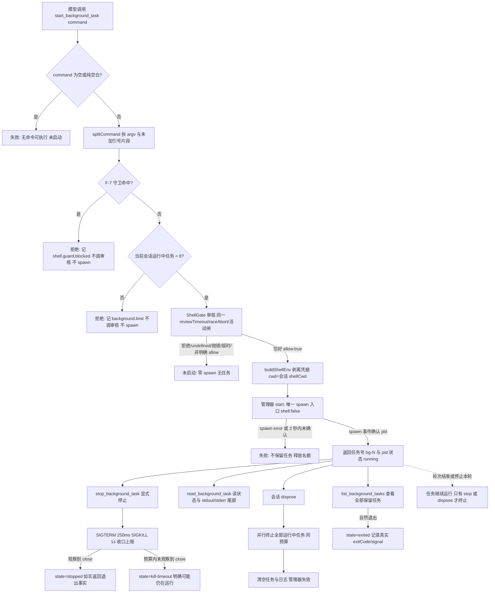

# 会话级后台任务：启动开发服务器后立即把回合还给模型

模型要启动开发服务器时，用 `start_background_task` 启动一个**只属于当前角色会话**的后台任务；工具在确认进程真的启动后**立即返回任务号与 pid**，模型可以继续写代码、跑测试。之后可以用 `list_background_tasks` 看全部任务、用 `read_background_task` 读 stdout/stderr 尾部、用 `stop_background_task` 结束任务。关闭角色会话时，仍在运行的任务被并行终止。

这项功能解决的是「`run_shell` 会一直等进程结束，开发服务器永远不结束，回合被占住直到 10 分钟时限杀进程」的问题。它**不**把 `run_shell` 改成后台模式：`run_shell` 的审核顺序、时限与文案完全不变。

## 当前完整流程（实际实现）

关键顺序（**实际代码顺序**）：

1. 取 `command`；空/纯空白直接失败，不调用审核、不创建任务。
2. 用与 `run_shell` **同一个** `splitCommand` 拆 argv（不做变量展开、不解释引号外元字符）。
3. 用**同一个** `detectUnsupportedShellSyntax` 做 F-7 守卫；`npm run dev &`、`a && b`、`echo $(x)` 在审核前被拒，诊断沿用 `shell.guard.blocked`。
4. **并发检查在 F-7 守卫之后、ShellGate 之前**：运行中任务已达 8 个就直接拒绝，不弹审批、不 spawn，记 `background.limit`（`reasonCode` + `count`）。项目管理已于 2026-10-22 补正设计并置 `status: accepted`，四处统一为此次序；本实现按该设计执行。
5. 调用**同一个** `ShellGate`（同一审核时限、`raceAbort`、交互挂起闸）；只有恰好 `allow:true` 才继续。拒绝、`undefined`、抛错、超时一律未执行、零 spawn。
6. 用**同一个** `buildShellEnv(process.env, extraCredentialEnvVars)` 构造剥离凭据后的环境；cwd 固定为会话 `shellCwd`（默认项目根），调用方不能指定 cwd。
7. 调用管理器的 `start`（**唯一 spawn 入口**）：`shell:false`、`windowsHide:true`、POSIX 下 `detached:true` 建进程组。管理器等待 `spawn`/`error` 事件（约 2 秒上界），拿到 pid 才返回任务号；spawn 失败不保留半成品任务、名额释放。

## 四个工具与真实返回

| 工具 | 参数 | 成功 | 失败/边界 |
| --- | --- | --- | --- |
| `start_background_task` | `command`（必填） | 实际 spawn 成功后返回任务号（`bg-1`）、pid、状态 `running`，并说明可用哪些工具 | 空命令 / F-7 / 审核未通过 / 并发满 / spawn 失败 / 会话已关闭 → `ok:false`，不产生任务、零 spawn |
| `list_background_tasks` | 无 | 当前会话保留任务摘要：任务号、状态、pid、启动时间、命令摘要、退出码；空列表如实说「没有后台任务」 | 无失败分支；不猜测已过期任务 |
| `read_background_task` | `taskId` 必填；`stream?: stdout/stderr/both`（默认 both）；`tailLines?: 1..200`（默认 40） | 状态快照 + 指定流尾部；请求超 200 行按 200 行返回并如实标注；缓冲溢出标 `truncated` | 未知/已过期任务号 → 明确「未知任务——不要假设它运行过」；参数非法明确报错 |
| `stop_background_task` | `taskId` 必填；`force?: boolean`（默认 false） | 观察到真实 `close` 才返回 `stopped` 与退出事实；对已结束任务如实返回原状态与退出码，不声称「刚刚停止」 | 未知任务 → 明确报错；预算内未收口 → `kill-timeout`，明确「可能仍在运行，请如实告知客户」 |

**注册条件（结构性）**：四个工具只在**同时注入 `ShellGate` 与后台任务管理器**时一起注册（与 `run_shell` 同一判据）。判断会话（`shellJudge` / `governanceJudge`）走 `buildShellJudgeTools` / `buildGovernanceJudgeTools`，不经过 `buildGovernedTools`，因此结构上看不到这四个工具；没有 `ShellGate` 的普通会话也不会注册。

**显示规则**：`start_background_task` 使用 `core-command-v1`（和 `run_shell` 一样把命令作为展示目标、走同一套凭据脱敏）；`list/read/stop` 使用 `none`。

## 会话访问面（桌面任务面板，2026-10-25）

桌面应用展示后台任务时，不必也不应绕到模型工具面。绑定会话（`RoleSession`）新增三个可选方法，直接转调**当前会话同一个**后台任务管理器：

| 方法 | 有管理器 | 无管理器 / 会话已关闭 |
| --- | --- | --- |
| `listBackgroundTasks()` | 当前保留任务的快照数组（运行中/已结束都列出） | `[]` |
| `readBackgroundTask(taskId, options?)` | 与管理器 `read` 同语义：默认 both / 40 行、上限 200、`tailClamped` 如实、UTF-8 安全截断 | `undefined`（未知/已过期 taskId 也是 `undefined`） |
| `stopBackgroundTask(taskId, options?)` | 已有任务沿用管理器语义：观察到 `close` 才 `stopped`；已结束返回 `alreadyEnded:true`；预算内未收口返回 `kill-timeout`；未知 taskId 返回 `unknown-task` | `{ ok:false, reason:"closed", message:… }`，**不抛异常、不伪造“已停止”** |

这些方法只读/受控，不新增写权、不绕过审核，也不改变四个模型工具的行为。管理器仍由 `providerFor` 在「普通受治理会话 + `ShellGate`」时创建一次；`dispose()` 统一终止任务并让管理器失效。`dispose()` 开始后调用这三个方法会立即得到关闭语义（空/未找到/失败），且**不会重新创建**管理器。任务表、日志、pid 都只在内存，因此任务只存在于会话生命周期内；应用重启或会话关闭后旧任务号只会返回「未知任务」。桌面展示必须如实区分 `kill-timeout`（可能仍在运行）与 `stopped`（观察到真实退出），不能把前者写成已停止。

## 管理器行为（当前上限与预算）

- 状态只由真实事件驱动：`running` → `exited`（自然退出）/ `stopped`（stop/dispose 终止并观察到 close）/ `failed`（启动后运行错误）/ `kill-timeout`（终止预算内未观察到 close）。启动失败**不产生任务**。
- 同时运行上限 **8**；保留上限 **32**，超出时淘汰最老的**已结束**任务，运行中的任务永不淘汰；被淘汰任务号读取返回「未知任务」。
- 每任务每路（stdout/stderr）**256 KiB** 字节环形缓冲；读取按行取尾部，缓冲溢出标 `truncated`，截断按 UTF-8 安全处理，不返回损坏的多字节字符。
- 终止预算：默认 SIGTERM → 250ms → SIGKILL → 1s 内等待 `close`；`force:true` 直接 SIGKILL。`dispose` 并行终止全部任务（总时长有界），幂等，随后清空任务与日志、拒绝后续 `start`（即使审核刚好通过也零 spawn）。
- 不持久化：任务表、日志、pid 只在内存；会话关闭或应用重启后 `list` 为空、旧任务号只返回「未知任务」。
- 任务号只在工具结果与聊天行出现；诊断事件不落 `taskId`。

## 失败时用户会看到什么

- 命令为空、被 F-7 守卫拒绝、审核拒绝/超时/异常、并发已满、spawn 失败：工具明确说「未启动」，没有任何进程、任务或日志。
- 停止预算内没观察到进程退出：明确说「可能仍在运行，请如实告知客户」，绝不写「已停止」。
- 对已结束任务再次 stop：如实返回 `exited`/`stopped` 与退出码，说明本次没有发送终止信号。
- 会话关闭后再查旧任务号：明确「未知任务（可能来自其他会话或已过期）」；再 start 明确「会话已关闭，未启动」。

## 明确不承诺的限制

1. **不跨会话、不跨应用重启**：任务表、日志缓冲、pid 都只在内存；会话关闭或应用重启后不存在。
2. **日志不落盘**：会话结束后日志消失，不能事后从磁盘找回。
3. **应用直接退出可能残留进程**：正常关闭/淘汰会话会 dispose 清理；应用崩溃、被强杀、断电或桌面退出流程不逐个 dispose 会话时，后台进程可能存活。Windows 上 `taskkill` 不可用时只回退终止直接子进程，孙进程可能残留；POSIX 上程序自行 `setsid`/双 fork 也可能逃出清理。
4. **轮次结束/停止本轮不杀后台任务**：这是功能本身；停止只由显式 `stop_background_task` 或会话 `dispose` 触发。
5. **后台任务不受 10 分钟命令级时限约束**：这正是功能目的；以并发上限、显式停止和会话清理控制风险。
6. 应用退出兜底（O5）、日志落盘（O2）、增量读取（O3）、审核卡标注后台任务（O4）均**未获授权、未实施**。桌面任务面板 UI（O1）本身也**未实施**；2026-10-25 只在绑定会话上提供了供桌面消费的 `list/read/stop` 访问面（见上节），Pipeline/桌面接线仍待各自属主。
7. **`bindRole` 失败后的同 adapter 重试（已知边缘，未修复）**：失败路径当前只释放后台任务管理器、未清除 provider 缓存；同一 adapter 对同一角色重试会复用已关闭的管理器，四个工具仍注册但 `start_background_task` 一律 fail-closed「会话已关闭，未启动」。每次新建 adapter 的正常入口（如 `openRoleSession`）不受影响。后续建议在失败 catch 中删除 provider 缓存并补重试测试。

## 从哪里继续看

- 设计与取舍（项目管理，权威）：[后台任务设计](../../../项目管理/docs/design/2026-10-22_design_background-tasks.md)
- 独立验收标准 A1：[验收标准](../../../独立验收/docs/design/2026-10-22_design_background-tasks-acceptance.md)
- 本次实施记录（改动路径、验证命令与结果、偏差）：[change 记录](../change/2026-10-22_change_background-tasks.md)
- 会话访问面（桌面展示）改动与验证：[change 记录](../change/2026-10-25_change_background-task-session-access.md)
- 代码入口：`src/provider/runtime/tools.ts`（四工具与注册条件）、`src/provider/runtime/schema.ts`（schema 与说明）、`src/common/runtime-core/background-tasks.ts`（管理器）、`src/common/runtime-core/process-tree.ts`（进程树终止单一实现）、`src/service/runtime/session.ts`（创建/注入/释放与会话访问方法）。

## 演变历史

| 日期 | 类型 | 状态 | 变化摘要 | 文档 |
| --- | --- | --- | --- | --- |
| 2026-10-22 | design | draft（客户已确认实施 B1–B4） | 项目管理产出后台任务方案；su 审核后派发运行时核心实施必需项 | [设计](../../../项目管理/docs/design/2026-10-22_design_background-tasks.md) |
| 2026-10-22 | change | implemented-unverified | 四工具、会话级管理器、同源审核、诊断与 Service 接线落地；新增测试与类型检查通过，待独立验收与真实入口联调 | [change](../change/2026-10-22_change_background-tasks.md) |
| 2026-10-25 | change | implemented-unverified | 绑定会话新增 `listBackgroundTasks` / `readBackgroundTask` / `stopBackgroundTask`；只转调同一管理器，无管理器/关闭后行为明确且不复活；新增 3 例测试通过 | [change](../change/2026-10-25_change_background-task-session-access.md) |
