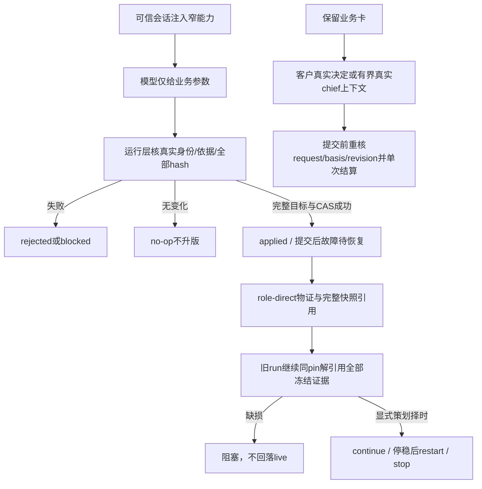

# 角色直接能力共享契约

产品升级、策划整单修正沿现有 `submit_version_change`，应用可返回整单直接结果；新主干与旧冻结 run 分开。当前 Model、五窄工具/schema与Service独立chief模式已实施；身份鉴真、存储和宿主业务接线由后继实施，尚未独立验收。

来源分别为 `customer-decision`、`role-direct`、`chief-delegated`，不能补假客户批准。纯结构检查不鉴真身份、不计算字节哈希，也不执行 I/O。完整快照带原字节 base64；冻结 run 的八项物证必须齐全并来自同快照。chief 的独立有界执行上下文只允许决定工具且无生产写权，实际限制由宿主强制，避免主回合忙等待同一 chief。

契约见 [api-spec](../../api-spec.md)。演变与验证见 [M1-R1](../change/2026-11-05_change_direct-role-capabilities.md)；P3.1、C0、调用者限制均在该记录追踪。
