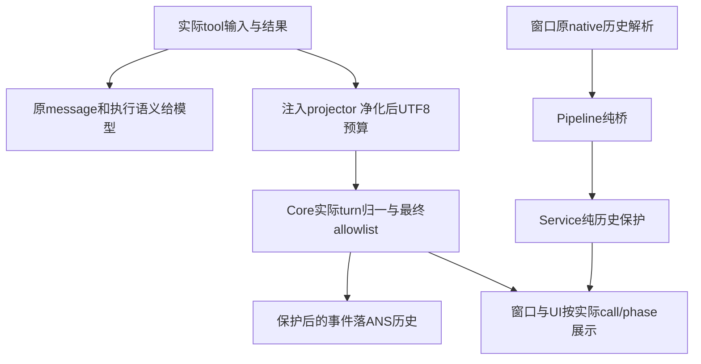
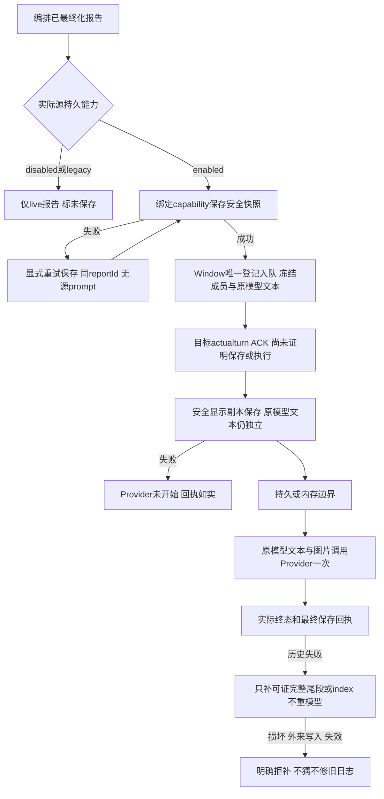

# 同一套治理工具与隔离会话

编排在用户选择 Pi、Codex 或 Claude 后，交给核心固定的角色和已注入能力。核心让这些引擎收到相同的工具与处理器：初次门禁拒绝不创建目录或文件；写前重判拒绝不提交目标文件，但可能保留已创建的父目录。客户拒绝或停止也不会变成同意。开启持久化后，可读历史按角色和引擎隔离保存。

状态：C1 核心已实现及无网络验证；三种 SDK 与 CLI/桌面入口最终接线由各原属主验证。

```mermaid
flowchart TD
  input[编排提供 role runtime gate 与注入能力] --> choose[Service 懒加载所选公开工厂]
  choose -->|缺依赖或工厂失败| error[如实返回失败]
  choose --> inject[注入公共 schema handler 和精确 storage]
  inject --> precheck{disposed active quarantined 检查通过?}
  precheck -->|否| prereject[拒绝 无新turn 无开始通知]
  precheck -->|是| prompt[生成固定 turnId 绑定本轮]
  prompt --> ack[原prompt闭包同步一次开始确认]
  ack -->|callback抛错| ackfailed[failed终态 释放active 无nativeprompt]
  ackfailed --> terminal
  ack -->|返回或缺省| inputecho[保存原输入 取消检查 单次typed输入事件]
  inputecho --> native[原nativeprompt 图片对象透传]
  native --> call{工具请求?}
  call -->|写或编辑| writegate{写 gate 允许且未停止?}
  writegate -->|否| deny[拒绝 无写入副作用]
  writegate -->|是| guard{真实路径与目标状态有效?}
  guard -->|否| deny
  guard -->|是| prepare[write_file按需建父目录 edit_file保留原目录]
  prepare --> regate{同一写gate重判且真实父目录未变?}
  regate -->|否| stopped[拒绝 未提交文件 可能已有父目录]
  regate -->|是| atomic[读取普通mode 临时文件写入并恢复权限后原子替换 随信号取消]
  call -->|shell| shellgate{审核明确 allow 且未停止?}
  shellgate -->|否| deny
  shellgate -->|是| child[剥离凭据后执行 argv]
  call -->|确认或选项| wait[暂停 prompt 时限 等客户回应]
  wait -->|拒绝或中止| no[未获客户同意]
  wait -->|明确回应| answer[如实交回结果]
  call -->|报告派发审读| receipt[仅调用注入能力 如实交回回执]
  native --> stop{停止或超时?}
  stop -->|是| abort[每轮一次中止请求]
  abort -->|一秒清理失败| quarantine[报错 隔离当前会话]
  abort -->|清理完成| terminal[一个 settled 标明实际 outcome]
  atomic --> terminal
  stopped --> terminal
  child --> terminal
  deny --> terminal
  no --> terminal
  answer --> terminal
  receipt --> terminal
  stop -->|否| terminal
  terminal --> persist{显式开启持久化?}
  persist -->|否| memory[保持内存 无 .ans 创建]
  persist -->|是| save[保存 ANS 回放与 adapter 确认的原生结果]
  save -->|失败| failure[抛出存储错误 修复后可重试]
  save -->|成功| done[本轮结束 可继续下一轮]
```

使用核心 API 的最小调用是 `createRuntimeAdapter({ runtime, gate, projectRoot, skillRoot, providerFactories }).bindRole(role)`；需要写入时明确传项目根 writeRoot，需要存历史时传 `persistSession: true`。`providerFactories` 在测试中接收与真实 adapter 完全相同的 tools/storage，测试直接调用实际 handler。公开完整参数见 [api-spec](../../api-spec.md)。

2026-10-21 D3：写文件和编辑文件在提交前复用同一 `WriteGate`，实际目标是否满足角色边界和任务写集仍由门禁决定。核心复核真实父目录与首次守卫一致，拒绝目标文件本身的链接或其他非普通文件；状态读取仅 `ENOENT` 可按新文件处理。POSIX 已有文件保留 `mode & 0777`，共享原子写在临时句柄恢复权限、同步后才替换目标；新文件仍按 `0600` 和 umask 创建。失败或中止不提交半成品，但这不提供无竞态的 OS 隔离。Windows 原生结果仍待独立验证。当前核心回归和限制见 [D3 修复记录](../fix/2026-10-21_fix_d3-file-write.md)。

每条原始输入可在 `PromptOptions.onTurnStarted` 同步获知Core真正创建的 `turnId/roleId/runtime`。通知在前置检查通过、生成UUID后且任何输入持久化/native工作前恰一次；未创建轮次的前置拒绝没有通知。Window只在原direct/queued发送闭包捕获此ID，再按actualturn映射自己的clientMessageId，不按FIFO/latest/文本猜测。Core不会收到或存储clientMessageId；回调抛错仍按单failed终态收尾，后续合法轮次不被占住。细节及当前核心证据见 [C1A](../fix/2026-10-14_fix_prompt-start-acknowledgement.md)，实际窗口映射/renderer去重仍由D1/U1/T1验证。

Pi 外层和内层使用相同的有效 prompt/构造时限。显式参数优先，未给时读取现有 `ANS_PI_PROMPT_TIMEOUT_MS` 与 `ANS_PI_CONSTRUCT_TIMEOUT_MS`；有限正数环境值取 floor，非法或缺失回退 120000ms。显式非法值维持原 timer helper 的不设时限行为。其他引擎不读取 Pi 环境时限，仍用显式值或既有默认。这样已有 300 秒配置不会再被外层 120 秒提前切断，详见 [C1T 验证](../fix/2026-10-14_fix_pi-effective-timeouts.md)。

store 构造、读取和原生目录校验都不建目录。真正持久化时才创建自己的目录；native 准备回调拒绝符号链接。历史位于 `.ans/sessions/<role>/<runtime>/ans/`，native 位于同一隔离目录 `native/`。`readRuntimeSessionHistory` 返回 ANS 可读记录，不能据此说模型恢复了原生上下文；`resumed` 只来自 adapter 的确认，失败后重建记录为 `recovered` 并附警告。

本轮中止会使工具的客户等待返回“未获同意”。确认/选项回调现在还会收到入口捕获的原始 signal 和轮次/角色/runtime；迟到回调不能用新的轮次或信号代替旧请求判断许可。编排的许可发行者必须在真正发放路径前检查该原始信号，桌面必须使旧卡失效；这些实际消费者连接由 O1/D1 和独立测试验证。运行中的 shell 先 SIGTERM，仍未结束时 250ms 后 SIGKILL，一秒后仍没结束会报清理超时。它直接执行 argv，`shell:false`；不声称提供 OS 全面沙箱。原生 abort 挂住时同样一秒内报错并隔离会话，下一轮不能在未确认清理的上下文里运行。

公共工具的停止失败保持各自含义：确认/选项“未获客户同意”、报告/审读“未能交回”、派发“未能派发”、执行前shell“未执行”。统一取消包装不再覆盖 handler 已经返回的真实失败；迟到成功仍返回失败。实际运行后被中止的shell保留自己的运行失败信息。当前兼容验证见 [C1P](../fix/2026-10-14_fix_tool-abort-failure-messages.md)。

Service 外层已经确定的失败、中止或超时结果具有优先级；随后 inner abort 清理发出的 terminal 或事件流错误不能改写该结果。清理错误仍单独报告，清理失败仍隔离会话。正常未由外层强制的轮次照实采用 inner outcome，最终每轮一个 settled；当前竞态验证见 [C1O](../fix/2026-10-14_fix_outer-terminal-outcome.md)。

主要源码入口为 `src/service/runtime/session.ts::createRuntimeAdapter` 与同文件 `readRuntimeSessionHistory`。后者是编排的公共历史读取 operation，Service 委托现有 Provider 只返回 Model 记录/回放；桌面经 Pipeline 再到该 Service，不能直读 Provider。工具执行位于 `src/provider/runtime/tools.ts::buildGovernedTools`，实际存储位于 `src/provider/runtime/session-store.ts`。自测覆盖真实临时文件写/edit、越界与停止零副作用、实际 shell 中止、自定义凭据剥离、隔离回放及单轮结束身份；历史入口当前验证见 [C1H](../fix/2026-10-14_fix_service-history-entry.md)，原始环境与候选见 [C1 记录](../change/2026-10-14_change_runtime-core.md)。未运行真实在线模型轮次，也未完成其他角色的迁移测试。

| 日期 | 类型 | 状态 | 变化 | 记录 |
| --- | --- | --- | --- | --- |
| 2026-10-14 | 设计 | 已实施 C1 | 中立契约与公共治理工具迁移 | [独立设计与影响评估](../design/2026-10-14_design_runtime-core.md) |
| 2026-10-14 | 修改 | 核心已验证 | 公共工具、隔离记录、停止与 Service 组合 | [原始证据](../change/2026-10-14_change_runtime-core.md) |
| 2026-10-14 | 修复 | 核心已验证，消费者待集成 | 客户回调拿到原始取消上下文，迟到 yes 不给后轮发行许可 | [C1R 当前证据](../fix/2026-10-14_fix_customer-input-cancellation.md) |
| 2026-10-14 | 修复 | 核心已验证，编排接线待属主重测 | 通过 Service operation 读取既有 Provider 的隔离记录 | [C1H 当前证据](../fix/2026-10-14_fix_service-history-entry.md) |
| 2026-10-14 | 修复 | 核心已验证 | Pi 既有有效环境时限同时用于内外层计时 | [C1T 当前证据](../fix/2026-10-14_fix_pi-effective-timeouts.md) |
| 2026-10-14 | 修复 | 核心已验证，Pi回归待原属主重测 | 停止时保留工具专属失败语义 | [C1P 当前证据](../fix/2026-10-14_fix_tool-abort-failure-messages.md) |
| 2026-10-14 | 修复 | 核心已验证，Pi迁移竞态待原属主重测 | 外层既定结果不被内层清理事件改写 | [C1O 当前证据](../fix/2026-10-14_fix_outer-terminal-outcome.md) |
| 2026-10-14 | 修复 | 核心已验证，桌面原闭包映射待属主/独立测试 | 原始prompt得到真实turn的同步只读开始确认 | [C1A 当前证据](../fix/2026-10-14_fix_prompt-start-acknowledgement.md) |

实际输入由 Core 在开始确认、原输入持久化及取消检查后统一发一次 message，detail.source 为 prompt-input、text 为原文，非空图片只记 imageCount。top/detail.turnId 都为该实际轮次；Pi 注入与 demo Core 路径不再另发输入回声。消费者凭标记与轮次合并同一输入的历史/live表示，真实助手前缀文字和同文不同轮均保留。确认/选择回调另外收到入口原 toolCallId（可选），供实际请求卡关联；它不增加写权。run_shell 说明明确一次 argv 程序调用、不解释 shell operators/展开，多命令分开调用，原审核与执行不变。

2026-10-15 修复：Core已自验，独立桌面待验。单次可信输入事件、确认卡原调用身份与argv说明，见[当前修复与证据](../fix/2026-10-15_fix_run-shell-description.md)。

## 展开真实工具详情与核对报告历史

Core给适配器同一套必需显示投影，实际命令/路径、ToolResult原message及shell结构结果成为有界、安全的展示数据；模型仍收到原工具内容。身份、start/blocked/result不混用，投影失败只报告显示诊断，不改治理或实际终态。旧native-only历史由Window原reader/解析后经Pipeline调用纯Service保护，不为了补命令再执行或读业务文件；没有事实就未保存。



实际绑定的ANS store决定persistence.enabled/disabled。Pipeline最终报告在真正收口后交bound capability保存，报告成员与目标投递尝试、实际目标turn分别标识。source保存失败只影响保存状态；显式重试仅存同快照，成功后可首次继续原回交。disabled及旧adapter保原live语义，不能伪称保存成功。



新C历史是“交接内容（安全显示副本）”，不是完整模型输入；flags如实表示净化/截断。原文仍逐字给SDK，原生转录与普通chat未被泛清。bound保存材料会随16MiB预算或handle关闭失效，详细成功回执最多128个；最小seen保护防同attempt被再次当成新执行。磁盘后来损坏也不能把已执行事实倒退为未执行。跨文件事务、跨进程exactly-once和重启自动发队列均不在能力内。

2026-10-15：A4/C2文本补充1核心实现与自测完成，消费者整合待验。[实际候选与故障证据](../change/2026-10-15_change_complete-flow-core.md)，[公共API](../../api-spec.md)。

工具展示仅处理真实工具结构；普通引擎失败即使kind=denied，仍是原失败，不产生空工具名或虚构blocked阶段。live和历史同判断，未知detail不侧车回传，真实failed终态与安全summary保持。2026-10-15该必要边界修复已Core77/77及原独验1/1通过，消费者整体重测待续：[当前修复](../fix/2026-10-15_fix_non-tool-event-routing.md)。

2026-10-21 思考等级轻量兼容：设置保存后沿现有配置版本与安全重建路径生效。Core 仍仅在合法显式值时注入 `reasoningEffort`；留空或非法值不注入，由平台默认策略接管。Pi 恢复时须重新应用模型/全局/当前版本默认而非残留旧档，默认预算同样保护。参数明确被拒时，适配器按 D1 的有限兼容路径继续；普通网络/鉴权/限流故障不改档。提示在活动轮内作为 `source:system` 的普通消息显示和回放，不进入助手反馈，不使用“已思考”事实通道；只有正常结果才提示兼容成功。核心本次只同步注释和契约说明，平台实现/真实请求证据由各所有者提供，见 [默认契约修复记录](../fix/2026-10-21_fix_reasoning-default-contract.md)。
