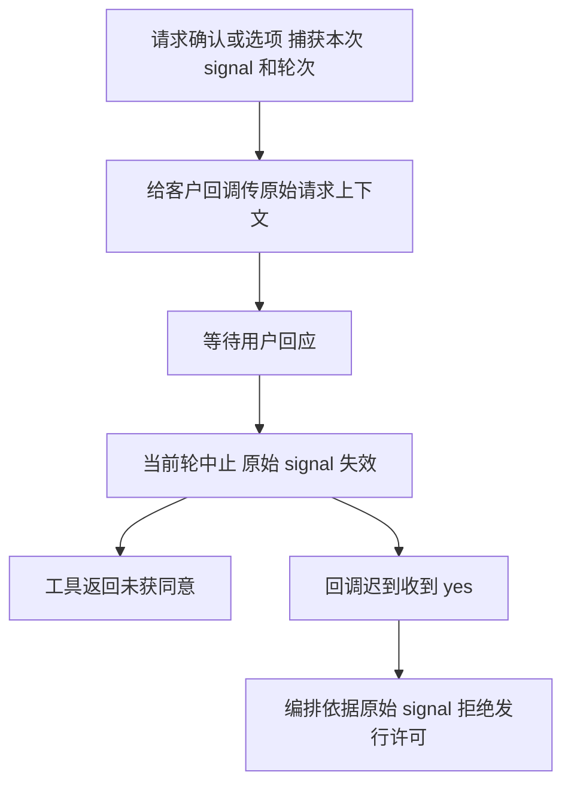

# 停止后的迟到同意不能发行下一轮写权

**后续候选说明（C1H）：** 本记录的 23/23 和源码/依赖哈希保留为 C1R 原始结果；后续 Service 新增相邻层历史读取 operation 后需用 [C1H 当前证据](2026-10-14_fix_service-history-entry.md) 判断组合候选。客户取消上下文契约与其实现保持原样。

当前 `src/provider/runtime/tools.ts::askCustomer` 能让确认工具在中止时立即返回“未获客户同意”，但原始客户回调仍可能继续等待。它迟到收到 yes 时，编排的写集发行者不知道请求已中止，可能把旧许可带到下一轮。这是已批准的停止/确认要求中的实际缺口，项目管理已将 C1R 修复分配给本固定角色；没有新增功能选装或边界变化。

计划在唯一 Model 中为 `CustomerInputFn` 增可选第二参数 `CustomerInputMetadata`，含原始 `signal` 和入口捕获的 `turnId/roleId/runtime`。确认与选项处理器在入口捕获轮次，把该工具调用的原始信号送给回调。单参 callback 保持合法。编排属主 O1 在发许可前检查同一原始信号，桌面属主 D1 使旧卡失效；本角色不改这些文件。

Mutation Contract 只改 `src/model/runtime.ts`、`src/provider/runtime/tools.ts`、`test/runtime-core/**` 与本角色 API/功能/历史文档。验证命令为 `node --test 'test/runtime-core/**/*.test.ts'`、`npx tsc --noEmit` 和自有结构检查；原 21 项证据保持原样，Model/tools 与共享凭据名单已变化，因此原证据不能作为当前候选结果。

本角色测试将让实际确认处理器等待、停止、跨到下一轮后才收到旧 yes；注入的许可发行替身使用收到的原始 signal，不发行路径，下一轮实际 write_file 被 gate 拒绝且临时目录为空。选项处理器也校验 signal 身份与轮次固定，不引用后来 `currentTurnId`。这仅证明核心传递正确，实际编排/桌面/独立集成验证由对应属主完成。

当前状态：Model/确认与选项处理器已实现，核心范围当前验证通过；实际 O1/D1 消费者与独立集成尚未验证。当前功能见 [核心功能](../feature/runtime-core.md)，原证据见 [C1 原始记录](../change/2026-10-14_change_runtime-core.md)。

## C1R 当前原始证据

本次实际源码变化仅 `src/model/runtime.ts` 的可选 metadata 型与 `src/provider/runtime/tools.ts` 的客户上下文捕获/透传。测试增加 `test/runtime-core/customer-input-context.test.ts` 并补固定 CODEX_ACCESS_TOKEN 剥离断言；其余核心实现保持原候选。API/feature/自身历史同步，没有其他角色源文件/依赖配置编辑。

- 生产者：运行时核心固定角色。环境：Node v24.14.0，TypeScript 7.0.2，macOS arm64；基线 HEAD 906abd3ee275cba82b2f9e54ceef1cd9473c2d5c，无网络模型或真实 .env 写入。
- `node --test 'test/runtime-core/**/*.test.ts'`：最终 **23 passed / 0 failed / 0 skipped**，exit 0。新增两个用例直接调用公共实际 handler，确认 callback signal 与原始对象同一引用、轮次在入口捕获；停止后跨轮迟到 yes 未发行路径，下一轮真正 write_file 被 gate 拒绝且目录为空；choice 捕获同样有效，旧单参 callback 保持成功。
- `./node_modules/.bin/tsc --noEmit --project /private/tmp/ans-runtime-core-c1r-fl_60ub8.json`：exit 0。临时配置仅 extends 原始 tsconfig、绝对 node typeRoots 和本角色源码/测试 include，没有改变 strict/noEmit 或任何检查策略；验证核心及其实际只读依赖图。
- `npx tsc --noEmit`：当前 **exit 1，未通过**。实际错误位于 Claude 属主 src/common/claude-adapter、src/provider/claude 与 test/claude-adapter：缺 `@anthropic-ai/claude-agent-sdk`、`zod`、`@modelcontextprotocol/sdk` 及关联参数隐式 any。没有改 peer/manifest，也不把核心范围检查当成全仓检查通过；SDK 安装和最终全仓验证由装配与对应属主完成。
- `git diff --check` 与所有 14 个核心源码/测试的尾空白、foreign Pi-private 引用检查：通过。跨层结构和唯一契约同 C1，无新增 SDK/Provider peer/他人 common 导入。

C1 的原 21/21 与当时 typecheck/hash 保留在原 change 记录，已注明 Model/tools/shared 注册表变化导致证据不能代表当前候选。当前共享 CODEX_ACCESS_TOKEN 只是官方环境秘密剥离/掩码名单，不新增认证 fallback；已用当前注册表重新跑固定和自定义凭据剥离测试。

这些结果证明核心将取消身份交给客户回调，并证明遵守该身份的许可替身阻止旧 yes。原 callback 是否真正检查 signal、桌面旧卡是否失效、实际 ANS writeSet 在下一轮是否拒绝，仍需 O1/D1/T1 各自原证据，不能用本测试替代。

## 当前候选身份

14 个核心源码/测试合成 SHA-256（路径、NUL、内容、NUL，按下面顺序）：`42f532bf1c4030c0f735135e161f022eea79c8552869f9940138b0dc69c5f8f1`。

| 路径 | SHA-256 |
| --- | --- |
| `src/model/runtime.ts` | `a0e2b0686cf90f76d1736fa6219f3add89ae32c5e485b850a1deab18e2d3eee8` |
| `src/service/runtime/session.ts` | `5527dfd6a83d3f0341502ea8294a9644641f71ae264d5519ded83dc719fe4a7f` |
| `src/provider/runtime/tools.ts` | `7b4e5a7975e7733634c6deffd1ac97b0b54b33429010f117d552dd69b12bf245` |
| `src/provider/runtime/schema.ts` | `67df518e52b5821bba617db35eca375779353f86d24e80af8c98aa45ad9f51f0` |
| `src/provider/runtime/session-store.ts` | `9fbdd32e5bb9df0aea64f2c8ac58dbdf3a1b19bd30cd74ace44e3830294548a2` |
| `src/common/runtime-core/event-queue.ts` | `ac3afa2e42fe82c8c49cf574764ae0c69a32fa61380e01a90f21a3effed9538d` |
| `src/common/runtime-core/format-denial.ts` | `6906f6da4a75913072493fc9e5a4a4c2c6832af171806c95cbcaddd104f2d9e8` |
| `src/common/runtime-core/fs-write.ts` | `bc134fc5b803ca30fcf57fda2778420c4a07a73df52f6218080da8ce174eb438` |
| `src/common/runtime-core/timeout.ts` | `fc932d369a9abf82cba56c8e852f2f429f308c3b372edcc4722efb97ea129d61` |
| `test/runtime-core/customer-input-context.test.ts` | `d1228008a479a84daa61dddd0d118d8df591b7884b33caf1edf314a2ba076602` |
| `test/runtime-core/fixtures.ts` | `be1619f77b3f277ca6917a10b4a06653122f46bf08dd7045ab90bf586bc74f22` |
| `test/runtime-core/session-store.test.ts` | `6251094f05e0f01ab35555f11e73e3f5778a88f38d40a94c489b58cab8b2c5b8` |
| `test/runtime-core/session.test.ts` | `bda888e8d855a14f823583d9b63246dab45610b30fc07b40dcab22e431b40351` |
| `test/runtime-core/tools.test.ts` | `4c8a41cda1cffc5a6024a3041b19ad3c281480e5e732f30432205bc0a2d26a23` |

当前只读共享依赖（不属于核心写集）：

| 依赖 | SHA-256 |
| --- | --- |
| `src/common/shared/runtime-shared.ts` | `fcaa56d7d5e952dc1092b84e34875719d0e2943ae2b00e8ca14b1217b343f9da` |
| `src/common/shared/atomic-write.ts` | `dd51305f2126bca77c462a8db4f3f7effa83f0e9bde3bba765e396d64e5fcf15` |
| `src/common/shared/path-primitives.ts` | `e9915c756f35d70363d9c7d80912a1f7706583f597201b16a5d1de43a246834f` |
