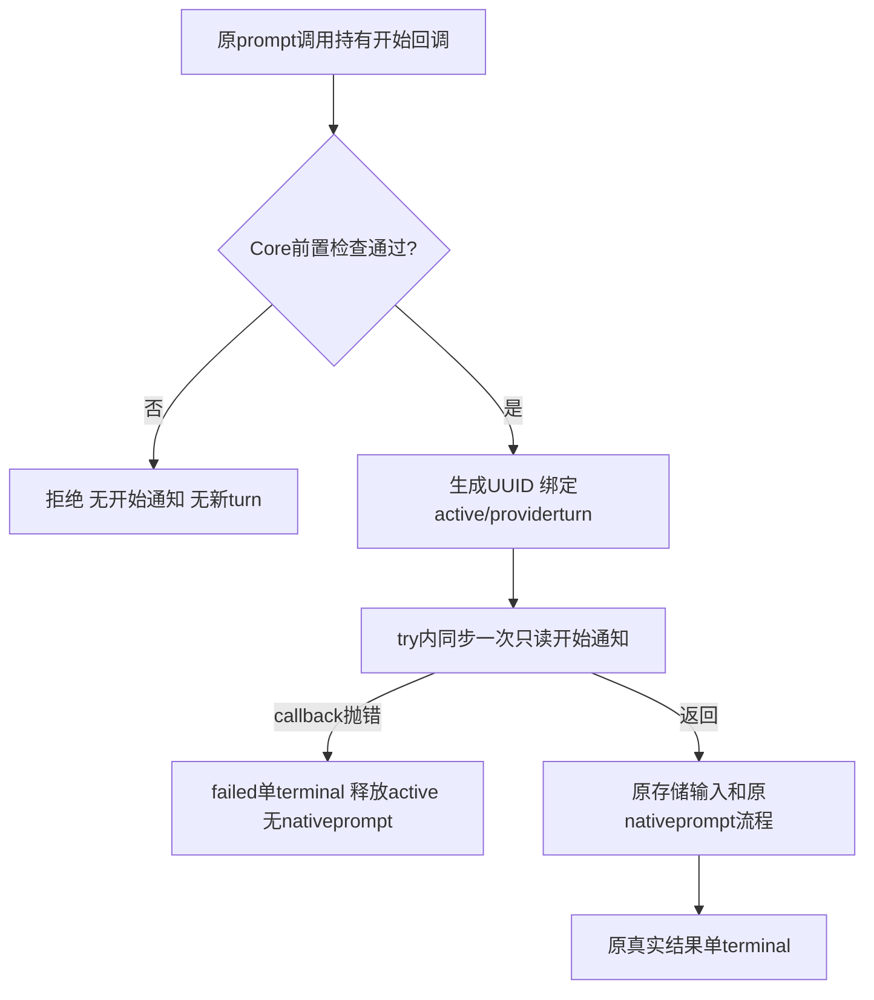

# 原始发送请求精确获知实际轮次

实际桌面历史/实时流合并需要把乐观输入气泡对应到Core真实轮次。Window仅凭Promise<void>/events不能区分Core已创建失败轮次但Pipeline延后yield与Core前置拒绝根本没有轮次；FIFO/首次事件/latest猜测会关联错下一条，禁整个handle后续关联又保留重复。已读取管理冻结方案末尾、[窗口原方案](../../../桌面窗口/docs/fix/2026-10-14_fix_client-message-origin.md)与[独立实际入口红证据](../../../测试/docs/fix/2026-10-14_fix_actual-main-live-history-duplication.md)。本角色按C1A同范围已授权修复，不扩权。

最小契约为Model `PromptOptions.onTurnStarted?: (metadata:{readonly turnId:string;readonly roleId:string;readonly runtime:RuntimeKind})=>void`。Service通过disposed/active/quarantined检查，实际生成本轮UUID并设置active/providerturn后，在try内、任何appendReplay/native prompt前同步调用一次。前置拒绝不调用。callback同步抛错进入原failed结果与单terminal，active会释放；尚未启动native prompt时没有当前native工作需要中止，不调用idle native abort。原PromptOptions对象继续原样送adapter，images/reference兼容，adapter不产生第二次通知。

影响评估：这只是原prompt闭包的被动生命周期通知，不包含signal/客户端ID，不修改Store、SDK、工具或授权。Window在原direct/queued闭包按ack精确映射实际turn→原clientMessageId，删除FIFO/latest猜测；Pipeline已透传PromptOptions，无需本角色编辑。Model兼容可选字段会使相关调用者需要当前typecheck/Window/T1验证，但SDK路径证据不因这一被动字段失效。UI与Window的客户端ID始终留在它们自己的显示层。

Mutation Contract只改已拥有的Model/Service、自有测试与API/功能/历史文档。门槛：实际turn恰一次且与persist input/event top+detail/reportmetadata相同；active/disposed/quarantine前置拒绝零通知；callbackthrow单failed、零nativeprompt/abort、后续合法轮次可用；旧abort/timed_out/取消测试保留。命令 `node --test 'test/runtime-core/**/*.test.ts'` 与 `npx tsc --noEmit`，不跑无关SDK探针或全仓动态测试。

当前Core实现及规定门槛完成；Window/U1/T1实际连接与去重仍需对应原属主当前证据。前序33/33/hash保持历史；后续当前证据写本记录，功能见[核心功能](../feature/runtime-core.md)。

## C1A 当前原始证据

实际生产变更仅Model的可选PromptOptions字段/readonly metadata型和Service的try首句通知，以及无underlying工作时不调用idle native.abort。没有新增事件、Store字段、transport、clientMessageId、SDK hook或工具权限。新测试为 `test/runtime-core/prompt-start-acknowledgement.test.ts`；原33项保持并同轮重跑。

- 生产者：同一固定运行时核心角色。环境：Node v24.14.0 / TypeScript7.0.2 / macOS arm64；基线HEAD906abd3ee275cba82b2f9e54ceef1cd9473c2d5c；全部临时项目/注入Provider，无在线模型、真实.env、peer/Git/package编辑。
- `node --test 'test/runtime-core/**/*.test.ts'`：当前 **38 passed / 0 failed / 0 skipped**，exit0（原33+五项被动ack合同）。
- 有效轮次测试直接观察callback在prompt Promise返回前已调用，顺序为ack→user appendReplay→nativeprompt；只有一次通知，字段恰turnId/roleId/runtime，原opts/images对象引用保持。通知ID与persisted user、event top/detail、回放event以及report metadata均相同；函数/图片不被写进ANS回放。
- active/disposed/quarantined前置拒绝无新ack；同步callbackthrow产生一个failed terminal，nativeprompt/nativeabort均零调用，active释放后同句柄下一合法轮次可用并产生不同UUID；原stopped/timed_out各自仍一个匹配通知ID的真实terminal。
- `npx tsc --noEmit`：最终 **exit0**，仅既有npm mirror user-config提醒。首次38项行为已通过但新测试受assert.equal(forwarded,undefined)控制流收窄影响，出现TS2339 never.images；把相同引用观察改为记录数组并额外断言恰一次forward后重新运行38项+whole types全部通过，未删断言或放宽检查。
- `git diff --check` 与实际Model/Service/test三文件尾白/foreign-private引用检查通过；源码检索onTurnStarted只在Model定义、Core Service调用，adapter没有调用。旧SDK路径未变，不运行无关native probe或全仓动态测试；实际桌面组合仍需D1/U1/T1当前gate。

原C1O33/33/hash保留历史并注明后续Model/Service候选变化。本修复消除Core开始归属的不确定性，不能把核心合同测试当作Window删除FIFO、renderer去重或T1原红断言已通过。

当前[机器可读own manifest](2026-10-14_prompt-start-acknowledgement-manifest.json)包含17份Core源码/测试，合成SHA-256（路径、NUL、内容、NUL，按下列顺序）：`ff9a654a6968c9888b60c03a96d16cf70ff58e3f05bf8c236f8ca8145f0e0e53`。

| 路径 | SHA-256 |
| --- | --- |
| `src/model/runtime.ts` | `fcbdf0b89235ffa5c0c7678ad234c9652e7313efe66cead7d0d961c3b471ae62` |
| `src/service/runtime/session.ts` | `cccddb80c4d963b403a9b9dc7fd0e5f3ecb9ca96d45b8037d8f64b67e3f9c763` |
| `src/provider/runtime/tools.ts` | `752382a5c709893f7331e5cb1a1f2aee2d23f8cd9f7c055f40680f2c3dc958b3` |
| `src/provider/runtime/schema.ts` | `67df518e52b5821bba617db35eca375779353f86d24e80af8c98aa45ad9f51f0` |
| `src/provider/runtime/session-store.ts` | `9fbdd32e5bb9df0aea64f2c8ac58dbdf3a1b19bd30cd74ace44e3830294548a2` |
| `src/common/runtime-core/event-queue.ts` | `ac3afa2e42fe82c8c49cf574764ae0c69a32fa61380e01a90f21a3effed9538d` |
| `src/common/runtime-core/format-denial.ts` | `6906f6da4a75913072493fc9e5a4a4c2c6832af171806c95cbcaddd104f2d9e8` |
| `src/common/runtime-core/fs-write.ts` | `bc134fc5b803ca30fcf57fda2778420c4a07a73df52f6218080da8ce174eb438` |
| `src/common/runtime-core/timeout.ts` | `e73a2c76ede16499c1f7da54725206eef63080fa5e76e33ef8f168c9587bbb47` |
| `test/runtime-core/abort-failure-semantics.test.ts` | `c8a40efbe148e689a5aaad0d3f5a98b3ed8937194a2b46212d369fc4ceb38e99` |
| `test/runtime-core/customer-input-context.test.ts` | `d1228008a479a84daa61dddd0d118d8df591b7884b33caf1edf314a2ba076602` |
| `test/runtime-core/effective-timeouts.test.ts` | `c79e52b9008953f7735b07759336d3df6ff19559a900065623162350dfb16520` |
| `test/runtime-core/fixtures.ts` | `be1619f77b3f277ca6917a10b4a06653122f46bf08dd7045ab90bf586bc74f22` |
| `test/runtime-core/prompt-start-acknowledgement.test.ts` | `f2c28313283ec336e615a9eaf2765ad260df8e3ab2fe2b2fcffaada28a074304` |
| `test/runtime-core/session-store.test.ts` | `6251094f05e0f01ab35555f11e73e3f5778a88f38d40a94c489b58cab8b2c5b8` |
| `test/runtime-core/session.test.ts` | `174f78df6ffcb837b79c461de72d7c44cf1cb9507fea587341a1f39fe124357f` |
| `test/runtime-core/tools.test.ts` | `4c8a41cda1cffc5a6024a3041b19ad3c281480e5e732f30432205bc0a2d26a23` |
