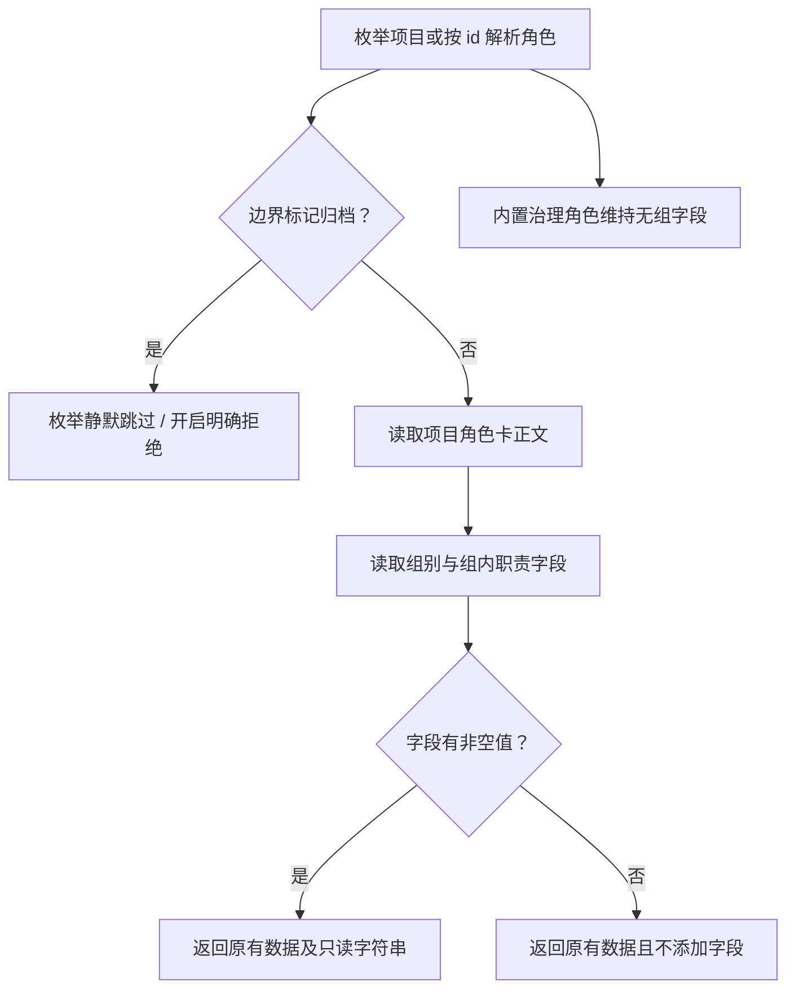

# 从角色卡读取协作组信息供桌面展示

桌面导入本项目时，需要知道运行时核心是“运行时接入组”的组长，Pi、Codex、Claude 适配器是该组组员。目前四份角色卡已经有这两项信息，但角色枚举只返回角色卡全文，桌面无法直接使用结构化字段。

本方案细化项目管理已获客户授权的 [ANS-RUNTIME-V2 revision 1](../../../项目管理/docs/design/2026-10-14_design_multi-runtime-integration.md) 的 G1。同范围既有实施授权继续有效；这里只记录门禁引擎的独立影响评估，不新增选装或权限。

## 字段和数据过程

Model `src/model/role.ts` 新增唯一共享接口 `RoleGroupMetadata`，包含 `readonly group?: string` 与 `readonly groupDuty?: string`。`ResolvedRole` 和 Service 已有 `ProjectRoleSummary` 继承它；既有公开入口、其他字段和返回容器保持原样。桌面窗口从摘要透传这两个字段，桌面UI消费它们，不另写正文解析。

`resolveRole` 读到项目角色卡后，`listProject` 通过归档和文件/边界检查后，调用本角色私有纯函数解析同一正文。只认独立字段行中的 `group` / `组别`、`groupDuty` / `组内职责`，支持当前中文双语粗体格式及技能中的英文粗体模板。以第一条非空字段值为准，去掉值首尾空白，内部文字原样保留。缺失或空白字段不创建对应属性，也不产生 warning。返回值是字符串，不把 `groupDuty` 限为枚举，也不进行 HTML 转义；渲染侧按文本展示并负责转义。

## 独立影响评估和写集

这是既有角色解析职责的展示数据扩展，不是新的授权责任。共享 Model 是本角色唯一主属，字段可选使既有替身和旧卡仍可构造；`readonly` 表达消费方不得修改组信息。枚举排序、主入口、角色 kind、归档、接受证据和路径判定均不根据这两个字段变化。未知组名/职责名保留供展示，不参与权限。

写集为 `src/model/role.ts`、`src/service/role/resolve-role.ts`、本角色私有 `src/common/门禁引擎/role-card-metadata.ts`、`test/门禁引擎/role-group-metadata.test.ts`，以及本角色已授权的 API、功能、变更、导航和模块说明。无需修改其他 Model、边界解析、gate、角色卡或配置。桌面类型映射和展示属于原属主，本文只提供消费契约。

现有 Service 入口保留仓库实际路径；新增私有解析器只依赖 Model，不调用其他运行层或其他角色的私有 common。当前 Service 直接读文件的既有结构不在 G1 内迁移。新增元数据没有文件系统副作用。

## 验证门槛

- Model/Service 契约测试：真实四份组卡通过 `listProject` 和 `resolveRole` 得到预期字段；英文模板、单字段、空字段、未知文字及 HTML 特殊字符如实返回。
- 兼容：旧卡不增加属性，内置角色不推导默认组；组字段不会替代 boundary 来源、改变 kind/acceptance 或 `resolveWrite` 结果；带组字段的归档角色仍静默排除并拒绝开启。
- 命令：`node --test test/门禁引擎/role-group-metadata.test.ts`，再运行 `node --test "test/门禁引擎/**/*.test.ts"` 与 `npm run typecheck`。必要时读取受影响调用方检查结果；越界失败只回交原属主。
- 静态核对实际写集、新增依赖方向、所有文档链接；保留既有断言，不改权限或构建配置。

本方案已在同范围授权下实施并验证。当前说明见[角色协作组摘要](../feature/role-group-metadata.md)，实际契约见[API](../../api-spec.md)，候选、环境和检查结果见[变更记录](../change/2026-10-14_change_role-group-metadata.md)。桌面透传与呈现仍由对应属主验证。
