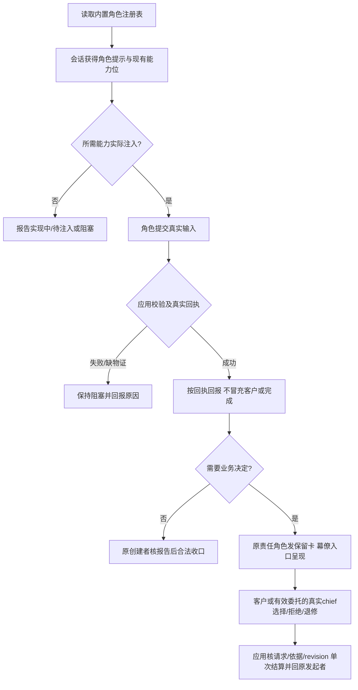

# 六角色直接能力提示

帮助内置六角色在幕僚唯一客户入口下理解直接提交、完整角色激活、运行择时及委托业务决定的责任。当前 G1 只实现提示合同；工具与持久化生产链由运行时、编排和桌面属主实施，未提供的能力必须明确报告待注入。

例如产品在本会话看到已注入的 `submit_version_change` 时，可以提交 version-upgrade 整单；提示要求如实报告 applied/no-op/rejected/已提交待恢复等真实结果，不能将准备材料或通知投递称为生效。若工具没有提供，只报告待注入。此文档不宣称这些跨角色分支已接好或通过测试。

策划承担 detail-amendment 整单修正及 continue-frozen / stop-and-restart / stop 择时；人事保留 D3，直接准备三文档后等待完整激活回执；运营直接完成计划并主动提出环境阻塞卡。chief/convener 只收口自己创建且有合法报告/依据的任务。委托不取代独立质检、结构/hash/权限检查或 shell/下载/stable 执行审批。

G2阶段已实现真实冻结读取：宿主传入run/pin/完整八ref，Service每次从Provider读不可变字节再解析角色三文档，live改变不渗入新建旧run会话，缺损即拒绝。无run角色查询消费有效trunk；规划发布与执行授权闭包分开。激活前纯校验产生绑定角色与完整snapshot的普通检查结果，单文件草稿准备不调用该完整激活检查。O1具体业务授权字节语义与旧R9 I/O迁移仍未完成，当前不宣称整条激活/派发已接通。

提示数据入口为 `src/common/门禁引擎/governance-roles.ts`，公开消费沿既有 `src/service/boundary/resolve-boundary.ts` 与 `src/service/role/resolve-role.ts`。只读矩阵摘要同步，摘要不参与门禁或工具注册。[公开接口](../../api-spec.md)记录范围。

本次提示定向合同测试通过；主类型检查仍有其他属主诊断，未作独立验收或完整流程结论。[变更与验证](../change/2026-11-05_change_direct-role-capabilities.md)记录实际命令及限制。
