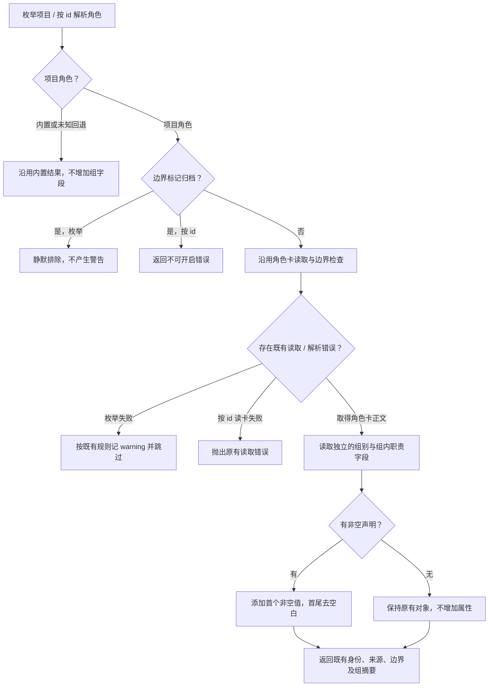

# 读取角色协作组摘要

桌面导入项目或系统开启角色时，可从已有角色结果直接取得角色属于哪个协作组、在组内负责什么。比如运行时核心声明“运行时接入组、组长”，三种适配器声明同组“组员”。没有声明的旧角色仍按原方式返回，界面可以继续原有平铺展示。

门禁引擎负责读取并返回摘要。桌面窗口负责把摘要交给界面，桌面UI负责呈现；本页验证的是解析结果，不代表桌面显示已接入。

## 当前过程

调用 `listProject(projectRoot)` 枚举项目，或 `resolveRole(roleId, project)` 开启前解析某角色。项目角色的组信息只能来自对应 `role-card.md`，字段为可选只读字符串 `group` 与 `groupDuty`。使用下列声明即可：

```markdown
**组别（group）：** 运行时接入组
**组内职责（groupDuty）：** 组员
```



枚举先保留原有归档与文件/边界判断，再从可用卡正文读取字段。按 id 解析也先拒绝归档；角色卡读取失败仍抛出原有错误，边界解析和接受回退保持原有规则。组字段本身缺失或空白不会新增 warning，也没有写盘或网络请求。

中文双语粗体、英文技能模板和独立中英字段行共享同一私有解析函数。两个字段各自取第一条非空值；重复声明不覆盖，未知文字不报错。字符串内部内容保留原样，包含 HTML 特殊字符时消费者负责文本展示和转义。字段不参与 kind、接受、写集或文件权限判断。

## 在哪里核对

公开入口为 [`resolve-role.ts`](../../../../src/service/role/resolve-role.ts)，共享只读形状为 [`RoleGroupMetadata`](../../../../src/model/role.ts)。完整返回约定见[公开接口](../../api-spec.md)，公开入口测试为 [`role-group-metadata.test.ts`](../../../../test/门禁引擎/role-group-metadata.test.ts)。已验证真实四份组卡、旧卡、空值/单字段、英文模板、未知/特殊字符串、归档和门禁结果不变；详细检查见下方变更记录。

## 演变历史

| 日期 | 类型 | 状态 | 变化 | 详细记录 |
| --- | --- | --- | --- | --- |
| 2026-10-14 | 设计 | 已实施 | 将已批准 G1 细化为可选只读字段与正文单一解析 | [设计](../design/2026-10-14_design_role-group-metadata.md) |
| 2026-10-14 | 修改 | 已验证 | 枚举与按 id 解析返回组摘要，旧卡/归档/写权保持既有行为 | [变更和证据](../change/2026-10-14_change_role-group-metadata.md) |
