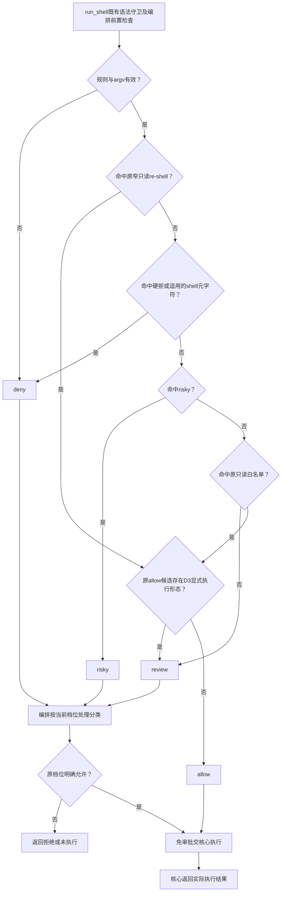

# 命令分类与明确执行用法

角色调用 `run_shell` 后，编排使用纯分类器给命令返回 allow、deny、risky 或 review。常见只读用法继续免审批；显式带路径程序、脚本包装和 rg 预处理不能仅凭名称冒充只读工具。

公共入口为 [`shell-rules.ts`](../../../../src/service/gate/shell-rules.ts)，分类唯一实现位于门禁私有 [`classify-shell.ts`](../../../../src/common/门禁引擎/classify-shell.ts)，不读取文件系统、不操作 PATH 或环境。

原 allow 候选中，程序 token 包含正反斜杠、Windows 盘符前缀或 `.cmd/.bat/.ps1` 后缀时返回 `review:explicit-program`。例如 `cat file.txt` 保留原分类，`./cat file.txt` 和 `/bin/cat file.txt` 转交既有审批。裸 `.exe` 继续原行为。原已判 deny/risky 的命令不会因此降为 review，既有窄 re-shell 形态及优先顺序保留。

`rg --pre helper pattern file` 与 `rg --pre=helper pattern file` 返回 `review:rg-preprocessor`。检查按参数位置进行：`--` 后均是普通参数；`-e/--regexp` 等带值选项吃掉下一项，短选项组合中带值项吃掉余部或下一项。因此 `rg -e --pre file`、`rg -ne--pre file`、`rg pattern -- --pre` 不因文本含 `--pre` 被误报；位置参数后出现的真正 `--pre` 仍须审批。

review 的结果取决于[现有 shell 审核档位](../../../编排/docs/feature/shell-review.md)：advisory、operator-only、普通 B/A 链按原机制评审；readonly-only 只运行白名单。自动审批开启时可能由判断 agent 处理，不保证必须弹人工卡。拒绝、不可用、超时或中止不启动执行，审核批准不等于运行成功。门禁不新增审批字段或改变执行层。

PATH 前置同名程序、隐式 rg 配置、预加载环境和恶意并发替换属于 D3 明确接受的剩余风险。其他未列出的间接执行形态不因本轮而被宣称已封堵；批准后的 shell 副作用也不受文件写门禁约束。

## 验证与演变

2026-10-21 D3 增加显式路径/脚本后缀、原 deny/risky 保留、rg 两种预处理形式与参数位置反例。结果与候选详见[轻量修复记录](../fix/2026-10-21_fix_lightweight-permission-repairs.md)；真实执行及多档审批链由核心/编排和独立测试接续验证。
