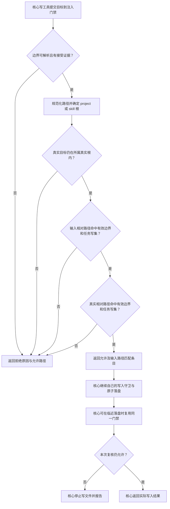

# 文件写入授权

角色调用 `write_file` 或 `edit_file` 时，门禁判断它是否有权修改目标。目录链接不能把一个目录的授权带到另一处；输入路径和真实目标都必须获授权。

入口为 [`resolve-write.ts`](../../../../src/service/gate/resolve-write.ts)。相对输入属于项目根，绝对输入按已有 project/skill 根归属判断。合法链接工作区按真实根计算相对路径；真实目标逃出其所属根则拒绝。目标不存在时，共享路径原语解析最深已存在祖先后拼回尾部，仍检查将创建的真实位置。

同一根内每条路径都按精确文件、目录或已激活条件目录匹配。没有 scope 时仅受角色边界限制；有 scope 时还必须精确命中任务 writeSet。别名和真实路径相同则无需重复检查。边界条目不跟随链接扩权。

例如 `allowed/link → private`：只授权 `allowed/` 时，写 `allowed/link/data.ts` 会返回真实目标未授权；两目录都获授权且任务写集同时包含别名和 `private/data.ts` 时可通过。仅添加一个路径不会自动发行另一个路径的写权。

门禁自身不建目录、不写目标。初次拒绝由核心阻止副作用；临近写入的再次拒绝可能发生在合法父目录已创建之后。最终文件链接拒绝、原子落盘及错误收尾由[公共运行时工具](../../../运行时核心/docs/feature/runtime-core.md)负责。缺少条件、未匹配条目、任务范围不符和旧快照提示均沿原相对判定逻辑返回；真实目标拒绝额外标注输入和真实路径。客户确认/任务发行后重试仍重新检查，不缓存放行。

普通路径复核不能消除所有恶意并发替换风险。此处不代表 shell 进程副作用也受到文件门禁约束。

## 验证与演变

2026-10-21 D3 已加入 project/skill 双根、真实任务范围、条件目录、已有文件/新建尾部和合法链接根的单元验证。Windows 字符串/大小写用例不替代原生 junction 结果。详细候选与测试见[轻量修复记录](../fix/2026-10-21_fix_lightweight-permission-repairs.md)。
