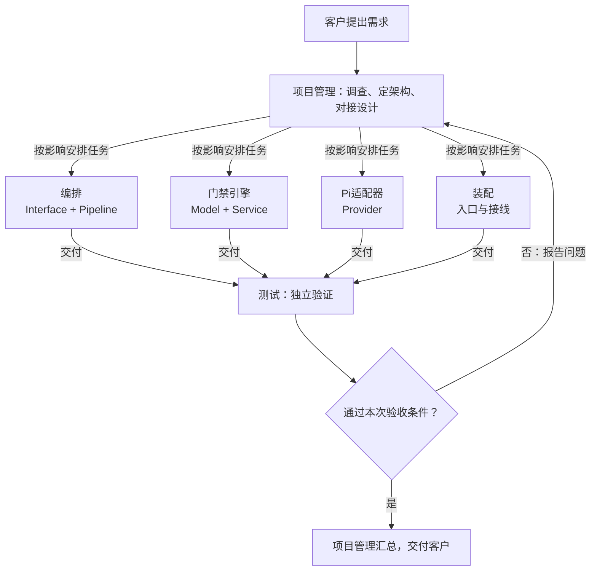
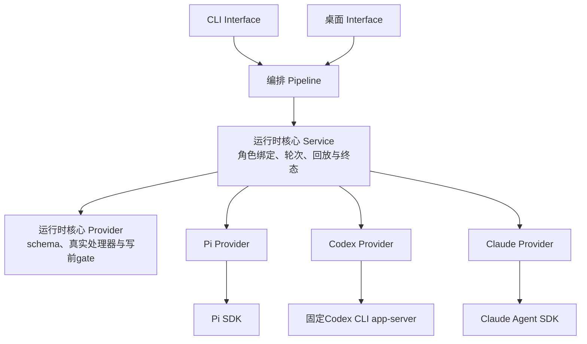

# ANS CLI 整体架构与角色协作

本文件说明这个项目实际的整体结构、每个角色负责什么、它们怎么配合。是"当前架构"的阅读入口。

**状态说明（先看这里）**：本项目的**角色结构已由客户验收**，下面「角色与职责」「分层与调用方向」写的是已确认的结构。CLI 的**运行时实现已有落地代码**：跨角色对接契约冻结在设计文档 `2026-10-11_design_ans-cli-v1-prototype.md`（状态：accepted，客户经调度方确认实施），`src/` 与 `app/` 下各层均已建立（`src/model`、`src/service`、`src/provider`、`src/pipeline`、`src/interface`、`app/`）。原设计文档 `2026-10-11_design_ans-cli-pi-runtime.md` 的评审结论为 `needs revision`，其可实施部分已由上述冻结契约取代。凡**尚未落地或未实测**的内容（V3 取舍、真实模型轮次、容器沙箱），在本文件内仍标为**「方案/待确认」**，不作为已实现结构。

## 这个项目要做什么

ANS CLI 是一条命令行工具，让"受治理的开发"跑起来。今天用 ANS 的做法是：人手工开一个对话、把角色卡和边界贴进去、做完再人工检查有没有改到不该改的文件。规则写在提示词里，只能靠模型自觉。

ANS CLI 想把它变成一条命令：启动一个角色会话，这个会话**从生到死只有这一个角色**，想改边界外的文件时**在写入发生之前就被拒绝**，模型得到一条能看懂的拒绝信息，可以改走别的路。它做的是**治理层**，底层的 agent（Pi、Codex或Claude）是**执行层**。

一个具体例子：

```
ans role run 订单服务 --task T-123
```

一条命令把角色跑起来，它改不了边界外的文件——不是事后发现，而是写之前就被挡住。

> 上述命令名与参数已由冻结契约 `2026-10-11_design_ans-cli-v1-prototype.md` §5–§7 确定，并在 `src/index.ts` 实现：`ans role run` 已全链路跑通，`ans govern` 为真实治理会话入口，另有 `ans doctor` / `ans help`。见 README。

## 当前诊断与任务收口

桌面、Pi适配器和编排共同使用项目管理主属的 `src/common/shared/diagnostics.ts`，诊断日志固定滚动保留24小时，默认目录为Electron userData下 `ans/diagnostics`。关键事件只记录净化后的元数据；各角色不另建存储。接口、时钟清理和消费方见[共享组件目录](architecture/shared-components.md)。

角色回交按实际turnId关联正式报告，失败、超时、中止和未报告不再推导为已完成。桌面把主入口队首连续已到达报告合成一次验收输入，遇客户消息/派发保持FIFO边界；su依据已收到的证据对客户汇总，不猜未知任务收齐。已授权项目的精确常规检查在审核明确允许后自动执行，既有硬拒与其它审核链保持。聊天视口和显式卡定位、故障恢复的实现与验证见[本次统一记录](design/2026-10-13_design_runtime-diagnostics-and-reporting.md)。

## 角色与职责（已验收）

本项目有 13 个有效项目角色，固定身份、各自独立上下文。每个角色位于 `角色卡/<角色>/`，含 `role-card.md`、`boundary.yaml`、`memo.md` 与 `docs/`。

| 角色 | 负责什么 | 主要层/目录 | 角色卡 |
| --- | --- | --- | --- |
| 项目管理 | 整体架构、跨角色对接设计、调度协调、验收；维护工程法案与共享组件 | `src/common/shared/`、`角色卡/项目管理/docs/`、`docs/scheduling/` | [role-card](../role-card.md) |
| 编排 | 命令接口与会话编排：把命令变成一次受治理的角色会话并管生命周期 | Interface（`src/interface/cli/`）+ Pipeline（`src/pipeline/orchestration/`） | [role-card](../../编排/role-card.md) |
| 门禁引擎 | 判定核心：共享类型（Model）、双来源角色与边界解析、`resolveWrite` 路径判定 | Model（`src/model/`）+ Service（`src/service/`） | [role-card](../../门禁引擎/role-card.md) |
| Pi适配器 | 消费核心工具与契约，注册 Pi SDK 工具/钩子、转换事件并管理原生会话；运行时接入组组员 | Provider（`src/provider/pi/`） | [role-card](../../Pi适配器/role-card.md) |
| 运行时核心 | 中立会话契约、公共治理工具/schema、引擎入口与 ANS 会话回放；运行时接入组组长 | Model（`src/model/runtime.ts`）、Service（`src/service/runtime/`）、Provider（`src/provider/runtime/`） | [role-card](../../运行时核心/role-card.md) |
| Codex适配器 | Codex SDK/MCP 运输、原生会话与事件转换；运行时接入组组员 | Provider（`src/provider/codex/`） | [role-card](../../Codex适配器/role-card.md) |
| Claude适配器 | Claude Agent SDK/MCP 接入、原生会话与事件转换；运行时接入组组员 | Provider（`src/provider/claude/`） | [role-card](../../Claude适配器/role-card.md) |
| 装配 | 入口、构建与测试配置、层间接线；让各角色的能力能被真正启动 | `src/index.ts`、`bin/ans.js`、`package.json`、`tsconfig.json` | [role-card](../../装配/role-card.md) |
| 测试 | 独立做跨角色联调、完整流程与回归，给出可复现结论；不修产品代码 | `test/测试/` | [role-card](../../测试/role-card.md) |
| 产品 | 产品视角：把 CLI 与桌面客户端当作整体，从使用与维护两端审视体验、流程与优先级；产出提案与评审，不写产品代码 | `角色卡/产品/` | [role-card](../../产品/role-card.md) |
| UIUX设计师 | 桌面界面布局、交互方案、可检查的 HTML 设计原型与设计规范，参加联合评审；设计产物由实现角色接入正式应用 | `角色卡/UIUX设计师/` | [role-card](../../UIUX设计师/role-card.md) |
| 桌面UI | 桌面客户端渲染前端（`app/renderer/`）：界面展示与交互，按已确认设计实现；不接触 Node/文件系统 | Interface（`app/renderer/`、渲染侧测试） | [role-card](../../桌面UI/role-card.md) |
| 桌面窗口 | Electron 主进程、窗口生命周期、preload 受限桥与桌面会话装配 | Interface（`app/main.ts`、`app/preload.cjs`、`app/desktop/`、窗口侧测试） | [role-card](../../桌面窗口/role-card.md) |

三点补充：

- **门禁引擎是 `src/model/` 下三个共享类型文件（`boundary.ts`、`role.ts`、`decision.ts`）的唯一主属主**，其他角色只读引用。改动它们会让所有引用方的既有证据失效。
- **运行时接入组已经客户确认建立**：运行时核心为组长，Pi适配器、Codex适配器、Claude适配器为组员。组别与组内职责是协作文档字段，不合并写入权限。多运行时实现按 [ANS-RUNTIME-V2 revision 1](design/2026-10-14_design_multi-runtime-integration.md) 进行；核心、三个适配器、CLI入口与桌面的自有验证及最终独立无网络候选验证已通过；真实在线模型未测。`src/model/runtime.ts` 的单一主属为运行时核心，旧 Pi 契约由 Pi 属主维护兼容转出。
- **项目管理是 `src/common/shared/`（跨角色共享组件）的唯一写入者**，并维护 `docs/architecture/shared-components.md`。**现有共享组件**：`src/common/shared/config-loader.ts`（`.ans/project.json` 有效配置加载 + pin-backed acceptance 校验；由**装配**与**桌面窗口**只读导入，消费方不复制第二份）。
- **`docs/scheduling/`（调度记录）归项目管理**：目录在 pm 的 Section 1 内（`purpose: 任务调度记录（内容由 task_ops 写入）`）；**内容唯一写入者是 `task_ops`**（技能 `scripts/task_ops.py`，含 hash 链式机器段），pm 只承载/发起、不另写一份，**编排不得直接写**（F3）。使用约定与真实记录样例见 `docs/design/2026-10-11_design_scheduling-record-convention.md`。**注：调度「执行」路径不在 V1（设计 §3.7）。**

## 分层与调用方向（已验收）

源码树 `src/` 按五个运行层组织，每个功能的代码放在它所属的层，不放进以功能命名的目录。

```text
Interface  ->  Pipeline  ->  Service  ->  Provider  ->  外部基础设施
Model: 由上面四个运行层共享
```

- **只允许相邻层调用**，不得向上、跳层或平级互调。Interface 只调 Pipeline，不直接触达更下层。
- **Model 是共享依赖**：共享的类型、值对象、不变量，被四个运行层引用，本身不属于调用链中的一环。
- **Service / Provider 层内部三段式**：`abstract/`（契约）、`public/`（对外入口）、`impl/`（具体实现）；上层只依赖 `abstract/`，不直接依赖 `impl/`。
- **`common/` 是支撑目录，不是第六层**。每个角色有私有 `common/<role-id>/`；跨角色共享走项目管理的 `common/shared/`；`common/` 不得反向调用运行层。

**桌面客户端是 Interface 层的第二个前端**（2026-10-14 自「桌面应用」拆分为**桌面UI**与**桌面窗口**两个角色）：与 CLI（`src/interface/cli/`）同处 Interface 层，共用 Pipeline / Service / Provider；判定一律调门禁引擎，Pi 调用一律经 Pi 适配器，渲染进程不另写边界判断（`app/renderer/` 归桌面UI；`app/main.ts`、`app/preload.cjs`、`app/desktop/` 归桌面窗口）。

**与技能示例的命名差异（现状，如实记录）**：技能 `references/architecture.md` 的示例树用复数名（`models/`、`services/`、`providers/`、`pipelines/`）。本项目已验收的边界用单数名：`src/model/`、`src/service/`、`src/provider/`、`src/pipeline/`、`src/interface/`。职责保持不变，仅词形不同；以本项目的实际路径为准。

## 角色协作（责任流）

下图表达**责任与协作**：谁把工作交给谁、结果怎么汇总。**它不是代码运行时的调用图**，也不表示每个任务都要经过全部开发角色。



当前已核对的关键连接（依据：已验收的角色卡与边界）：

| 连接 | 依据 | 变更时怎么配合 |
| --- | --- | --- |
| 编排 → 门禁引擎 | 编排只做编排；角色解析、边界解析与路径判定归门禁引擎 | 判定接口变化时，门禁引擎先改 `src/model/` 共享类型，再通知编排调整引用 |
| 编排 → Pi适配器 | 编排通过 `RuntimeAdapter` 接口使用适配器，不直接依赖 Pi | 适配器接口变化属跨角色契约，先由项目管理定对接设计 |
| 编排 / 门禁引擎 / Pi适配器 → 装配 | 各角色实现后由装配接线、启动 | 装配读各角色 `api-spec.md` 实际导出后接线；依赖未实现时可用替身隔离，但不算联调通过 |
| 各角色 → 测试 | 开发角色做自己的单元测试；跨角色、完整流程与回归由测试角色独立做 | 测试发现问题报告复现步骤，项目管理安排所属角色修复，再由测试角色复测 |
| 全部 ← 项目管理 | 调度、对接受权、验收与共享组件由项目管理统筹 | 任何角色发现要改别人的文件，把请求交回项目管理 |

各角色的详细功能流程由**各角色自己**维护在 `docs/feature/<功能-id>.md`，本文件只链接、不复制。当前运行时功能入口：[核心工具/会话](../../运行时核心/docs/feature/runtime-core.md)、[Pi](../../Pi适配器/docs/feature/pi-runtime.md)、[Codex](../../Codex适配器/docs/feature/codex-governed-session.md)、[Claude](../../Claude适配器/docs/feature/claude-session.md)、[编排选择](../../编排/docs/feature/runtime-selection.md)、[CLI装配](../../装配/docs/feature/cli-runtime-assembly.md)、[桌面选择/分组](../../桌面UI/docs/feature/runtime-choice.md)、[窗口会话/设置](../../桌面窗口/docs/feature/multi-runtime-desktop.md) 与 [共享组件](architecture/shared-components.md)。拆分前的桌面三栏说明原位归档，继续作为历史链接。

## 当前运行时结构

CLI与桌面共享同一套角色与治理工具。当前源码已提供Pi、Codex、Claude适配器；自有与独立无网络验证通过，最终实际入口与全仓证据见[整体验收报告](change/2026-10-14_change_multi-runtime-integration.md)。入口默认值保留既有兼容：CLI role run默认demo，govern默认Pi；用户可用 `--runtime pi|codex|claude` 明确选择。所选runtime不能因失败退回另一引擎。



图中的工具与适配器由同一Service装配，适配器只消费捕获原始轮次/signal的工具注入，不另造权限。共享契约在Model，公共治理执行在Core Provider；旧Pi `tools.ts` 仅为公共兼容转出，旧schema helper只引用核心SDK中立公共schema。实际迁移入口的有限兼容边见[ANS-RUNTIME-V2](design/2026-10-14_design_multi-runtime-integration.md)，没有授权全仓层结构清理。

Pi使用SDK的custom tools、`noTools:"builtin"`、关闭扩展与实际目录校验。Codex固定 `@openai/codex@0.162.1`，必要app-server运输在创建线程前核验有效配置，关闭全部native MCP、native shell及其它未治理能力，使用read-only/never；只有精确thread/turn/call匹配的ANS dynamic tool代理可进入注入处理器。这个experimental接口不是TypeScript SDK的回调能力。Claude固定Agent SDK `0.3.299`，`tools:[]`、严格MCP目录与设置隔离，`settings.disableAllHooks:true`关闭设置/插件hooks并保留显式SDK hooks；原生UserPromptSubmit/PreToolUse到真实MCP处理器的关联已经严格loopback假端点验证。任何native关联标识只证明来源，实际写权限仍取原ANS gate。

写入处理器的 `writeRoot` 恒为projectRoot，是对Section 1的进一步收窄；skill-root即使边界通过也不能经此写层落盘。真实写/编辑/shell仍在原gate通过后执行，取消信号在异步写提交边界与shell子进程清理处检查。普通流事件只表达结果，不能用来证明写前阻断。demo保留只判不写的旧兼容行为。

原生文件与ANS回放分开保存到 `.ans/sessions/<role>/<runtime>/`；旧Pi JSONL仅用于Pi兼容恢复/展示。ANS历史存在不证明原生上下文恢复成功；真正native恢复、恢复失败后重建和活句柄复用在桌面显式映射。桌面句柄、事件、历史、待确认卡与排队均带project/role/runtime，后台派发/回交继承来源runtime。配置只有保存成功才增加profile revision，下一会话应用；忙Pi在安全时点前保持原ambient配置。

当前验证是SDK配置/真实本地工具、CLI接线与假端点/注入引擎证据；没有真实账户或线上模型轮次。Claude上游MCP时限设为约24.8天，不能声称原生无限等待；完整OS沙箱不在本次实现中。各属主的实际版本、测试和原失败记录通过[阶段证据](design/2026-10-14_design_multi-runtime-integration.md)追溯。

### 设计分层与已验收角色分工的对应（需留意）

设计 §3 的"CLI 编排层"把"角色解析（双来源）与 boundary 解析"放在同一层。但本项目**已验收的边界**把它拆开了：双来源**角色解析与边界解析**归**门禁引擎**（Service 层），Pi 调用归 **Pi 适配器**（Provider 层），编排只负责命令解析与会话生命周期。两者不是一一对应。以**已验收边界**为准；设计若继续使用三层表述，应说明它是 runtime-agnostic 的抽象层，或补一张到本项目角色的映射表。此项已列入评审发现。

## 待核实与未决

- CLI 运行时方案已被冻结契约 `2026-10-11_design_ans-cli-v1-prototype.md`（状态：accepted）取代并落地实现；原设计文档的评审结论 `needs revision` 仅对原设计成立（其 F4/F5/F6/F7/F9/F10 已作为契约约束实现）。
- 原v1设计的V1/V4前提由Pi实际SDK测试保留；本次公共run_shell只经ANS审核/确认后执行，不能把旧方案的V3未决标记当作新的权限来源。
- **真实账户/线上模型轮次未验证**；本次只做无网络可注入引擎、实际SDK/MCP和loopback假端点。**完整容器 / OS 沙箱未做**。
- 设计 §2.6「角色与角色空间由 pm 创建」是对 SKILL.md 的未确认改动；在本项目内，项目管理**不假定该权限已存在**。
- 本项目尚未建立 `.ans/project.json`（客户审核过的执行配置），也尚未建立工程法案之外的项目脚手架。

## 变更（2026-10-11）

- **第 7 个角色：桌面应用**。客户决定做 Electron 桌面应用（同一引擎的第二个前端），`角色卡/桌面应用/`、`app/`、`test/桌面应用/` 已落盘。它属 **Interface 层**，与 CLI 共用 Service / Pipeline / Provider（判定一律调门禁引擎，Pi 调用一律经 Pi 适配器；不在渲染进程另写边界判断）。**初版验收时为 6 个角色**；本次文档审计已把上文角色表更新为 7 个。
- **共享契约追加：`ProjectConfig.builtInRoles`（门禁引擎主属）**。用于让**会话式入口**（编排 `openRoleSession` / 桌面聊天）能开启内置治理角色（如 su），而 `role run`（CLI 一次性路径）语义**结构性不变**：「哪个入口能开」由编排的**入口意图闸**约束（`runRole` 恒不允许、`openRoleSession` 恒允许），「能开哪些」由该**配置清单**约束（数据来自门禁引擎 `listProject` 的 `builtIn` 枚举）。新增为**可选字段、向后兼容**，不放松任何既有守卫。详见 `docs/design/2026-10-11_design_ans-cli-v1-prototype.md` §2 与 `docs/change/2026-10-11_change_su-session-open.md`。
- **文档审计（本次）**。通读全文并与当前仓库逐条核对，就地修正过时陈述：(1)「状态说明」中「应用代码目前尚未建立」已删——`src/`、`app/` 已落盘；运行时「尚在评审」改为「已有冻结契约（accepted）与落地代码」。(2)「角色与职责」6 个角色 → **7 个**，补桌面应用行，边界文件名 `boundary.md` → `boundary.yaml`。(3) 命令名 `ans role run` / `govern` / `init` 由「方案/待确认」改为**已实现**。(4)「运行时结构：**方案/待确认**」改为「**v1 原型已落地**」：`noTools:"builtin"` + `customTools`、治理扩展 `on("tool_call")` 均已在 `src/common/pi-adapter/real-adapter.ts` 中；「一个角色 = 一个 worker 进程」改为如实描述（进程内一次绑定，未见派生子进程）。(5) 前提更新：**V1 已核实、V4 已确认 fail-closed、V3 仍未决**。(6)「待核实与未决」逐条更新（原始评审 `needs revision` 已被 accepted 契约取代；补真实模型轮次与容器沙箱未验证）。(7) 各角色功能文档状态更正（仅桌面应用已建）。**依据**：`src/`、`app/`、`package.json`、`角色卡/*/boundary.yaml`、设计稿 `2026-10-11_design_ans-cli-v1-prototype.md`（含附录 A）、评审记录 `2026-10-11_design_ans-cli-pi-runtime-review.md`、变更记录 `docs/change/2026-10-11_change_su-session-open.md`。
- **补记：写入层的隐式第二边界（2026-10-11）**。T3 落地「写入真落盘」后，在「运行时结构」段落补记：受治理写入层 `writeRoot` **恒为 projectRoot**（不在任何 `boundary.yaml` 里表达），故**门禁放行的 skill 根写会被写层拒**（有意收窄、纵深防御）；**授权唯一来源仍是 Section 1**（writeRoot 只紧不松）。同时如实标注**桌面应用当前只判不写**（`chat-adapter` 未传 `writeRoot`），真实写入列二期。**依据**：`src/provider/pi/tools.ts`、`app/desktop/chat-adapter.ts`、设计稿 `docs/design/2026-10-11_design_v1-full-implementation.md` §3.8/§3.9。来源：协调方转达 T3 回报。
- **补记：`docs/scheduling/` 的归属与唯一写入者（2026-10-11）**。在「角色与职责」补记：`docs/scheduling/`（调度记录）**归项目管理**（Section 1），**内容唯一写入者是 `task_ops`**（技能 `scripts/task_ops.py`，含 hash 链式机器段），pm 只承载/发起、**编排不得直接写**（F3）；使用约定与真实记录样例见 `docs/design/2026-10-11_design_scheduling-record-convention.md`。**注：调度「执行」路径不在 V1**（设计 §3.7）。**依据**：`角色卡/项目管理/boundary.yaml`、设计稿 `docs/design/2026-10-11_design_v1-full-implementation.md` §3.4/§3.6/§3.7、技能 `references/task-operations.md`。来源：本项目任务 T6。

## 变更（2026-10-14）

- **角色拆分：桌面应用 → 桌面UI ＋ 桌面窗口**。客户指令「桌面拆分成两个角色吧，一个UI，一个window 相关的」；拆分名称「桌面UI」「桌面窗口」经客户确认。上文角色表、「分层与调用方向」与「运行时结构」相关段落已同步；旧目录 `角色卡/桌面应用/` **原位冻结归档**（`boundary.yaml` 保留原名并置顶层 `archived: true`——门禁引擎 2026-10-14 按客户指令落地的**归档键约定**：枚举静默跳过（零提示）、不可开启、其边界不予采用；另有 `归档说明.md`；既有链接全部保持有效）。拆分设计含逐文件路由表（`app/**` 与 `test/桌面应用/**`，程序化核对无遗漏、无重叠）：`角色卡/桌面UI/docs/design/2026-10-14_design_role-split-ui.md`、`角色卡/桌面窗口/docs/design/2026-10-14_design_role-split-window.md`。
- **角色表补录 产品 / UIUX设计师**：两名 2026-10-13 建立的角色此前未登记入角色表，本次随拆分更新一并补录（职责照各自角色卡）；角色数 7 → 10。

- **多运行时接入完成**：运行时接入组四角色、核心单一工具与契约、CLI四runtime（含demo兼容）/桌面三引擎选择、masked设置、隔离回放与原轮次来源已实现。最终T1实际23/119/14、全仓1225通过/1既有Windows跳过及类型/diff通过；[当前报告](change/2026-10-14_change_multi-runtime-integration.md)区分真实产品修复、静态守卫迁移与旧测试fixture前置缺口。无网络证据不代表真实账户/线上模型或完整OS沙箱验证。
