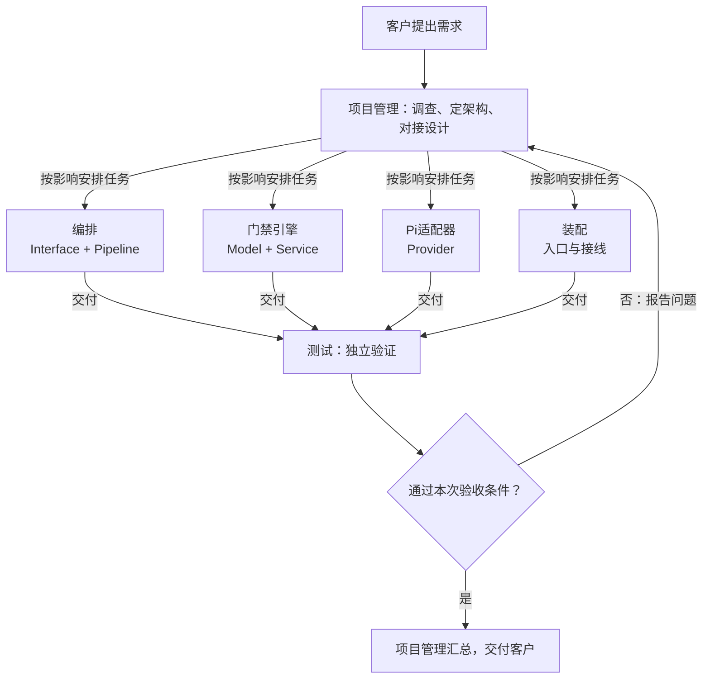
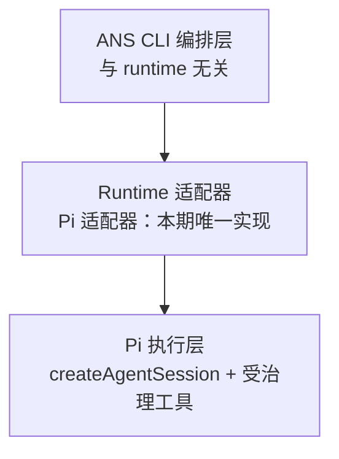

# ANS CLI 整体架构与角色协作

本文件说明这个项目实际的整体结构、每个角色负责什么、它们怎么配合。是"当前架构"的阅读入口。

**状态说明（先看这里）**：本项目的**角色结构已由客户验收**，下面「角色与职责」「分层与调用方向」写的是已确认的结构。CLI 的**运行时实现已有落地代码**：跨角色对接契约冻结在设计文档 `2026-10-11_design_ans-cli-v1-prototype.md`（状态：accepted，客户经调度方确认实施），`src/` 与 `app/` 下各层均已建立（`src/model`、`src/service`、`src/provider`、`src/pipeline`、`src/interface`、`app/`）。原设计文档 `2026-10-11_design_ans-cli-pi-runtime.md` 的评审结论为 `needs revision`，其可实施部分已由上述冻结契约取代。凡**尚未落地或未实测**的内容（V3 取舍、真实模型轮次、容器沙箱），在本文件内仍标为**「方案/待确认」**，不作为已实现结构。

## 这个项目要做什么

ANS CLI 是一条命令行工具，让"受治理的开发"跑起来。今天用 ANS 的做法是：人手工开一个对话、把角色卡和边界贴进去、做完再人工检查有没有改到不该改的文件。规则写在提示词里，只能靠模型自觉。

ANS CLI 想把它变成一条命令：启动一个角色会话，这个会话**从生到死只有这一个角色**，想改边界外的文件时**在写入发生之前就被拒绝**，模型得到一条能看懂的拒绝信息，可以改走别的路。它做的是**治理层**，底层的 agent（首选 Pi）是**执行层**。

一个具体例子：

```
ans role run 订单服务 --task T-123
```

一条命令把角色跑起来，它改不了边界外的文件——不是事后发现，而是写之前就被挡住。

> 上述命令名与参数已由冻结契约 `2026-10-11_design_ans-cli-v1-prototype.md` §5–§7 确定，并在 `src/index.ts` 实现：`ans role run` 已全链路跑通，`ans govern` 为最小占位链路，另有 `ans doctor` / `ans help`。见 README。

## 角色与职责（已验收）

本项目有 7 个角色，固定身份、各自独立上下文。每个角色位于 `角色卡/<角色>/`，含 `role-card.md`、`boundary.yaml`、`memo.md` 与 `docs/`。

| 角色 | 负责什么 | 主要层/目录 | 角色卡 |
| --- | --- | --- | --- |
| 项目管理 | 整体架构、跨角色对接设计、调度协调、验收；维护工程法案与共享组件 | `src/common/shared/`、`角色卡/项目管理/docs/`、`docs/scheduling/` | [role-card](../role-card.md) |
| 编排 | 命令接口与会话编排：把命令变成一次受治理的角色会话并管生命周期 | Interface（`src/interface/cli/`）+ Pipeline（`src/pipeline/orchestration/`） | [role-card](../../编排/role-card.md) |
| 门禁引擎 | 判定核心：共享类型（Model）、双来源角色与边界解析、`resolveWrite` 路径判定 | Model（`src/model/`）+ Service（`src/service/`） | [role-card](../../门禁引擎/role-card.md) |
| Pi适配器 | 把 Pi 的 TypeScript SDK 包成运行时适配器：建工具集、注册工具与 `tool_call` 钩子 | Provider（`src/provider/pi/`） | [role-card](../../Pi适配器/role-card.md) |
| 装配 | 入口、构建与测试配置、层间接线；让各角色的能力能被真正启动 | `src/index.ts`、`bin/ans.js`、`package.json`、`tsconfig.json` | [role-card](../../装配/role-card.md) |
| 测试 | 独立做跨角色联调、完整流程与回归，给出可复现结论；不修产品代码 | `test/测试/` | [role-card](../../测试/role-card.md) |
| 桌面应用 | Electron 桌面客户端：三栏界面（项目/角色树、会话聊天、角色资料），同一引擎的第二个前端 | Interface（`app/`、`test/桌面应用/`） | [role-card](../../桌面应用/role-card.md) |

三点补充：

- **门禁引擎是 `src/model/` 下三个共享类型文件（`boundary.ts`、`role.ts`、`decision.ts`）的唯一主属主**，其他角色只读引用。改动它们会让所有引用方的既有证据失效。
- **项目管理是 `src/common/shared/`（跨角色共享组件）的唯一写入者**，并维护 `docs/architecture/shared-components.md`。**现有共享组件**：`src/common/shared/config-loader.ts`（`.ans/project.json` 有效配置加载 + pin-backed acceptance 校验；由**装配**与**桌面应用**只读导入，消费方不复制第二份）。
- **`docs/scheduling/`（调度记录）归项目管理**：目录在 pm 的 Section 1 内（`purpose: 任务调度记录（内容由 task_ops 写入）`）；**内容唯一写入者是 `task_ops`**（技能 `scripts/task_ops.py`，含 hash 链式机器段），pm 只承载/发起、不另写一份，**编排不得直接写**（F3）。使用约定与真实记录样例见 `docs/design/2026-10-11_design_scheduling-record-convention.md`。**注：调度「执行」路径不在 V1（设计 §3.7）。**

## 分层与调用方向（已验收）

源码树 `src/` 按五个运行层组织，每个功能的代码放在它所属的层，不放进以功能命名的目录。

```text
Interface  ->  Pipeline  ->  Service  ->  Provider  ->  外部基础设施
Model: 由上面四个运行层共享
```

- **只允许相邻层调用**，不得向上、跳层或平级互调。Interface 只调 Pipeline，不直接触达更下层。
- **Model 是共享依赖**：共享的类型、值对象、不变量，被四个运行层引用，本身不属于调用链中的一环。
- **Service / Provider 层内部三段式**：`abstract/`（契约）、`public/`（对外入口）、`impl/`（具体实现）；上层只依赖 `abstract/`，不直接依赖 `impl/`。
- **`common/` 是支撑目录，不是第六层**。每个角色有私有 `common/<role-id>/`；跨角色共享走项目管理的 `common/shared/`；`common/` 不得反向调用运行层。

**桌面应用是 Interface 层的第二个前端**：与 CLI（`src/interface/cli/`）同处 Interface 层，共用 Pipeline / Service / Provider；判定一律调门禁引擎，Pi 调用一律经 Pi 适配器，渲染进程不另写边界判断（见 `app/desktop/`）。

**与技能示例的命名差异（现状，如实记录）**：技能 `references/architecture.md` 的示例树用复数名（`models/`、`services/`、`providers/`、`pipelines/`）。本项目已验收的边界用单数名：`src/model/`、`src/service/`、`src/provider/`、`src/pipeline/`、`src/interface/`。职责保持不变，仅词形不同；以本项目的实际路径为准。

## 角色协作（责任流）

下图表达**责任与协作**：谁把工作交给谁、结果怎么汇总。**它不是代码运行时的调用图**，也不表示每个任务都要经过全部开发角色。



当前已核对的关键连接（依据：已验收的角色卡与边界）：

| 连接 | 依据 | 变更时怎么配合 |
| --- | --- | --- |
| 编排 → 门禁引擎 | 编排只做编排；角色解析、边界解析与路径判定归门禁引擎 | 判定接口变化时，门禁引擎先改 `src/model/` 共享类型，再通知编排调整引用 |
| 编排 → Pi适配器 | 编排通过 `RuntimeAdapter` 接口使用适配器，不直接依赖 Pi | 适配器接口变化属跨角色契约，先由项目管理定对接设计 |
| 编排 / 门禁引擎 / Pi适配器 → 装配 | 各角色实现后由装配接线、启动 | 装配读各角色 `api-spec.md` 实际导出后接线；依赖未实现时可用替身隔离，但不算联调通过 |
| 各角色 → 测试 | 开发角色做自己的单元测试；跨角色、完整流程与回归由测试角色独立做 | 测试发现问题报告复现步骤，项目管理安排所属角色修复，再由测试角色复测 |
| 全部 ← 项目管理 | 调度、对接受权、验收与共享组件由项目管理统筹 | 任何角色发现要改别人的文件，把请求交回项目管理 |

各角色的详细功能流程由**各角色自己**维护在 `docs/feature/<功能-id>.md`，本文件只链接、不复制。目前仅**桌面应用**建立了功能文档（`角色卡/桌面应用/docs/feature/2026-10-11_feature_desktop-three-pane.md`），其余角色的功能文档尚未建立（验收后由各角色补）；共享组件文档已建立（`角色卡/项目管理/docs/architecture/shared-components.md`，登记本项目首个共享组件 `src/common/shared/config-loader.ts`）。

## 运行时结构（v1 原型已落地）

以下运行时结构已由 v1 原型**实现**（代码见 `src/provider/pi/`、`src/pipeline/orchestration/`、`src/interface/cli/`、`app/`），不再是「尚未实现」的拟采用做法。设计把运行时分为三层，只有中间一层需要为每个 runtime 各写一份：



关键结构决定：**一个角色 = 一个受治理会话上下文**。会话**嵌入** Pi 的 TypeScript SDK（不是调用 `pi` 命令）：

- 嵌入 SDK 才能用 `pi.registerTool()` 与 `pi.on("tool_call")`，这是门禁能生效的前提——**已落地**（`src/common/pi-adapter/real-adapter.ts`）；
- 设计稿设想的「一个角色 = 一个独立 worker 进程」，在当前实现里体现为**同一进程内的一次角色绑定**：CLI 一次命令、桌面端一个主进程各绑定一个角色会话，代码中未见派生子进程（`child_process` / `worker_threads`）。「一个上下文一个角色」由角色卡纪律与本项目的写入边界保证。

核心选择：**构造优于拦截**（已落地）。受治理的工具由自己注册，未受治理的内置工具可以直接让它**不存在**（`noTools: "builtin"`），"没有那道门，就不需要守门"。第二层 `pi.on("tool_call")` 钩子作为 fail-safe 兜底（见 `src/common/pi-adapter/real-adapter.ts` 的治理扩展）。

**写入层有一道隐式的第二边界（须留意，勿当隐含行为）**：受治理工具的写入层 `writeRoot` **恒为 projectRoot**（`src/provider/pi/tools.ts`）——它**不在任何 `boundary.yaml` 里表达**。门禁按其 `root: project | skill` 判定，写入层只落 projectRoot，故**门禁放行的 skill 根写会被写层拒**（有意收窄 = 纵深防御：内建治理边界全是 skill 根，正好在写层再兜一次「治理会话不写技能目录」）。**授权的唯一来源仍是 Section 1**——`writeRoot` 只紧不松，不会放行 Section 1 之外的写，只会让 Section 1 之内的 skill 根写被二次拒绝。此收窄属**如实标注的边界行为**（与「容器/OS 沙箱未做」同列）。另：**桌面应用的写入按运行时路径区分**——**demo 路径只判不写**（`app/desktop/chat-adapter.ts` 未传 `writeRoot` → 写层 fail-closed），**pi 路径真实写入**（编排 `createPiAdapterFactory` → 真实适配器，`writeRoot=projectRoot`，受门禁约束；需凭据 + `ANS_PI_BASE_URL` / `ANS_PI_MODEL`；`ANS_PI_CONTEXT_WINDOW` 现为可选、缺省用保守默认）。**界面文案须按运行时如实**。详见设计稿 `docs/design/2026-10-11_design_v1-full-implementation.md` §3.8、§3.9。

> **前提核实更新**：设计 §7 的三条前提状态已变——**V1（`noTools:"builtin"` 与 `customTools` 可否并存）已核实成立**（"内置不存在 + 注册自定义"在 API 层成立，接线探针 `test/pi-adapter/wire-probe.ts` 印证）；**V4（`on("tool_call")` 钩子是否 fail-closed）已确认为 fail-closed**（处理器出错 → 工具在执行前被阻断）；**V3（`run_shell` 给不给）仍是政策选择、未决**——它决定「构造优于拦截」是否需回落到「构造 + 拦截双轨」。依据：设计稿 `2026-10-11_design_ans-cli-v1-prototype.md` 附录 A（来自安装包 `@earendil-works/pi-coding-agent@1.1.0` 产物）；原始评审见 `docs/design/2026-10-11_design_ans-cli-pi-runtime-review.md`。

### 设计分层与已验收角色分工的对应（需留意）

设计 §3 的"CLI 编排层"把"角色解析（双来源）与 boundary 解析"放在同一层。但本项目**已验收的边界**把它拆开了：双来源**角色解析与边界解析**归**门禁引擎**（Service 层），Pi 调用归 **Pi 适配器**（Provider 层），编排只负责命令解析与会话生命周期。两者不是一一对应。以**已验收边界**为准；设计若继续使用三层表述，应说明它是 runtime-agnostic 的抽象层，或补一张到本项目角色的映射表。此项已列入评审发现。

## 待核实与未决

- CLI 运行时方案已被冻结契约 `2026-10-11_design_ans-cli-v1-prototype.md`（状态：accepted）取代并落地实现；原设计文档的评审结论 `needs revision` 仅对原设计成立（其 F4/F5/F6/F7/F9/F10 已作为契约约束实现）。
- 设计 §7 前提：**V1 已核实、V4 已确认为 fail-closed**；**V3（`run_shell` 给不给）仍未决**，属政策选择。
- **真实模型轮次仍未验证**（真实 Pi 会话可构造、适配器冒烟测试通过，但本机无 API key，未跑过真实模型轮次）；**容器 / OS 沙箱未做**。
- 设计 §2.6「角色与角色空间由 pm 创建」是对 SKILL.md 的未确认改动；在本项目内，项目管理**不假定该权限已存在**。
- 本项目尚未建立 `.ans/project.json`（客户审核过的执行配置），也尚未建立工程法案之外的项目脚手架。

## 变更（2026-10-11）

- **第 7 个角色：桌面应用**。客户决定做 Electron 桌面应用（同一引擎的第二个前端），`角色卡/桌面应用/`、`app/`、`test/桌面应用/` 已落盘。它属 **Interface 层**，与 CLI 共用 Service / Pipeline / Provider（判定一律调门禁引擎，Pi 调用一律经 Pi 适配器；不在渲染进程另写边界判断）。**初版验收时为 6 个角色**；本次文档审计已把上文角色表更新为 7 个。
- **共享契约追加：`ProjectConfig.builtInRoles`（门禁引擎主属）**。用于让**会话式入口**（编排 `openRoleSession` / 桌面聊天）能开启内置治理角色（如 su），而 `role run`（CLI 一次性路径）语义**结构性不变**：「哪个入口能开」由编排的**入口意图闸**约束（`runRole` 恒不允许、`openRoleSession` 恒允许），「能开哪些」由该**配置清单**约束（数据来自门禁引擎 `listProject` 的 `builtIn` 枚举）。新增为**可选字段、向后兼容**，不放松任何既有守卫。详见 `docs/design/2026-10-11_design_ans-cli-v1-prototype.md` §2 与 `docs/change/2026-10-11_change_su-session-open.md`。
- **文档审计（本次）**。通读全文并与当前仓库逐条核对，就地修正过时陈述：(1)「状态说明」中「应用代码目前尚未建立」已删——`src/`、`app/` 已落盘；运行时「尚在评审」改为「已有冻结契约（accepted）与落地代码」。(2)「角色与职责」6 个角色 → **7 个**，补桌面应用行，边界文件名 `boundary.md` → `boundary.yaml`。(3) 命令名 `ans role run` / `govern` / `init` 由「方案/待确认」改为**已实现**。(4)「运行时结构：**方案/待确认**」改为「**v1 原型已落地**」：`noTools:"builtin"` + `customTools`、治理扩展 `on("tool_call")` 均已在 `src/common/pi-adapter/real-adapter.ts` 中；「一个角色 = 一个 worker 进程」改为如实描述（进程内一次绑定，未见派生子进程）。(5) 前提更新：**V1 已核实、V4 已确认 fail-closed、V3 仍未决**。(6)「待核实与未决」逐条更新（原始评审 `needs revision` 已被 accepted 契约取代；补真实模型轮次与容器沙箱未验证）。(7) 各角色功能文档状态更正（仅桌面应用已建）。**依据**：`src/`、`app/`、`package.json`、`角色卡/*/boundary.yaml`、设计稿 `2026-10-11_design_ans-cli-v1-prototype.md`（含附录 A）、评审记录 `2026-10-11_design_ans-cli-pi-runtime-review.md`、变更记录 `docs/change/2026-10-11_change_su-session-open.md`。
- **补记：写入层的隐式第二边界（2026-10-11）**。T3 落地「写入真落盘」后，在「运行时结构」段落补记：受治理写入层 `writeRoot` **恒为 projectRoot**（不在任何 `boundary.yaml` 里表达），故**门禁放行的 skill 根写会被写层拒**（有意收窄、纵深防御）；**授权唯一来源仍是 Section 1**（writeRoot 只紧不松）。同时如实标注**桌面应用当前只判不写**（`chat-adapter` 未传 `writeRoot`），真实写入列二期。**依据**：`src/provider/pi/tools.ts`、`app/desktop/chat-adapter.ts`、设计稿 `docs/design/2026-10-11_design_v1-full-implementation.md` §3.8/§3.9。来源：协调方转达 T3 回报。
- **补记：`docs/scheduling/` 的归属与唯一写入者（2026-10-11）**。在「角色与职责」补记：`docs/scheduling/`（调度记录）**归项目管理**（Section 1），**内容唯一写入者是 `task_ops`**（技能 `scripts/task_ops.py`，含 hash 链式机器段），pm 只承载/发起、**编排不得直接写**（F3）；使用约定与真实记录样例见 `docs/design/2026-10-11_design_scheduling-record-convention.md`。**注：调度「执行」路径不在 V1**（设计 §3.7）。**依据**：`角色卡/项目管理/boundary.yaml`、设计稿 `docs/design/2026-10-11_design_v1-full-implementation.md` §3.4/§3.6/§3.7、技能 `references/task-operations.md`。来源：本项目任务 T6。
