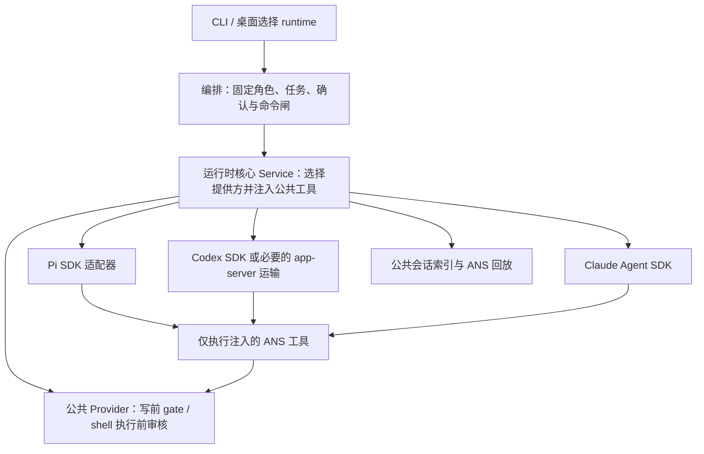

# 在同一套治理下接入 Pi、Codex 和 Claude

客户在命令行或桌面选择执行引擎后，仍然使用同一套角色、边界、确认、报告和派发能力。例如 `ans role run 编排 --runtime codex` 与 `--runtime claude` 应真正进入所选引擎；引擎不能通过自己的写文件或 shell 工具绕开 ANS。

本文件是已获批准方案的具体化，契约 ID 为 **ANS-RUNTIME-V2，revision 1**。客户先接受建立“运行时接入组”（运行时核心、Pi适配器、Codex适配器、Claude适配器，专属维护者及并行开发），随后明确说“可以的，你新建角色吧，然后开发吧”。该授权覆盖本文件所列必要实现，不重复要求确认；管理评审与测试通过仍是两个独立阶段。这一版本的必要实现与最终无网络候选检查已经完成；真实账户/线上模型未测。基线为 `906abd3ee275cba82b2f9e54ceef1cd9473c2d5c`，治理角色已先建立三份新角色定义并登记 Pi 组员。

## 已批准结果与边界

本次必要范围包括：三种真实引擎可选；CLI `role run`、`govern` 与桌面共同使用；设置准确标明所需认证与模型、凭据始终掩码；原生会话恢复与 ANS 可读回放按角色及 runtime 隔离；受治理的读取、写入、编辑、shell、客户确认/选项、报告、派发与审读结论按注入能力注册；SDK 懒加载；无网络可注入引擎的契约测试；既有 Pi 和 demo API 尽量兼容。

本次没有额外选装。不会为测试调用真实模型 API，不修改真实 `.env` 或持久凭据，不自动提交或推送代码。SDK 依赖及 lockfile 只由装配维护。没有证据的 SDK 能力不得写成已支持。

## 请求与治理执行

代码调用遵守 `Interface → Pipeline → Service → Provider`；共享契约归 Model。运行时核心的 Service 组合公共工具与各适配器，工具处理器/存储回调作为能力注入提供方，避免适配器之间互调。Provider 不向上导入编排、Service 或他人私有 common。已有 v1 的 Pipeline 直调 Pi Provider、桌面读取 Pi 历史属于本次明确迁移的连接，不借本次改动重构全仓。

治理判断仍归门禁引擎和编排：`write_file`/`edit_file` 在任何文件系统副作用前调用注入 gate；拒绝/异常没有 mkdir/write。`run_shell` 的唯一实际执行点先等待注入 ShellGate，缺少能力即不注册。SDK 事件只用来展示结果，不能用流式事件当写前阻断证据。

## 公共契约与兼容迁移

运行时核心在 `src/model/runtime.ts` 建立唯一中立契约，完整迁移现有 `src/provider/pi/session.ts` 的公共形状：`RuntimeAdapter`、`RoleSession`、`SessionEvent`、`PromptOptions`、写 gate、shell gate、客户交互、报告、派发及审读结果。旧 Pi 文件由 Pi 属主保留转出，既有 import 和测试仍能使用；新消费者直接引用 Model。`RuntimeKind` 及运行时设置目录仍由项目管理 `src/common/shared/runtime-shared.ts` 单一维护。

核心 Provider 迁移 SDK 无关的工具执行及 schema/描述，Pi 属主移除生产中的第二份治理实现并保留兼容 facade。需要迁移的私有 helper 不允许通过他人 common 引用；核心迁移实际必要实现后 Pi 改从公共入口使用。通用 schema 用 JSON Schema，Pi/Claude/Codex 只负责实际 SDK 的表示转换。工具定义含名称、描述、schema 和处理器；schema 中 optional/required 与处理器行为一致。

`RoleSession` 延续 `prompt/events/abort?/dispose`，扩展可选的实际上下文来源/原生 session ID，兼容缺省旧替身。模型信息、认证信息及 transport 选择属于适配器配置，不进入工具授权。Service 对选择失败明确报错，不退回 demo 或另一个引擎。

运行时核心先冻结实际类型和 `api-spec.md`，再释放 Codex/Claude 的实现。最终消费方法名以此单一实现报告和 Model 为准，不在本文件维护会漂移的第二份签名。

## 引擎接入要求与评审条件

| 引擎 | 接入方式与必须核实的限制 | 写前防线 |
| --- | --- | --- |
| Pi | 保留当前懒加载 SDK、受治理 custom tools 与 tool_call 防御钩子；公共工具/schema 改为核心提供 | 不提供 native builtin tools；ANS 处理器 gate；原有 fail-closed 钩子 |
| Codex | 先查当前官方 TypeScript SDK 文档和实际 npm types，评估通过 SDK config 连接 ANS MCP；若 SDK 缺少必要 MCP/能力关闭接口，再在本适配器中采用 app-server 运输 | 原生沙箱只读、禁原生写入与未治理 shell；只有 ANS MCP broker 执行治理工具。必须证明配置生效，不能仅看事件 |
| Claude | 当前官方 Agent SDK，`tools: []`；只有 ANS MCP tools，模型/tool event 映射到中立事件；按真实类型设置 allowed/disallowed 与权限 | 内置工具清空，MCP ANS 工具 handler gate；必要时 `PreToolUse` 防御性 deny 非 ANS 工具 |

Codex/Claude 各自用可注入假 engine 跑真实 MCP handler/生命周期契约，不依赖账号。SDK/API 版本、启用和关闭能力参数、官方来源和实际包类型证据由原属主写入各自设计及 `api-spec.md`。如果某 SDK 做不到所需治理隔离，先回报准确缺口，再决定实现，不编造钩子或把 shell 事件当审核。

Codex X0 独立评估已经返回：[原设计与实测探针说明](../../../Codex适配器/docs/design/2026-10-14_design_codex-governed-transport.md)。实际 `@openai/codex-sdk@0.162.1` 没有读取有效配置的接口；本机 alpha CLI 的本地 fake config 探针证实根 MCP map 覆盖会保留外部 server。该属主提出必要 app-server 运输，在任何线程前读实际配置、逐个禁用 server、重启复核，再使用只读沙箱、never 策略和禁 native shell 配置。管理评审接受这一已批准范围内的具体选择；不能把 app-server 路径称为 TS SDK callback 接入。第二轮 alpha fake config 验证只有 ANS 启用、外部假 server 未启动；生产拟固定 `@openai/codex@0.162.1` 与 MCP SDK `1.32.1`，装配后必须重新验证稳定版，当前不当作稳定版验证完成。没有真实模型/认证调用。

Codex X1 随后核实 native HTTP MCP 的已知 types 没有可验证的 turnId，不能把新轮 signal 交给迟到旧请求。为落实同一停止/轮次隔离契约，管理接受其必要运输细化：关闭所有 native MCP，向 app-server 只登记 ANS dynamic tool proxy；实际 `item/tool/call` 请求的 threadId/turnId/callId 在进入本地 MCP Client/InMemoryTransport 前精确校验，再执行注入的原 handler。该 request 是真正执行前回调，普通流事件仍不承担授权。未知/迟到轮次拒绝；不会保留缺轮次归属的 HTTP 可选路径。官方实际 schema 与最终稳定 CLI 的 experimental dynamic tool 支持由该属主/装配验证。

## 会话与回放

存储按 `<project>/.ans/sessions/<role>/<runtime>/` 隔离，索引含 runtime、角色、原生 ID、可读 ANS 回放与实际恢复结果。Pi 旧目录只作为 Pi 兼容恢复输入，Codex/Claude 不把任意 JSONL 当作可恢复模型上下文。Service/适配器读取自己注入的精确目录；无持久化选项保持内存行为。目录只在真正持久化时创建，保持创世态 `.ans` 不预建的既有语义。

恢复成功、恢复失败后重建、无历史新建分别如实表达。原生恢复失败不谎报 resumed；ANS 回放可仍显示历史，但不推断模型上下文已恢复。中止当前轮、等待客户时中止、下一轮继续、dispose 和 LRU 淘汰仍各有准确语义。桌面会话缓存键至少包含 project、role、runtime，切换引擎不会续接另一引擎的句柄/事件/历史。派发和报告带所属轮次、角色、runtime；不能因 settle 自动推断完成。

2026-10-14 核心实际契约已冻结：核心 `RoleSession.contextSource=resumed` 表示**原生恢复确实成功**，`recovered` 表示**原生恢复失败后重建**；既有桌面 OpenResult 恰好用 `resumed` 表示复用活句柄、`recovered` 表示从磁盘恢复成功。桌面窗口必须显式转换，不能直接透传同名字符串。活句柄复用可以继续旧 `resumed`；核心 native `resumed` 对应桌面“已恢复”；核心 `recovered` 必须带失败原因呈现“上下文已重建”。延迟到 prompt 才确认恢复时，轮次完成后更新实际状态，不能预先展示“已恢复”。核心单一实际接口见 [api-spec](../../../运行时核心/api-spec.md)。

## 设置与组展示

桌面提供 Pi/Codex/Claude 选择及各自设置视图，所选 runtime 贯穿开会话、派发、审读和历史读取。现有 Pi 设置 API 可保留兼容 alias；新增设置字段的秘密类型与掩码单一登记在共享目录，只有已设置布尔，不返回原值。模型/base URL/认证字段按所选 SDK 的真实支持范围表达；缺配置时明确说明，不假装可用。保存遵循现有逐行只改所需键及原子写；测试仅写临时假 env。

设置读取必须反映实际有效来源（文件/环境/明确fallback）而非只看文件。profile 保存成功才变更版本，失败保持原状态；所选 runtime 的旧会话不能在新配置下直接复用。活动轮次使用一份一致的环境/认证/净化快照，新输入或重开会话应用新 profile 并重建对应引擎；不得因全局 `lastRuntime` 把另一会话的任务改投新引擎。Pi 既有 SDK auth 从 ambient env 读取的路径，桌面保存时需安排安全的应用时点，避免忙轮次在旧 endpoint 上突然读到新 key；不引入新的认证模式。展示准确说明配置应用到新会话的时点。

组别字段是文档元数据，不授予组长其他成员的文件权限。必要展示由门禁引擎解析角色卡 group/groupDuty 并传递只读摘要，桌面UI按摘要呈现“运行时接入组”，缺字段时保留现有平铺/默认展示。不得在 renderer 另写角色解析或授权判断。

G1 实际对接字段为 Model `RoleGroupMetadata` 的 `readonly group?:string/groupDuty?:string`，解析角色卡第一条非空字段，原文trim且未知值保留；旧卡缺失不新增属性，built-in不推导分组。门禁引擎 [独立设计](../../../门禁引擎/docs/design/2026-10-14_design_role-group-metadata.md) 已由项目管理评审同范围接受，窗口透传、UI按文本转义展示，不能按 group 改权限。

## 角色范围预留与阶段

依据技能 `group-leadership.md` 的 **Without task_ops** 路径执行：仓库没有客户 pin 的 `.ans/project.json`，不伪造 config hash/审批或手写 scheduling 机器日志。以下表格仅是本设计的具体工作范围与释放条件，不模拟 task_ops 审计。每次启动均是 fresh `fork_turns: none`、固定角色，并核对边界和无重叠写者；总容量为治理、项目管理、最多两名执行者。

| 阶段 | 属主 | 本次允许写集 | 释放条件/证据 |
| --- | --- | --- | --- |
| C1 公共契约及核心 | 运行时核心（组长） | 自有边界的五个源码文件、`common/runtime-core/`、`test/runtime-core/`、自有 docs/API/功能资料 | 本文件具体化先完成；先冻结 Model/schema/工具注入接口；核心工具/存储单测 |
| P1 Pi 迁移 | Pi适配器 | 自有 session/tools、private common、tests 与 docs；新增公共迁移所需入口必须先由 Governance 扩边界 | C1 契约可用；兼容 API 与 Pi 全部受影响测试 |
| X1 / A1 | Codex适配器 / Claude适配器 | 各自唯一 `provider/<runtime>/session.ts`、private common、独立 tests/docs | C1 Model 与注入接口冻结；两个引擎并行；SDK 官方及 types 证据、治理工具/MCP/恢复/abort 测试 |
| M1 共享设置 | 项目管理 | `common/shared/runtime-shared.ts`、`env-file.ts`、自有共享 tests 与 docs | 核心契约和 SDK 配置证据；runtime 枚举、设置目录/秘密键、脱敏测试 |
| O1 编排迁移 | 编排 | 既有 CLI/Pipeline/private common/tests/docs | 核心与 adapter 接口可用；选 runtime、role run/govern、能力转发、runtime 隔离 |
| B1 装配 | 装配 | 入口、依赖/lock、自有 runtime/common/test/docs | adapters 实际版本/API 已确认；依赖安装、CLI 冒烟、类型检查 |
| G1 组摘要 | 门禁引擎 | 已有 Model role、角色解析、自有 tests/docs | 元数据解析具体范围与边界已核对；不改 gate 判定语义 |
| D1 / U1 | 桌面窗口 / 桌面UI | 各自已接受的精确 app 文件、自有 tests/docs | O1 和共享设置可用；前后端 contract 先确定；runtime 缓存/历史/设置、组展示 |
| T1 独立验证 | 测试 | `test/测试/` 与自有 docs | 最终合并候选；完整无网络流程、越界零副作用、回归/typecheck、必要桌面检查 |

各角色先在自己的允许文档中补充实现说明和影响评估，送项目管理核对。该同范围细化继续使用既有批准；实际越出批准范围或所有权缺口必须先交 Governance。已冻结 v1 文件的本次改动仅限上述运行时契约迁移与对应调用者，不授权 unrelated cleanup。

## 管理评审与验收

管理建议 **recommend approval（同范围已有客户授权，开始实施）**。当前结构里公共契约和治理工具归 Pi，会让新适配器复制权限逻辑；迁移到核心能保持同一个写前执行点。让 SDK 自带写工具再靠流式事件观察不可验证，不采用。Codex 的实际 SDK MCP 配置仍需原属主官方/types 评估，Claude 需核实当前 options/hook 类型；这些是实施验证门槛，未被写成已核实。

受影响属主的独立评估随阶段回报追加原链接。没有这些评估/验证前不声称最终可用。每个开发属主交路径、实际版本、测试命令/结果及问题；项目管理按原证据释放后继；测试角色独立跑最终合并候选，发现生产问题只交给其原属主修。

2026-10-14 写前/停止评审发现：核心处理器可在进入写入前检查 signal，但共享 `atomicWrite` 在异步 temp write/fsync/rename 内还可能忽略中止。完成同一停止契约的必要最小补充为项目管理给 `AtomicWriteOptions` 和兼容 `renameReplacingExisting` 增加 optional `signal`，在 temp open/write/sync 与每次 rename 提交前检查中止并按原失败路径清理 temp；核心向其传递每轮 signal。已提交到操作系统并完成的 rename 无法事后撤销，不声称回滚。旧无 signal 调用逐字保留既有行为。核心属主请求和治理只读审计构成本次独立影响评估；项目管理在自有测试中验证已中止零副作用、fsync 后中止不替换目标及 temp 清理，核心验证工具层与 shell 中止。

确认发行处同样必须看原轮次中止状态。工具的 raceAbort 不能终止另一个注入回调本身；若回调稍后收到旧“同意”，不能把路径加入新轮 writeSet。核心兼容扩展 `CustomerInputFn(req, metadata?: CustomerInputMetadata)`，metadata 含原始 `signal/turnId/roleId/runtime`，单参数回调继续兼容。确认/选项 handler 捕获原 signal 与 turn，编排 issuer 在任何发行前检查捕获的 signal，桌面原请求中止即失效。O1/T1 必测真实编排：等待确认→中止→旧答复 yes→下一轮未确认写仍拒绝。实际核心接口及影响见 [C1R 原记录](../../../运行时核心/docs/fix/2026-10-14_fix_customer-input-cancellation.md)。

必须验证：三引擎在 role run/govern/desktop 到达正确工厂；未知/缺依赖/缺认证诚实失败；每个 ANS 工具 schema 与 handler 同义；越界、gate 异常、shell deny 无副作用；非 ANS native 工具拒绝；确认拒绝/中止不授权；报告派发能力按角色注入且失败不伪造成功；同角色不同 runtime 不串历史/句柄；原生恢复和 ANS 回放区分；masked 设置不泄漏；SDK 懒加载和所有现有 tests/typecheck。真实在线轮次与 OS 全面沙箱不在本次无网络测试证据内。

## 阶段原证据与释放

C1 核心已实现并通过自己负责的门槛：[原始候选与检查](../../../运行时核心/docs/change/2026-10-14_change_runtime-core.md)，21/21 自测、当前工作区 tsc exit 0，组合候选 `572194d0a7e4dfd5d704daf2515b50533d845433ddea2c62923a970d9000ac06`。项目管理读原报告并复核其 13 源码/测试与 3 共享依赖哈希全匹配后释放 Codex/Claude 实现。核心证据包括停止、shell 有界清理、native 路径校验、custom key 剥离与回放存储；它不证明真实 SDK 或用户入口接线。C1 同一固定上下文保留用于后续实际 owner rework。

Codex X0 设计已评审，X1 与 Claude A1 分别在自己唯一源码/common/tests/docs 中并行，范围不重叠。Claude [原设计/独立影响](../../../Claude适配器/docs/design/2026-10-14_design_claude-governed-session.md) 依据 SDK `0.3.299` 的实际 types；停止/恢复/schema 必须由其真实 MCP handler 与无网络 engine 验证。

Claude A1 实际 SDK 限制：ANS 的 prompt 时限会在客户等待期间暂停，但 [Claude 原生 MCP](https://code.claude.com/docs/en/mcp) 有工具 wall-clock 上限，0 不是关闭该上限。属主核对 `McpSdkServerConfig.timeout` 与实际 env 行为后，设置 native server timeout 为 `2147483647ms`（约24.8天）并用官方 `CLAUDE_CODE_MCP_AUTO_BACKGROUND_MS=0` 禁用两分钟自动后台化；本地真实 MCP 客户端使用相同请求上限。此措施移除默认短期中断，仍不能承诺原生 SDK 真正无限等待。超过 upstream 限制或停止时必须如实失败并取消旧请求，不发行写权、不伪造客户同意。此为当前 SDK 的真实边界，不能由无网络测试消除；没有增加替代引擎或重放工具的方案。

Claude A1 已返回实现候选：[17项实际 SDK/MCP 临时环境原证据](../../../Claude适配器/docs/change/2026-10-14_change_claude-runtime.md)，本角色4份源码/测试指纹 `b79038ecdbe6303bf2d49c11d08710cfb8b8ee23515fab97581a86541f5987d9` 经项目管理复核匹配。单次随机 nonce 只将 PreToolUse 的原始 prompt/turn/signal 关联到 MCP handler，原 ANS gate 仍是唯一写授权。17/17 与针对实际 SDK 的编译通过证明的是本地 bridge 和真实 MCP，未证明 bare 下原生 SDK 的 prompt_id/输入 UUID/updatedInput 关系；不得提前标 A1 完全验收。A1V 保留为安装正常依赖后的该固定属主验证：严格 loopback fake Anthropic endpoint、假凭据和 bundled CLI，证明原生 hook/input 更新链及迟到 UserPromptSubmit 的权威 UUID 对照。不得调用真实外部 API 或账户。这是实际 SDK 兼容门槛，失败交原属主修复，不退回未治理路径。

A1V 随后已实际通过：[原生 hook/输入归属修复原证据](../../../Claude适配器/docs/fix/2026-10-14_fix_claude-native-hook-identity.md)。正常20/20、全仓tsc与实际 bundled CLI2.1.299回环probe exit0；5份源码/测试/probe指纹 `0877d5fb32aafea9119953102d4ee0332f9037d9238ad94f732490970fe1f497` 经项目管理复核匹配。实际证明 bare 会抑制必需 SDK hooks，因此生产移除 bare，使用经原生验证的 `settings.disableAllHooks:true` 关闭设置/插件 hooks，同时保留显式 SDK hooks。native prompt_id确实不同于SDK inputUUID，公共API没有提前关联ack；adapter只向wire前缀加入自己生成的opaque输入标识，UserPromptSubmit消费注册的原始Turn再关联实际nativeID，不能按最新输入猜测。该标识不授予任何权限，GUI/ANS回放原文不变，受控assistant/tool/error输出净化标识；原生transcript含关联前缀。两条相同文本有两组实际UserSubmit/PreToolUse，两个原生目录都只有ANS，updatedInput确实到2个真实ANS handler。旧bare/直接UUID/单init数量的错误假设和失败完整保留；A1早期推断被此原生结果取代。该probe仍未测试真实账户、线上模型或全OS沙箱。

共享设置 metadata 与掩码、atomic stop helper 已实现，实际接口与自测见 [项目管理报告](../../api-spec.md)。早期枚举一致性失败已由 O1 统一来源修复；共享目录首次109项中的旧Mac路径预期已由本角色用独立OS oracle修正并target21/21通过。当前共享全目录109/109通过，原日志 `/private/tmp/ans-pm-shared-final.log`；桌面消费方及最终全仓组合仍由独立T1验证。

后续实际门槛已推进：核心当前 [C1O 原证据](../../../运行时核心/docs/fix/2026-10-14_fix_outer-terminal-outcome.md) 为33/33及全仓tsc通过，补齐 Service 历史入口、原确认取消 metadata、旧 Pi outer/inner 时限、中止专属文案和已确定终态优先级。早期21项只作历史，不代替当前源码。编排 [O1 原证据](../../../编排/docs/change/2026-10-14_change_multi-runtime-orchestration.md) 为238/238、其中新增16项真实 Service/Gate/issuer 验证，历史入口及迟到确认场景通过，四枚举已统一。

装配 [B0 原证据](../../../装配/docs/change/2026-10-14_change_multi-runtime-assembly.md) 记录正常 npm 精确安装、稳定 Codex CLI0.162.1 的无模型 probe 通过、全仓tsc与54项装配基线通过。正常核心/adapter组合240项首跑239通过，唯一sandbox loopback listen EPERM经受管回环执行精确1/1通过；原失败保留，后续最终组合仍重新验证。B1入口源码接线未因此提前完成。

Pi P1 已按原属主 [实际方案](../../../Pi适配器/docs/design/2026-10-14_design_pi-injected-runtime.md) 迁移生产工具注入/native存储。有限兼容路径除 `provider/pi/tools.ts` 明确 public转出外，还包括 `common/pi-adapter/tool-compat.ts` 对核心 **SDK-neutral public schema** 的旧 helper alias；这是纯 schema 兼容入口，生产完整 ToolDefinition 不走 name-only lookup，不将 Core私有实现或其他adapter带入生产调用。该确切旧接口迁移边不扩张 common 的一般运行层调用权，也不保留第二份生产治理/schema。P1最终自身/实际SDK验证另取原报告，不用早期185项替代。

Pi P1 最终 [原实现证据](../../../Pi适配器/docs/change/2026-10-14_change_pi-injected-runtime.md) 为199/199（185项原断言保留、14项新增迁移/实际SDK验证），全仓tsc通过；42份源码/测试指纹 `58d888c4b34e0c4aa610908549b91599f8e608f5b0ab1d622b4a53bc00e9a152`。实际Core/Provider入口保留旧Pi env时限，生产完整schema/handler只取Core注入；旧JSONL只迁移到Pi自己的native目录后开启，不交另一引擎恢复。

Codex X1S [最终配置修复证据](../../../Codex适配器/docs/fix/2026-10-14_fix_blank-base-url-default.md) 为16/16与全仓tsc通过，源码/测试指纹 `a1c40099de0496efa8452aacf3f944fc462bdb90ac3c185421b88161bc642ede`。空白base URL按真实配置语义使用官方Responses默认地址，env快照及净化保持一致；X1的原动态工具隔离/native身份验证没有被替换。

装配B1 [当前入口证据](../../../装配/docs/change/2026-10-14_change_multi-runtime-assembly.md) 为自己67项及受影响Window会话11项共78/78，全仓tsc通过；22份属主文件指纹 `38f896e0ace0de540606080595e322c3e81cb80d8f3dab2a8b6506fba45a105c`。真实CLI入口以fake providers证明四runtime到达Core工厂并取得实际handler，缺认证/依赖诚实失败，import/help/doctor保持懒加载；在线模型轮次不在证据中。早期全仓1168项中的两个Window旧断言失败保留：项目目录basename由D1修独立路径oracle，角色首文件顺序由Governance在原权限不变下修边界entry顺序。后者原断言现11/11，不能删掉有效契约。

G1 [当前组摘要证据](../../../门禁引擎/docs/change/2026-10-14_change_role-group-metadata.md) 为新增8/8、属主总169项168通过/0失败/1既有Windows专属skip，全仓tsc通过；指纹 `d9bd2a97bcfd47f658974cc626564557260112e1f26495febdaec12fc61803e8`。Governance另以真实listProject复核运行时接入组四份卡与组长/组员，warnings为空；组元数据不参与权限判定。

D1/U1 的 [窗口设计](../../../桌面窗口/docs/design/2026-10-14_design_multi-runtime-window.md) 和 [界面设计](../../../桌面UI/docs/design/2026-10-14_design_multi-runtime-ui.md) 已按同一授权独立评审释放。实际IPC以projectRoot/roleId/runtime定位开会话、输入、历史、停止和排队；配置revision在保存成功后更新，忙Pi在安全应用点前不改ambient认证。shell确认缺少原CustomerInputMetadata，不声称同样的signal能力：窗口按精确handle绑定并在中止、重建、终态、reject和本地timeout时失效；Core仍以原signal挡住晚答后的spawn。U1按原请求身份缓存/失效，切选择器不自动中止后台会话。桌面属主当前自测是阶段证据，最终实际main/preload/renderer及合并回归交T1。

D1 [最终原报告](../../../桌面窗口/docs/change/2026-10-14_change_multi-runtime-window.md) 已交：22个属主单元文件171/171，其中新增15项，严格tsc及scope diff exit0；[46项实际manifest](../../../桌面窗口/docs/change/2026-10-14_multi-runtime-window-manifest.txt)含消费方依赖。旧 basename 测试用独立模块路径oracle修复，跨项目多个忙Pi安全点和shell原句柄终态失效均覆盖。最后main/preload仅注释同步已刷新manifest，不冒充其单元证明实际Electron主入口。U1首个冻结19项candidate指纹 `e7b7302819dd182557b7fc2c8aad58c4b137f7c4185aae41db681581d1b697d3` 已由项目管理逐文件复算全match；自有57/57及全仓tsc通过，实际Electron离线假IPC报告97条记录中87个布尔断言通过（其余测量/目标记录不是断言），IME26断言通过。宽/窄组与设置截图已经项目管理/治理人工读取确认，无新视觉需求。

U1最后对实际adapter事件进行只读核对发现工具行缺少兼容：Codex `detail.args.path/detail.ok` 与Core `detail.call/result` 嵌套字段没有全部呈现。管理将此作为同一已批准结果的必要最小修正，已释放UI属主先写具体字段映射再修自己的tool-rows/单测；Claude没有ok/status时仍显示unknown，不能从accepted猜测成功。新的candidate与受影响实际Electron观测由U1保存，早期19项摘要不代替新最终证据。T1并行准备真实入口，最终组合gate等此候选冻结后执行。

U1随后[最终交付](../../../桌面UI/docs/change/2026-10-14_change_multi-runtime-ui.md)：当前19项组合指纹 `10bf4028b588a1704c46c30a8b6dbd0c2fc9982b87da5c00c43ac836c5124ee1` 经管理逐文件复算全match；自身58/58、tsc与diff0，窄实际Electron15个布尔断言/16记录通过，含真实Codex args/ok与同callId目标继承。此前完整UIUX87断言/97记录、IME26和热路径测量保留旧manifest，不冒充新字段修正后全量重跑；最终受影响组合由T1检查。四张原截图已保存于属主的 `docs/change/2026-10-14-runtime-ui-evidence/`，明确是离线fixture证据。

T1 范围预留已经核对测试角色的有效boundary：只写 `test/测试/` 与其自有设计/变更资料，产品源码、peer单测和配置均只读。独立验证可用临时假凭据、注入fake providers和严格loopback运行真实CLI/Electron入口；不调用真实账户或外部模型API。测试失败由项目管理定位属主修复，不能由测试角色修产品或改权限。无网络native证据只复核实际稳定配置/回环hook门槛，不重复开展已通过SDK调研。

D1结束后已按容量释放fresh固定测试角色，T1先写独立方案供管理同范围评审；实际main/preload/renderer验证不能以复制IPC harness代替。外部SDK/临时env路径/目录对话框的替身只在测试目录loader中装配，不加入产品测试开关。当前活跃写者为Governance、项目管理、T1与U1，无交叠scope。

T1 [独立设计](../../../测试/docs/design/2026-10-14_design_multi-runtime-independent-verification.md) 已由项目管理读取并同范围评审释放。它的精准接缝是loader向原Codex/Claude factory注入已有engineFactory/loadSdk，执行原生产文件且保留真实MCP；Pi只替换外部SDK的createAgentSession，其余exports保留。临时env facade仅覆路径resolver，其余exports原样；原main/preload/renderer不改不复制。该边界证明产品接线和真实本地工具，不冒充在线原生模型验证。

T1首轮有限actualmain17项、独立Pipeline5项与实际CLI6项通过，受管全仓1212项为1211通过/0失败/1既有Windows专属skip，tsc/diff0；实际稳定Codex无模型probe及Claude bundledCLI严格loopback probe通过。sandbox的Pi/Claude listen EPERM和Electron SIGABRT原失败均保留，不能计作pass。但有限截图复核又确认X/claude只有一次输入、一个settled和一个handback的同turn被历史/live重复呈现；原17项没有覆盖重复，不能据此宣称完整验收。此为已批准可用历史呈现的必要修复，管理已返回同一固定U1上下文，限定own renderer/tests/记录先定位，保留旧history、后台runtime与两个独立相同输入。T1保留原快照/最小复现，加同turn重复guard；修后才重跑实际main及受影响组合，unchanged native probe不重复。

T1 [原始重复问题](../../../测试/docs/fix/2026-10-14_fix_actual-main-live-history-duplication.md)已经可复现为17项通过/1项真实失败。跨角色最小修复契约在 owner 改动前冻结：Window `ReplayRow`增加 `turnId?:string` 与 `eventKind?:string`，直接保留Core `RuntimeReplayEntry`的原始turnId（`entry.turnId ?? event.turnId`），事件行eventKind来自原`event.kind`，用户input没有eventKind；旧Pi JSONL缺字段时继续缺省，不猜造ID。D1只在自己的mapper/API/测试里透传。U1仅在可确证同一三元视图、同turn、同事件且逐次出现对应时合并history/live；同文本不同turn、无权威ID的legacy、未持久live、确认卡、settled和handback不能丢失。此为只读呈现metadata，不改变Core/Model、存储或写权，既有D1/U1边界覆盖，无需扩权；Governance已经再次确认。T1阶段交接释放后，D1/U1各自固定上下文并行实施，测试role保持原红guard，修后同role独立续接。

乐观user气泡尚无权威绑定：现SendResult只含ok/error/queued/position，running/queued也没有此客户投递的Service turnId，不能取latest或history尾条猜。同一最小修复继续冻结纯显示关联：`sendSession(text, images?, target?, metadata?:{clientMessageId?:string})`兼容增加第四参；renderer为每次独立输入生成opaque ID并绑定原气泡，Window直接与queued投递分别捕获该ID。`SessionEventEnvelope.clientMessageId?:string`只随该原投递的真实event.turnId返回，在settled清理/启动下一队列前捕获；匿名后台投递不能借用下一客户ID，旧/未知ID不能绑定新输入。不读全局latest，不按文本认同轮。UI据原clientMessageId→原气泡与实际turnId关联后才参与已确定的history合并。此字段不持久化到Core/store、不作为授权，不改Model或原工具；只涉及D1已有main/preload/Interface/session与U1发送/呈现。直接、queued、stop/失败与两次同文的owner测试须证明隔离，T1最终入口独立复核。

原事件可能由Pipeline repin延后yield，Window在send拒绝时仅凭未观测turn无法区分“Core已产生turn、failed终态在途”和“Core前置拒绝、根本无turn”。来源FIFO会猜错下一条，禁整个旧handle后续关联又留下重复。最终必要ack契约在Core改动前冻结：Model `PromptOptions.onTurnStarted?: (metadata:{readonly turnId:string;readonly roleId:string;readonly runtime:RuntimeKind})=>void`，Core实际生成新turn后，在try内且persist/native前同步恰一次通知；disposed/active/quarantined前置拒绝无通知。callback自身异常仍进入原failed终态/清理，不能泄漏active。Window由**原prompt投递闭包**捕获ack，事件仅按已确定turn映射原client ID；缺ack旧兼容不推断，删除已不需要的首次事件FIFO猜测。此为只读生命周期通知，不包含signal/客户端ID、不改存储、工具授权或SDK路径。当前source的Model与Service本来由Core精确拥有，Governance已确认无需扩权。由同一Core上下文实现/自验原终态与取消，D1再对接，T1最终复验。上段的原先“只Window/UI”计划由此实际验证缺口补充为三个原属主的最小必要修复。

最终README只读审计发现旧Pi-only正文与新增多引擎段冲突，管理将由装配固定属主在own文档范围同步现有选择器、运行时设置和role/runtime目录事实，保留Pi专属配置与旧JSONL兼容。不扩产品功能、依赖或其它角色范围。当前修复与最后文档完成前，验收维持未verified。

最终状态：已完成必要实现与T1当前候选独立验证。[整体验收报告](../change/2026-10-14_change_multi-runtime-integration.md)链接原属主与独立证据；T1当前actualmain23/23、旧UI119/119、锚点14/14、全仓1226总/1225通过/0失败/1既有Windows跳过，类型与diff0。最终UI b488候选、269代码/测试起止与当前哈希全部一致，之前所有原红作为历史保留。真实history/live重复与legacy卡位置已修并原断言转绿；两个NoHandler前提红属于旧测试夹具，不用于新增产品错误硬化。最后README已由固定装配属主同步事实与final链接，测试缓存清理保留报告/图/日志，Governance最终归属/权限/组字段核对通过。没有自动提交推送、真实凭据或保护路径改动；在线账户/模型与全OS沙箱仍未测。
