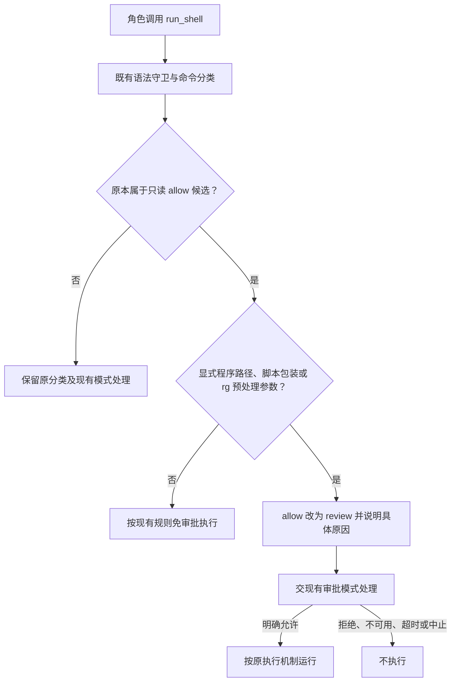

# 保留日常开发便利，只修明确的权限与文件行为问题

本方案约束 AI 日常误操作，同时保留现有审批能力。普通 `ls`、`cat`、`rg`、既有只读 git 用法等继续按原规则免审批；只把显式带路径的程序、脚本包装和明确会执行代码的参数用法转交现有审批。目录链接跨角色写入、编辑后文件权限丢失、文案与实现不一致仍应修复。

**方案编号：ANS-PERMISSION-REPAIR；版本：D3（轻量版）。** 客户指出 D2 过于严格、风险可控，并要求“按这个轻量方案，把方案文档更新一下给我看”。D3 据此取代 D2 的实施建议；本轮仅更新此文档，没有获得或执行代码实施指令。

## 与 D2 相比，这次保留与撤销什么

| 项目 | D3 轻量版 |
| --- | --- |
| 常用只读命令 | 保留当前白名单及其既有参数约束，不收缩成仅 cat |
| Windows | 保留既有免审批和执行能力，不改成全部审批 |
| 显式带路径的程序、脚本包装 | 不再仅凭 basename 获得只读免审批资格，按既有模式处理 |
| `rg --pre` | 明确执行用法退出只读免审批，普通 rg 搜索不受新增限制 |
| 系统程序信任框架 | 不建设；撤销 root 归属、安装目录链、ACL 核验要求 |
| 执行文件身份和环境 | 不新增内容哈希、执行计划、`executionFacts` 或专用最小环境；沿用当前运行机制 |
| 文件写入与权限 | 保留真实目标授权检查及普通权限位修复 |
| 对抗性攻击 | PATH 劫持、恶意并发替换、隐藏配置等记为本版剩余风险，不宣称已解决 |

## 本轮必要修复

| 编号 | 问题 | 计划行为 |
| --- | --- | --- |
| R1 | 目录链接使实际写入跨过角色边界 | 输入路径和实际目标都获授权才可写；临近写入复用现有门禁复核 |
| R2 | 显式 `./cat` 等自定义程序冒用只读白名单 | 显式带路径的程序和脚本后缀不能因为 basename 命中就免审批 |
| R3 | `rg --pre` 被当成只读搜索 | 覆盖两种显式参数形式，交原审批；保留普通搜索免审批 |
| R4 | 编辑脚本把 `0755` 改为 `0600` | 已有普通文件覆盖、编辑后保留读写执行位 |
| R5 | README 与界面说明过时 | 说明现行代批范围及失败处置，保持现有决策政策 |

没有选装项。不升级依赖、不新增通用信任配置、不扩展成操作系统沙箱、不发布运行包。

## 已有证据及其限制

调查基线为 `fc1a39c14e119faccf442fc8e22bbbbd978d1a04`；调查开始时工作区干净。环境：macOS / Darwin arm64，Node `v24.14.0`，npm `11.9.0`。

前一轮由当前聊天直接执行的隔离复现使用真实公共 handler、门禁和临时目录，结果如下。这是缺陷证据，不是 ANS 独立测试角色的验收：

- R1：直接写 `private/data.txt` 被拒；写 `allowed/link/data.txt` 返回成功，实际 `private/data.txt` 内容被修改。
- R2：执行临时项目内 `./cat`，脚本写入标记文件成功；审批通道调用 0 次，审计分支为 `c-allow`。
- R3：执行 `rg --pre ./preprocessor ...`，预处理脚本写入标记文件成功；审批通道调用 0 次，审计分支为 `c-allow`。
- R4：`edit_file` 成功后，脚本权限从 `0755` 变为 `0600`。

原始材料为本机临时文件：[复现脚本](/tmp/ans-review-repro.mjs)、[全量测试输出](/tmp/ans-review-tests.log)、[回环复测一](/tmp/ans-review-retest.log)、[回环复测二](/tmp/ans-review-retest-remaining.log)。这些路径不随 Git 分发，可能被系统清理；正式实施时由测试角色把场景固化为回归用例。

基线类型检查通过。全量测试发现 3359 项，3331 通过、2 跳过、26 因沙箱禁止监听 `127.0.0.1` 失败；允许本地回环监听后，相关测试文件重跑通过。不能把这个结果写成“修复已通过”，也不能用 macOS 结果代替 Windows junction、PATH/PATHEXT、原生文件替换验证。真实模型服务和桌面完整操作流程尚未验证。

## R1：同时检查输入路径和真实目标

当前入口为 `src/provider/runtime/tools.ts` 中的 `write_file` / `edit_file`。注入的写门禁最终调用 `src/service/gate/resolve-write.ts::resolveWrite`；落盘使用运行时核心的 `fs-write.ts` 和项目管理的共享 `atomic-write.ts`。

拟采用双重授权：

1. 保留输入路径的规范化、角色边界、条件目录、任务 `writeSet` 检查。
2. 使用现有共享路径原语取得目标所属受治理根（project/skill）的真实路径、真实目标及其相对路径。真实目标也必须满足同一套角色边界、条件与任务写集。
3. **不把边界条目自动转换成链接目标来扩权。** `allowed/` 指向 `private/` 不意味着 `private/` 获得授权。
4. mkdir 后、写入前，核心重新调用同一注入门禁，并确认真实父目录没有偏离已检查目标；不得在核心复制角色规则。
5. 继续拒绝目标文件本身为符号链接。项目根本身是合法链接时，以解析后的真实根为基准，不因此拒绝整个工作区。

失败要指出输入路径、真实目标及缺失授权。初次门禁拒绝不创建目录；mkdir 后发现变化则停止写文件，但可能保留已经创建的合法空目录，错误描述须如实区分。

**兼容代价：**仅授权别名路径、未授权真实目标的任务将被拒绝。若两处都在角色边界内，仍需当前任务写集同时覆盖；系统不自动补发写权。

相比禁止所有目录链接，双重授权可以保留有明确授权的合法别名。普通 realpath 和写前复核只能缩小并发替换窗口，本轮不声称对同权限恶意进程提供无竞态的操作系统隔离。

## R2、R3：只收紧明确的非只读用法

分类修复集中在现有纯函数 `src/common/门禁引擎/classify-shell.ts`，不在分类器读取文件系统、不新增公共运行时字段。`src/provider/runtime/tools.ts` 的 shell 执行路径、凭据剥离和超时机制沿用现状。

### 确定的新增规则

| 输入 | D3 处理 |
| --- | --- |
| 裸程序名 `cat`、`ls`、普通 `rg` 搜索和既有只读 git 调用 | 保留现有分类，不增加系统来源核验 |
| `./cat`、`tools/cat`、`/tmp/cat`、`/bin/cat` | 显式程序路径不能按 basename 免审批；原 allow 候选降为 review |
| Windows 反斜线、盘符绝对/相对路径、UNC 程序路径 | 与 POSIX 显式路径同样处理，不因分隔符差异漏过 |
| 裸 `cat.cmd`、`cat.bat`、`cat.ps1` | 不把脚本后缀剥掉后冒充白名单程序；原 allow 候选降为 review。Windows 裸 `.exe` 名保留既有行为 |
| `rg --pre helper ...`、`rg --pre=helper ...` | 原 allow 候选降为 review；原因明确为预处理参数可启动外部程序 |
| `rg -- pattern ...`、`--` 后名为 `--pre` 的普通文件、包含该文本的模式参数 | 按参数位置解释，不能只做全命令子串匹配造成误报 |
| 原已判 `deny`、`risky` 或被语法守卫拒绝的输入 | 保留原分类和模式规则，不借新增 review 降级或扩展能力 |

显式绝对系统路径也会进入审批，这是避免建立安装来源信任体系的有限代价；需要日常只读免审批时可以继续使用裸程序名。判定前复用现有程序 token 的去引号/规范化，防止引号或路径分隔形式改变结果。

`rg` 参数检查只针对 `--pre` 这个已复现的明确执行入口。利用其参数位置识别或在私有目录增加必要的小辅助函数，不引入通用 shell 解析器，不以整条命令包含 `--pre` 为充分条件。参数结构无法确认时，不把它误判成确定的只读。

### 保留原审批含义

仅新增上述 allow 候选的 review 降级。advisory、operator-only、兼容 readonly-only 和普通 B/A 链仍按当前实现处理：交审批不等于全局硬拒，也不保证必然由人手动点卡；自动审批开关开启时仍可由判断 agent 处理。只读档仍拒绝非白名单。拒绝、超时、中止与不可用不放行，既有长内联、无界搜索限制保持。

现有审计保存规则原因、原命令和真实审批分支即可；不新增执行身份字段或日志格式。批准仍只证明允许执行，实际运行是否成功由原工具结果报告。

### 本版明确接受的剩余风险

- 裸 `cat` 等仍依赖当前 PATH 查找，同名程序被 PATH 前置替换不会被新增规则可靠识别。
- `RIPGREP_CONFIG_PATH` 等隐藏配置、环境预加载及未列出的间接执行能力不在本版检测范围；只挡显式 `--pre` 不代表 rg 的所有执行途径均已封堵。
- 审批等待期间的程序替换、环境变化及文件系统并发竞争不新增哈希/身份锁定防护。
- shell 经原审批放行后，其文件副作用仍不受 `write_file` 的角色写区门禁约束，这是现有产品边界。

这些限制对应客户选择的轻量风险取舍。实现、测试和用户说明不能把本版描述成恶意程序隔离或“所有执行都已可信”。

## R4：在提交新文件前恢复普通权限位

已有普通文件保留 `mode & 0o777`，新文件继续采用当前 `0600` 创建策略。不复制 setuid/setgid/sticky，不承诺保留 owner、ACL、扩展属性。

核心读取目标状态；只有 `ENOENT` 可以视为新文件，权限等其他读取失败必须返回错误。共享 `atomicWrite` 拟增加可选 `finalMode`（0 到 `0o777` 的整数）：

1. 用原有安全 mode 创建临时文件并写入内容。
2. POSIX 上在临时文件句柄调用 chmod 应用 `finalMode`，避免仅依赖 open 的 mode 被 umask 再次收窄。
3. 完成 fsync、关闭，再原子 rename 覆盖目标。
4. chmod/fsync/rename 或中止失败，清理临时文件并报告；rename 前原文件内容和权限不变。不能先替换目标再 chmod。

未传 `finalMode` 的共享调用方行为保持原样，`.env`、会话记录等不被顺带扩权。Windows 不承诺 POSIX 执行位等价，保留既有原子替换及有界重试行为，并做原生回归。

## R5：说明当前代批行为，不倒退代码政策

代码记录的现行规则是：开启“替我决策”后，需求确认 `intent-confirm` 可以代选 `confirm`，不能代选 `revise`。README“需求确认不代批”已过时。

装配更新 README 的首次使用、验收说明和权限说明；桌面UI更新开关标题、开启提示和相关陈旧注释。推荐范围提示为：**“替我决策中：需求确认、提案接受、任命、验收将由判断 agent 代批。”**

窗口角色已只读核定：对适用自动判断且开关开启的请求，证据不足、读取失败、判断不可用、超时或解析失败按未通过处理；shell 不执行，写入与决策请求退回修正，不因此自动弹手动卡。开关关闭、未接入自动判断或不适用的请求仍走原手动路径；治理判断期间关闭开关，原卡可恢复；轮次中止走取消分支。README 第 66、68、93、95 行及 UI 开关标题、警告应分别说明这些条件。成功代批标识仍以实际结果为准，不能承诺所有拒绝都会显示 judge 结果行。

手动需求确认卡仍可使用“需求确认 · 客户”徽标；成功代批已有独立 judge 结果行，不为了修文案把手动卡改成 judge 身份。`GOVERNANCE_CARD_GROUP` 的既有决策政策不因 R5 改变。

## 谁改哪些文件

下表是 D3 的实施候选范围，不是本轮已经派发的写权。当前只编辑本方案，工作区中其他角色的既有改动保持原样。

| 所有者 | 候选生产文件 | 对应验证与说明 |
| --- | --- | --- |
| 门禁引擎 | `src/service/gate/resolve-write.ts`；`src/common/门禁引擎/classify-shell.ts` | 扩展 `test/门禁引擎/resolve-write.test.ts`、`classify-shell.test.ts`；必要私有参数辅助留在已有私有目录 |
| 运行时核心 | `src/provider/runtime/tools.ts` 中写文件路径；`src/common/runtime-core/fs-write.ts` | 扩展 `test/runtime-core/tools.test.ts`；复用写门禁和新的 finalMode；不改 shell 身份契约 |
| 项目管理 | `src/common/shared/atomic-write.ts` | 扩展 `test/项目管理/shared/atomic-write.test.ts`；同步共享组件说明 |
| 装配 | `README.md` | 同步首次使用、代批范围与失败说明 |
| 桌面UI | `app/renderer/ui-labels.js` | 更新 `test/桌面应用/tool-rows.test.ts`、`test/桌面应用/e2e/uiux-v2.mjs` 的相关文案断言 |
| 测试 | 无产品源码写权 | 拟新增一个 `test/测试/lightweight-permission-repairs.test.ts`，真实 handler、门禁与临时文件联调 |

`src/model/runtime.ts`、新增 `shell-executable.ts`、编排 `shell-gate.ts` / `shell-audit.ts` 均从生产改动范围撤出。编排现有测试用于验证分类降级仍走原审批；三适配器与桌面窗口按受影响路径复测，不各自复制修复。若实施中确实发现额外生产改动必要，先说明并更新范围。

各所有者在自己的功能文档、api-spec 或修复记录中更新实际变化，不把其他角色文档纳入自己的写集。纯分类保持无文件系统副作用；角色规则归门禁 Service；实际写入归运行时 Provider；共享原子写仍由 PM 维护，不新增跨角色私有 common 导入。

### 与实施有关的边界说明

项目管理 Markdown 边界已覆盖本方案目录。运行时核心的 Markdown 目前仅转引 YAML，与当前技能的 Markdown 授权源要求存在差异；实施涉及其文件前，由团队组建核对并按必要范围对齐，不能由代码所有者自扩权。本次文档更新不修改角色定义或 `.ans/project.json`，也不开展全仓治理迁移。

后续实施仍需落实适用的调度和独立验收安排；当前仓库的旧 PM 混合职责或测试报告不能自动冒充独立验收。本方案只是修复设计，不写 task_ops 机器记录或生成凭据。

## 实施顺序与完成标准

1. 在获得本版实施指令后，核对参与角色和精确文件范围，并明确独立验收标准。
2. 门禁完成 R1/R2/R3；PM完成共享 finalMode；各自运行相关单元测试。这两部分可以独立准备。
3. 核心接入写前复核和权限保留，依赖实际实现后做联调；装配和UI同步R5文案。
4. 测试角色对同一候选验证以下场景，再按受影响范围回归；独立验收区分通过、返工和证据不足。

| 验收编号 | D3 必须观察到的结果 |
| --- | --- |
| AC1 | 根内跨角色目录链接的覆盖/新建被拒；真实目标不在任务 writeSet 也拒绝；未授权目标无变化 |
| AC2 | 普通合法路径、已完整授权的链接别名、合法链接项目根正常；根外链接及目标本身链接继续拒绝；Windows junction单独记录原生结果 |
| AC3 | 显式相对/绝对/Windows程序路径、同名脚本后缀不能 basename 命中即免审批；拒绝无哨兵文件，原模式明确批准后才执行 |
| AC4 | 显式 `rg --pre` 两种形式交原审批；`--` 后普通文件名和模式文本不因子串误报；普通 cat/ls/rg/既有只读git分类保持原基线 |
| AC5 | advisory、operator-only、readonly-only及普通链保持现行差异；原 deny/risky不降级；拒绝、超时、中止、不可用无执行副作用 |
| AC6 | write_file覆盖及edit_file保留0755/0644/0600普通权限；严格umask在独立子进程验证；新文件保持安全创建策略 |
| AC7 | stat/chmod/fsync/rename/abort失败如实返回；提交前原文件保持；初判拒绝零副作用，mkdir后重判失败允许留下合法空目录但不得越界写入 |
| AC8 | README/UI与现行需求确认代批、失败退回及人工路径一致；手动卡徽标和实际决策政策不被改写 |
| AC9 | Pi/Codex/Claude受影响的公共工具接线回归，不能用三个引擎名字重复调用一个分类桩冒充真实接线验证 |
| AC10 | 没有增加系统来源/文件哈希/最小环境框架，没有全面收紧Windows或原只读白名单；剩余风险按本文说明保留 |

先运行相关角色窄测试、拟新增联调用例及 `npm run typecheck`，再运行 `node --test "test/**/*.test.ts"`。UI按既有离线Electron入口核对相关提示；本仓没有 `npm test` 脚本。文案断言按真实实现更新，不修改策略来迁就说明。

本轮文档更新只检查版本、范围、链接和残留重型要求，不重新运行产品测试。正式修复后需重新取证，不能复用修复前基线作为通过。Windows原生证据不足明确标记，不用macOS或跳过结果代替。

## 版本、评审与当前状态

- D1/D2 是此前偏强的防护方案。其门禁/核心评审结论只对应原版本，不能沿用为D3已经通过。
- 客户明确选择轻量方向，D3已撤销系统程序信任、哈希复核、内部身份契约、仅cat免审批及Windows全面审批要求。该选择授权本轮更新方案，不代表已经实施修复。
- PM建议采用D3：直接修复已复现的常见误操作入口，保留日常开发便利，并如实接受未覆盖的对抗风险。R1、R4、R5沿用已核实的问题和现行行为依据；R2/R3需按轻量目标复核，不再以“覆盖全部绕过”作为通过条件。
- 门禁引擎与运行时核心已分别在固定角色上下文只读复核D3，均给出 `recommend approval`。门禁建议的两处措辞已采纳：显式路径规则含 `/bin/cat`；真实路径检查保留 project/skill 双根语义。该结论仅是方案建议，不是独立验收、客户实施批准或测试通过。

相关现状导航：[公共运行时工具](../../../运行时核心/docs/feature/runtime-core.md)、[shell 审核](../../../编排/docs/feature/shell-review.md)、[共享组件](../architecture/shared-components.md)。部分功能文档仍含旧审批描述，本方案以当前代码和已核对测试为证据；实施后由原所有者更新其当前行为文档。

本轮仅更新此方案文档。产品代码和测试未由本轮修改；修复验证和发布尚未进行。
