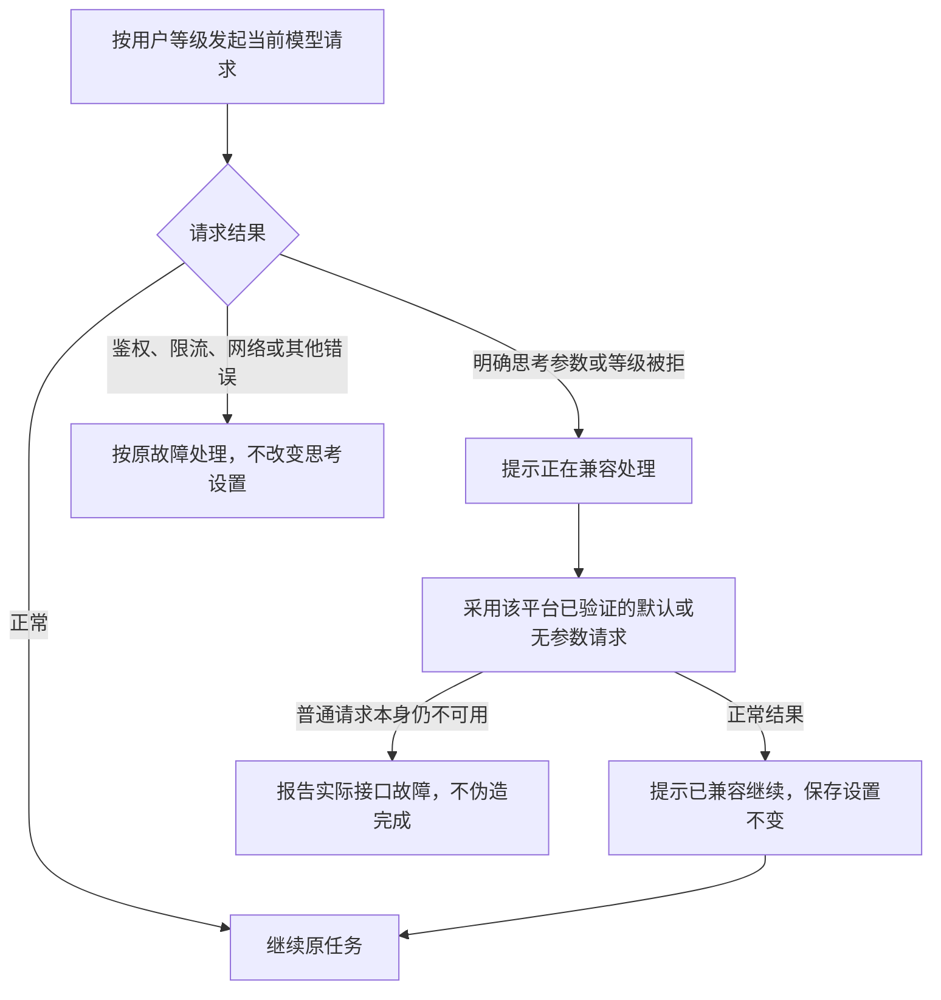

# 等级不支持时继续回答，让用户知道实际用了什么请求方式

用户选择高等级后，应按该配置请求模型；模型或网关不接受这个等级时，应用提示并采用可用的默认/兼容请求继续，不把单纯的等级不支持直接当作任务失败，也不暗中改掉用户保存的设置。

**方案编号：ANS-REASONING-LIGHT；版本：D1。** 本文由项目管理编写，当前仅是待审阅方案。用户明确要求“针对这三个平台的思考等级问题出个轻量修复方案”，并补充“**不支持的可以提示，但是不能失败**”。UI 仍只给其他负责人的修改意见，不纳入实施或测试写集。本轮不改源码、真实配置、模型、网关或依赖。

## 推荐的最小范围

1. **修正兼容继续。** 仅明确的思考参数/档位拒绝触发兼容，兼容请求要确实改变被拒参数，成功后才说完成。
2. **保存设置不变。** 临时兼容状态只属于当前活会话；修改设置、模型或端点并重建后重新采用用户配置。
3. **Pi 清空等级要恢复默认。** 恢复旧会话时不再无意继承旧 high；保留历史和原会话身份。
4. **说明请求配置与平台限制。** 保留现有档位和 SDK 映射，不虚构一个更强的“极高”，不把“参数已交 SDK”说成“服务端已采纳”。

不建立通用模型能力数据库、不扫描远程模型、不增加本地 HTTP 代理、不修改 SDK、不升级依赖、不切换用户的模型/网关/运行时，也不新增设置页面、IPC 或公共状态协议。没有选装项。

## 已经确认的事实

调查使用本机 Node 24.14.0、Pi 1.1.0、Claude Agent SDK 0.3.299 / bundled CLI 2.1.299、Codex CLI 0.162.1。源码基线 HEAD 为 `fc1a39c14e119faccf442fc8e22bbbbd978d1a04`；工作区含此前 D3 修复及其他聊天的 UI 平台化工作，本方案不接管它们。

| 平台 | 已实测的问题与正常行为 |
| --- | --- |
| Pi | low/medium/high/xhigh 预算为 2048/8192/16384/16384；清空配置后恢复旧 high 会话，实际仍发 16384，而新空会话默认 8192；普通 500 也能触发整会话删参数；当前整轮重发会重复追加用户输入 |
| Claude | 正常新会话能传出等级；部分旧模型忽略 effort，部分模型把 xhigh 钳为 high；返回空 SDK 选项仍会补默认 thinking/effort，已经复现 low 被拒后变成 high，提示却说去参 |
| Codex | 正常四档及持久恢复实际请求正确；非持久兼容重建留有旧 thread ID，导致未真正重发却提前提示成功；无关的模型错误也可能被误识别成思考参数拒绝 |

这些是实际 SDK/CLI 对 **127.0.0.1 模拟服务**发出的请求证据，不是对真实网关采纳程度的证明。没有使用真实 API 凭据或向用户网关发送诊断请求。

主要证据：[Pi 档位请求](/tmp/ans-pi-reasoning-20261021/reasoning-wire-result.json)、[Pi 恢复默认复现](/tmp/ans-pi-reasoning-resume-20261021-result.json)、[Pi 单请求兼容与工具不重放](/tmp/ans-pi-compat-request-20261021-result.json)、[Claude 模型矩阵](/tmp/ans-claude-model-20261021.json)、[Claude 真正去参并继续完成](/tmp/ans-claude-compat-adapter-20261021.json)、[Codex 四档与恢复](/tmp/ans-codex-adapter-wire.json)、[Codex 拒绝对照](/tmp/ans-codex-adapter-reject.json)、[Codex 同线程默认档继续](/tmp/ans-codex-same-thread-default.json)。临时证据不随 Git 分发，实施时由原所有者将关键场景固化为测试。

## 共同规则：先兼容继续，不擅自改档



这里的“不失败”指：**普通模型请求可用、只是思考等级/参数被拒时，必须自动尝试已验证的兼容路径并继续完成。** 不能要求用户为了这一类问题手动重新提交任务。账号无权限、连接中断、模型不存在或连普通请求都不支持，是另外的接口故障，不能靠成功提示掩盖。

- 优先依据结构化错误的 `param`、`code/type` 与确切拒绝对象；错误只剩文本时，只接受已验证的明确参数拒绝格式。不能用“出现 reasoning/effort 单词”或“HTTP >=400”推断不支持。
- 401/403、408/429、普通 5xx、运输错误、`param:model` 均不得让后续会话丢掉思考设置；保留 SDK 原有网络重试。
- 不循环试遍所有档位。Pi/Claude 一次兼容切换；Codex 最多“目录默认档”与“去显式覆盖”两个不同候选，相同候选不重复尝试。SDK 自己的传输重试不算 ANS 新增一次任务。
- 分开记录“正在尝试兼容”与“兼容请求已正常完成”。只有观察到正常结果，才保留成功兼容状态；兼容未成功不永久覆盖后续轮的请求策略。
- 状态只属于适配器实例中的当前 model/endpoint，不写 `.env`、不跨项目缓存、不自动修改选择框值。通过现有设置保存→安全重建链生效，无需热更新协议。
- 不为了兼容而重新执行已经完成的工具。Pi 使用单请求重试；Claude/Codex 的整轮重试必须在本轮尚无正常输出、尚无工具启动时进行，原生 MCP/搜索在 started 时就算已开始，不能等 completed。

## Pi：请求级兼容、恢复真正的默认

### 拒绝后重试同一请求

复用现有 `anthropicMessagesApi()`，通过其公开 `ProviderStreams.stream/streamSimple` 和 `StreamOptions.fetch` 接缝处理，不改 SDK 或另开代理。

当前请求尚未进入成功响应流，且接口明确拒绝实际发送的 `thinking` 参数时，复制该请求、只删除该参数，兼容重试一次。messages、工具结果、图片、地址、认证头和取消信号保持一致。不再调用第二次 `session.prompt(text)`。

“已尝试一次”放在一次 provider 调用的闭包内，避免 SDK 传输重试重新获得无限兼容次数。一旦本次调用确认参数不支持，其后的 SDK 自有传输重试也沿用这次去参请求，不恢复被拒字段或重复触发兼容切换。这个请求内状态与活会话状态分开：正常结果到达后才记下成功的会话兼容；整次调用失败则丢弃请求内状态，不改变后续轮策略。成功后后续请求沿用已确认的无思考参数请求，设置改变并重建后重置。

现有探针已验证：同一请求的用户输入计数保持 1；前面工具已执行一次、随后模型请求拒参数时，兼容后工具仍只执行一次，原 tool_result 留在请求中。

### 清空设置与恢复

每次新建或恢复，按以下顺序选择并显式 `setThinkingLevel`：

1. 用户显式等级；
2. `settingsManager.getModelThinkingLevel(model.provider, model.id)`；
3. `settingsManager.getDefaultThinkingLevel()`；
4. 绑定当前 Pi **1.1.0** 的命名默认常量 `medium`。

由 SDK 正常钳位模型能力，不保存为用户全局偏好。恢复时这一选择覆盖转录中的旧等级，但不清空历史。当前 SDK 没公开默认常量，采用版本绑定常量比生产里额外构造一个 SDK 会话更轻；测试必须拿同版本无历史 SDK 会话作独立对照，升级后默认改变就失败并同步。

### 保留真实预算限制

high/xhigh 继续兼容现有值，预算仍可能相同；不擅自增大预算或 maxTokens。现有非法预算保护覆盖默认与显式档位两条路径，避免清空默认后重新进入已知非法预算窗口。ANS 自己钳位或因空间不足关闭本次 thinking 时，用现有系统消息说明；不把这次请求修正写成用户配置变更，也不声称覆盖全部 SDK 内部钳位。

## Claude：真正去参后继续，不能用空选项假装去参

明确参数拒绝且仍处于可安全重试阶段时，复用现有引擎重建路径。在新的 **SDK 子进程局部 env** 中设置：

```text
CLAUDE_CODE_EFFORT_LEVEL=unset
CLAUDE_CODE_DISABLE_THINKING=1
```

同时不传显式 `effort` / `thinking` 选项。不会修改主进程环境、保存配置或其他引擎。这两个安装版 SDK 的现成控制面已通过真实请求验证：兼容请求中 thinking 与 output_config 均缺席，拒 effort 和拒 thinking 的本地接口都完成了当前轮和下一轮。

采用一次直接无参数兼容，不先试“空选项默认→仍被拒→再试无参数”的多层链。只说“本会话按兼容方式继续”，不把 SDK 的默认 high 冒充用户选择的 low，也不称为服务端已关闭推理。保留失败清理、取消与会话持久化的现有语义。SDK 合成的 API 错误帧按 message.error 识别，不误算正常模型输出；工具保护在放行/执行前标记。

`CLAUDE_CODE_DISABLE_THINKING` 是固定安装版已有环境开关，不等同于公开 `thinking:disabled`。需真实 SDK 回归保护它，不能只用假 SDK 检查 options；不修改 SDK 实现。该证据针对请求体参数拒绝，不能推导任意 beta header 或任意第三方网关均兼容。

旧模型不消费 effort、部分模型把 xhigh 钳到 high，属于能力限制。保留 SDK 既有处理和正常回答，给出说明；本轮不为旧模型补造一套 budget 映射、不按模型名称猜能力。

## Codex：先用现成默认档，必要时修复既有兼容重建

正常 low/medium/high/xhigh 及恢复逻辑保持。off 仍是不覆盖，不表示真正关闭推理；不新增一个虚假的“关闭”档。

1. **只拒绝某个等级**：当前模型可精确匹配 CLI 的 `model/list` 元数据，且其 `defaultReasoningEffort` 不同于被拒等级时，使用同一线程的 `turn/start.effort` 显式给默认档。不重建进程，不切模型；这条路径已验证保留前轮历史并继续成功。目录信息来自现有 SDK，不建立 ANS 模型库，也不把它当成自定义网关的能力保证。
2. **effort 字段本身被拒、目录无匹配或默认档也被明确拒绝**：进入现有“不注入 effort 覆盖”的兼容重建。保存旧 resumable ID 后，清空会话级 nativeId 与轮级 ID；只有 resume/start 成功才采用返回 ID。同步对外 `nativeSessionId`，避免核心继续保存旧 ID。持久会话优先恢复原历史；非持久首轮重新建立临时线程。
3. **提示按真实阶段发送**：重建/重试前提示“正在兼容”，完成后才提示“已按默认请求配置完成”。不能在还没有第二次 HTTP 请求时就宣称已执行。
4. **失败不留下原生默认档残留**：尝试前保存最近一次已确认的请求策略；兼容轮只有最终 completed 才提交新策略。失败、取消或超时后，下一普通轮开始前必须恢复/显式重施原策略，不能仅清空 ANS 布尔标记却继续使用原生线程残留的默认档。可复用下一轮显式 effort 或已有同线程设置能力，`effort:null` 不能清除覆盖。去覆盖重建失败后也必须真正恢复原策略；恢复未确认时不复用状态不明的引擎实例。

只允许当前轮尚无正常输出、尚无工具启动时重试原输入；补齐原生 MCP/webSearch started 的保护，保留 ANS handler 执行前标记。same-thread 重试仍可能保留失败轮的用户消息，不宣称原生转录绝无重复；不得重复工具、重复用户可见输入回声或发出两次最终结算。

两项边界必须公开：

- 当前 CLI 即使不覆盖 effort，仍可能发 `reasoning:{summary:"auto"}`；`summary:none` 仍有空对象。**网关拒绝整个 reasoning 对象**是当前 CLI 的基础协议兼容限制，尚无经验证的轻量标量开关能完全移除；本轮不伪造成功、不另建请求代理或模型目录覆盖。
- 非持久多轮会话到后续轮才需要去覆盖重建时，不能保证原历史完整恢复；已有输出/工具启动后也不能整轮回放。本轮不做自动丢历史或重复工具的“强行成功”。这些情况保留现有故障恢复渠道并明确原因；不能描述成所有中途失败均可透明续跑。

上述边界不是让单纯的等级不支持直接失败。对已验证的“普通接口可用、等级或 effort 被拒”的安全重试场景，自动继续完成是必验项；超出该范围的网关/中途恢复问题不得混称为思考等级修复已覆盖。

## 配置与兼容说明：复用后台消息，UI只交意见

三适配器在**活动 prompt 内**发出必要的普通 `message`，使用既有 `detail.source:"system"`，小型 reasonCode/state 标识配置、尝试与已兼容。不能用 `source:"reasoning"` 冒充模型思考事实。构造阶段不提前发消息，避免核心丢弃非活动轮次事件。

示例：

- “本会话请求的思考等级：high；服务端实际采纳未验证。”
- “接口拒绝了本次思考参数，正在按兼容方式继续；已保存设置不变。”
- “本会话已使用兼容请求完成，后续沿用该方式；修改设置后重建会话会重新尝试。”

核心所有者已核对现有路径：普通消息正文放在 summary，在活动轮内可转发/回放；system 已被助手正文反馈采集排除。reasonCode/state 只作附加事实，不要求当前UI专门解析或提供新样式。使用已有 system 来源，使这些提示不进入助手正文反馈镜像；不新增 IPC、前端 schema 或日志敏感字段，不输出 API key、完整请求或原始错误正文。系统消息和诊断分别表示事实，不以固定思考秒数判断档位是否生效。

### 交给 UI 负责人的意见（本轮不改）

| 建议 | 目的 |
| --- | --- |
| 区分“保存的等级”“当前会话请求方式”“已兼容” | 选择框仍是 high 时，用户能理解为什么当前会话按兼容方式回答 |
| 将“已生效”改成“已配置/已请求”，实际采纳未知则如实说 | 避免把保存成功当作服务端确认 |
| Pi 的极高提示当前预算与高相同；Claude 提示模型可能限档；Codex 不把默认当关闭 | 不展示虚假的跨平台等价档位 |
| 沿用“下一会话/当前轮后应用”提示，兼容成功不做失败态 | 不让用户重复提交同一任务 |

这些是意见交接，不授权修改 `app/renderer/`、UI测试、布局或平台化工作。

## 角色与候选文件范围

| 固定角色 | 最小候选范围 |
| --- | --- |
| Pi适配器 | `src/common/pi-adapter/real-adapter.ts`；`test/pi-adapter/reasoning-effort.test.ts`；现有 `reasoning-wire.probe.ts` 的恢复/兼容证据；相关本角色说明 |
| Claude适配器 | `src/provider/claude/session.ts`；`test/claude-adapter/session.test.ts`、`reasoning-loopback.probe.ts`；相关本角色说明 |
| Codex适配器 | `src/provider/codex/session.ts`、`src/common/codex-adapter/protocol.ts`；如兼容覆盖编码需要，改同角色 `config.ts` 中相应小函数；`test/codex-adapter/reasoning.test.ts`、必要 session 测试；拟新增同目录 `reasoning-loopback.probe.ts` |
| 运行时核心 | `src/model/runtime.ts`、`src/service/runtime/session.ts` 中“未设零行为变化”的相关注释与契约说明；值域、字段形状及 env 归一行为保持；现有 reasoning-effort 契约测试 |
| 测试 | `test/测试/g5-reasoning-verify/c-claude.test.ts`、`d-codex.test.ts`、`e-pi.test.ts`，必要新增 `test/测试/g5-reasoning-verify/compatibility-loopback.test.ts`；独立报告与原始证据 |
| 项目管理 | 本跨角色方案、评审与交付记录；不代写各适配器实现 |
| 独立验收 | 自身标准与报告，核对同一候选；不实施或代改测试 |

以各角色实际 Section 1 与最终任务精确写集为准。Claude/Codex 的 Markdown 边界仍只转引 YAML，实施前由团队组建按已登记范围补齐表达，保留产品 YAML 格式、不扩大实际权限、不进行全仓治理迁移。当前只准备方案，不改角色定义。

不要求改 `package.json`、锁文件、真实 `.env`、公共事件结构、共享日志白名单、前端或主进程业务接线。若现有 system 来源确不能满足正确归类，再由原所有者提出最小差额，不能顺手扩范围。

## 如何验证“提示但继续”

1. 先固定模型请求正常成功的本地假网关，再让它只拒指定思考等级/字段。自动兼容后**同一用户任务必须 completed**，不得只断言“发过提示”。保存设置保持不变。
2. Pi 请求级重试维持同一 user 消息和已有 tool_result；工具计数仍为1；普通500/鉴权/限流不会让后续参数消失。兼容失败不能无限追加请求。
3. Pi high→清空→恢复，与同 SDK 新会话默认一致且保留历史；默认与显式档都经过预算合法性检查；high/xhigh同预算如实记录。
4. Claude 真 SDK 验证兼容请求体确实没有 thinking/output_config；low被拒后不能偷偷变成high还声称去参；当前轮与下一轮继续成功。不能只测假SDK options。
5. Codex 四档和恢复仍原样出站；同线程默认档继续成功；持久/非持久首轮去覆盖后真正产生第二次请求并完成；新native ID保存正确；unknown model等负例不误触发。
6. 兼容重试前后只结算一次；取消/超时不被重试覆盖；原生工具started和已输出情形不整轮重放。SDK自有重试单独计数，不把“HTTP恰一次”当全平台规则。
7. 会话设置改变后重建，兼容记忆随旧实例清除；未设/默认/off含义分别核对。Codex须真实捕获 high→默认兼容轮500失败/取消/超时→下一普通轮仍high；只有兼容轮completed后下一轮才沿用默认，不能只看内部变量。Pi兼容请求遇传输重试时继续去参，整次调用失败后下一轮仍按原策略。消息在活动轮内可见，不伪装思考正文、不进入助手反馈镜像。
8. 全量类型检查与受影响测试回归；原有降级用例按新具体行为改写，保留普通映射/推理事实/失败与取消断言。旧模型限档、Codex整个reasoning对象拒绝等明确限制要有真实对照，不伪造通过。

三平台使用各自真实已安装 SDK/CLI 和隔离临时目录，端点只连本地模拟服务；无需真实模型额度或修改用户配置。SDK版本、命令、原始请求字段摘要、输入/工具次数、当前源码hash写入证据。探针只证明请求和恢复行为，不证明所有第三方服务端都会执行某个等级。

## 项目管理评审与当前状态

推荐保留上述**有限、确实有效的兼容继续**，不采用“参数拒绝就直接失败”的前一候选。Pi/Claude已经提供真实兼容请求继续完成的证据；Codex默认档和安全去覆盖路径有证据，基础协议与中途恢复边界须保留。

本方案没有把 SDK 模型限档改造成新功能，也没有用改变保存设置掩盖兼容问题。主要代价是明确拒绝时的一到两次兼容尝试，以及现有引擎必要的重建耗时；正常路径不增加外部探测请求。

**PM评审：recommend approval，建议按本文明确范围采用。** Claude同版只读评审建议通过；Pi建议通过并要求保留请求内兼容状态跨SDK传输重试，已补入；Codex有条件采用，要求失败/取消/超时后真正恢复原生请求策略，已补入正文与验收。核心已确认既有system消息可转发、回放且不进入助手反馈，无需改app/desktop或公共schema。PM是本跨角色方案作者，不将这些意见冒充独立交付验收。

当前没有实施代码、修改配置、部署或验证修复完成。客户审阅确认本版并授意实施后，按角色和依赖顺序安排实现，再交测试及独立验收；Codex协议与中途恢复边界按本文单列，不能在交付时隐去。
