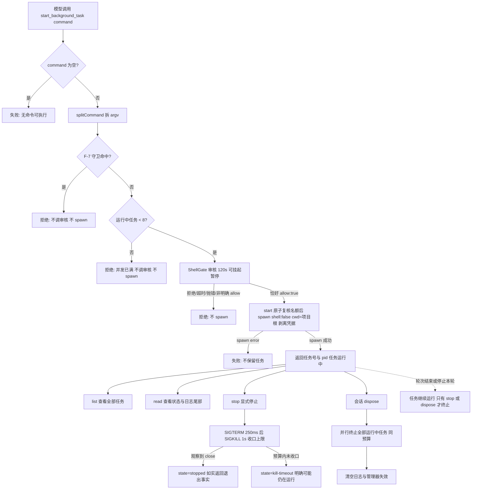
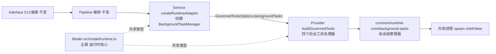

# 后台任务：启动开发服务器后立即把回合还给模型

**状态：设计已获客户确认（accepted）、未实施、未测试。** 客户于 2026-10-22 确认按 B1–B4 实施，可选项 O1–O5 未授权。本文只说明拟采用的方案和代价，不代表任何代码已经改动，也不代表测试已经跑过。客户流程要求先由项目管理出方案，su 审核后再派发具体角色开发；本轮只写这份设计，未改应用代码、测试、配置或其他角色文件，未提交 Git。

**独立验收标准（A1）**：[后台任务 B1–B4 独立验收标准](../../../独立验收/docs/design/2026-10-22_design_background-tasks-acceptance.md)。

## 一、用户场景与目标结果

客户要的是这样一个具体场景：

1. 客户让角色开发一个前端项目。模型判断需要启动开发服务器，于是调用后台启动工具：`start_background_task("npm run dev")`。
2. **工具立刻返回**：`已启动任务 bg-1（pid 12345，运行中）`。模型不阻塞，继续写代码、跑测试、改页面。
3. 过一会儿模型想确认服务器是否正常，调用 `read_background_task("bg-1")`，拿到最近几十行 stdout/stderr 和当前状态（运行中 / 已退出 / 已停止）。
4. 发现端口冲突或改完配置需要重启，调用 `stop_background_task("bg-1")`；工具在有限的终止预算内收掉整棵进程树，并如实告诉模型“已停止”或“可能仍在运行”。
5. 客户关闭这个角色会话时，仍在运行的后台任务自动清理，不把开发服务器留在后台。

**今天的实际体验**：模型执行 `npm run dev` 后，工具调用一直等到进程结束；开发服务器不会自己结束，于是整个回合被占住。默认 10 分钟的命令级时限一到，进程被终止，工具返回“超时已终止”，服务器也没了。模型既没法在服务器运行期间继续工作，也没法读日志或主动停止。

**失败时用户会看到什么**：

- 命令本身启动失败（例如程序不存在）→ 工具明确报失败，不产生任务。
- 审核拒绝、审核超时或审核通道异常 → 工具明确报“未执行”，**一个进程都不会启动**。
- 停止时进程树在预算内没有收口 → 工具明确说“可能仍在运行，请如实告知客户”，绝不谎称已停止。
- 会话关闭后再查旧任务编号 → 明确返回“未知任务”，不假装任务还活着。

**本方案不承诺**：任务跨会话或跨应用重启继续存在；应用崩溃、被强杀或断电后进程一定被清理（见风险节）。

## 二、现状与根因

| 事实 | 代码位置（截至 2026-10-22） |
| --- | --- |
| 唯一 shell 入口是 `run_shell`，参数只有 `command`；工具说明明确“不经 shell、多条命令分开调用” | `src/provider/runtime/schema.ts:19-31`，工具名常量 `src/provider/runtime/tools.ts:84-85` |
| `run_shell` 的处理顺序是：取命令 → `splitCommand` → F-7 守卫 → `ShellGate` 审核 → 仅当恰好 `allow:true` 才 spawn | `src/provider/runtime/tools.ts:821-910` |
| 执行函数 `runShell` 要等子进程 `close` 事件才返回；进程不结束，工具调用就不返回 | `src/provider/runtime/tools.ts:733-810`（`child.on("close", ...)` 在 801-808 行） |
| F-7 守卫把 `&`、`&&`、`|`、`;`、重定向、变量展开等按“独立操作符/内嵌操作符/展开语法”拒绝，并提示“拆分为多条命令或写成脚本文件” | `src/provider/runtime/tools.ts:577-646`；`npm run dev &` 会在调审核之前被拒，模型无法自行后台化 |
| 命令级执行时限默认 600000ms（10 分钟），到期终止命令；审核时限默认 120000ms | `src/common/runtime-core/timeout.ts:38`、`:51`；超时返回逻辑见 `tools.ts:877-897` |
| 没有后台任务设施：`src/`、`test/` 中没有可复用的后台进程/任务管理模块 | 本轮 `grep background` 仅命中桌面派发的既有 `metadata.background`，与本需求无关 |
| 三个适配器都按注入的 `options.tools` 通用暴露工具：Claude/Codex 直接遍历 `options.tools`；Pi 生产入口走 `"tools" in adapterInput` 分支，原样交给真实适配器 | `src/provider/claude/session.ts:337-346`、`src/provider/codex/session.ts:373/501/602`、`src/provider/pi/session.ts:382-388`、`src/common/pi-adapter/real-adapter.ts:1328` |
| 会话已有 `dispose()` 收口点，可挂清理 | `src/service/runtime/session.ts:362-371` |
| 诊断落盘有固定字段白名单，`taskId` 不在其中（会被静默丢弃） | `src/common/shared/diagnostics.ts:11-18` |
| 项目当前没有 `.ans/project.json`，也没有 `docs/scheduling/` | 本轮 `ls` 核实 |

**根因不是模型“不愿意后台运行”**，而是三件事叠在一起：

1. 唯一的 shell 工具语义是“前台执行并等待结束”；
2. F-7 守卫明确拒绝 `&` 等 shell 后台语法（这是有意的：执行层不经 shell，`&` 只会被当成普通参数，不会真的后台化）；
3. 命令级时限只会“到点杀进程”，没有任何“把进程留在后台并继续管理”的能力。

所以开发服务器这类长进程只有两种结局：占住回合直到被杀，或者根本启动不了。

## 三、推荐方案

一句话：**在运行时核心里增加一个“会话级后台任务管理器”，并向模型暴露四个工具；启动工具复用 `run_shell` 同一条审核链，任务只在当前角色会话内存在，会话关闭时统一清理。**

### 3.1 工具面（四个工具）

工具名沿用项目现有“动词_名词”风格。下面是语义约定；最终 JSON Schema 与描述写在 `src/provider/runtime/schema.ts`，本文不复制第二份会过期的 schema。

| 工具 | 参数 | 成功返回 | 失败语义 |
| --- | --- | --- | --- |
| `start_background_task` | `command: string`（必填；与 `run_shell` 相同的“一个程序 + 参数”口径） | 实际 spawn 成功后返回任务编号（如 `bg-1`）、pid、状态 `running`；`message` 说明之后可用哪些工具操作它 | 空命令 / F-7 守卫命中 / 审核拒绝、超时或异常 / 并发已满 / spawn 失败 → `ok:false`，**不产生任务、不 spawn**（spawn 失败不保留半成品任务） |
| `list_background_tasks` | 无 | 当前会话保留的全部任务摘要：任务号、状态、pid、启动时间、命令摘要（截断）、退出码；空列表如实说“没有后台任务” | 无失败分支；不猜测已过期任务 |
| `read_background_task` | `taskId: string`（必填）；`stream?: "stdout" \| "stderr" \| "both"`（默认 `both`）；`tailLines?: number`（默认 40，上限 200） | 返回该任务状态快照 + 指定流的尾部若干行；缓冲区溢出时明确标 `truncated` | 未知/已过期任务号 → 明确“未知任务（可能来自其他会话或已过期）——不要假设它运行过”；参数非法 → 明确报错 |
| `stop_background_task` | `taskId: string`（必填）；`force?: boolean`（默认 `false`：先 SIGTERM 再升级） | 观察到底层 `close` 后返回 `stopped` 与退出事实；任务本来已结束 → 如实返回原状态与退出码 | 未知任务号 → 明确报错；终止预算内未收口 → `kill-timeout`，明确“可能仍在运行，请如实告知客户” |

**注册条件（注入才注册）**：四个工具只在“注入了 `ShellGate`（与 `run_shell` 同一判据）+ Service 创建了后台任务管理器”时一起注册。没有 `ShellGate` 的会话连 `run_shell` 都没有，也不会有后台任务工具。判断会话（`shellJudge` / `governanceJudge`）走的是 `buildShellJudgeTools` / `buildGovernanceJudgeTools`，**结构性不经过** `buildGovernedTools`，所以判断会话天然看不到这些工具，不需要额外开关。

**工具显示规则**：`start_background_task` 使用现有的 `core-command-v1` 输入规则（和 `run_shell` 一样把命令作为展示目标、走同一套凭据脱敏）；`list` / `read` / `stop` 使用 `none`（它们的目标是任务号，不是路径或命令）。这样桌面聊天行不需要新渲染逻辑就能显示启动命令。

### 3.2 启动的审核顺序（与 `run_shell` 同源）

启动工具必须严格按下面顺序执行，任何一步不通过都**不 spawn**：

1. 取 `command`；空或纯空白 → 失败。
2. 用**同一个** `splitCommand` 拆成 argv（不做变量展开、不解释引号外的元字符）。
3. 用**同一个** `detectUnsupportedShellSyntax` 做 F-7 守卫。`npm run dev &`、`cmd1 && cmd2`、`echo $(x)` 等会在审核之前被拒，诊断事件沿用 `shell.guard.blocked`。这一步不调用审核、不创建任务。
4. **并发快速预检**：检查管理器当前运行中任务数是否已达上限（默认 8）。已满 → 直接失败，**不调审核、不弹审批、不 spawn**，诊断 `background.limit`。这一步放在 F-7 之后、`ShellGate` 之前，避免为一个注定不能启动的命令打扰客户或审读者；真正占用名额时 `start` 还会原子复核（见 3.3）。
5. 调**同一个** `shellGate({ command, argv, cwd, toolCallId })`，用与 `run_shell` 相同的审核时限、`raceAbort` 与交互挂起闸；只有恰好 `allow:true` 才继续。拒绝、`undefined`、抛错、超时 → 返回“未执行”，零 spawn。
6. 用**同一个** `buildShellEnv(process.env, extraCredentialEnvVars)` 构造剥离凭据后的环境；cwd 固定为会话的 `shellCwd`（默认项目根），不接受调用方指定。
7. 调管理器的 `start(...)`，这是**唯一**的 spawn 入口。spawn 参数与 `run_shell` 一致：`shell:false`、`windowsHide:true`、POSIX 下 `detached:true` 使子进程成为进程组组长，便于整组终止。
8. 等在 `spawn` 事件或 `error` 事件上收口（设一个很短的等待上界，例如 2 秒）：拿到 pid 才返回任务编号；`error` 则返回失败并释放名额。这样“返回任务编号”与“进程真的启动了”是同一个事实，不会出现“说启动了其实没有”的任务。

**“审核与 spawn 同址、拒绝零 spawn”的结构性保证**：管理器的 `start` 只允许被这一个工具处理器调用；处理器在审核结果不是明确 `allow:true` 时根本不会走到 `start`；管理器不暴露任何“直接启动”的公共入口。与 `run_shell` 的现有保证同型（`tools.ts:813-820` 的注释与实现）。

**审核请求形状不变**：`ShellReviewRequest` 仍是 `{ command, argv, cwd, toolCallId }`，不新增字段。好处是编排的 `ShellGate`、桌面操作者通道、审读会话都不需要改；代价是审核卡/审计里**不会自动标注“这是后台任务”**，只能从工具名与聊天行看出。若客户要求审核卡明确标注，列为可选项 O4（需要跨角色改动）。

### 3.3 会话级管理器

**位置与归属**：实现放 `src/common/runtime-core/background-tasks.ts`（运行时核心私有辅助目录内），由 Service 在 `createRuntimeAdapter` 的 `providerFor` 中为每个角色会话创建一个实例，经 `GovernedToolsOptions.backgroundTasks` 注入给 `buildGovernedTools`。管理器只持有内存状态与子进程句柄，不写盘、不读盘。

**生命周期**：

- 创建：`providerFor` 里、`buildGovernedTools` 之前；**只在走 `buildGovernedTools` 的普通受治理会话分支创建**，且只有注入了 `ShellGate` 才创建（与工具注册同判据）。判断会话走 `buildShellJudgeTools` / `buildGovernanceJudgeTools`，不创建管理器。
- 使用：`start` / `list` / `read` / `stop` 全部作用于本会话自己的任务；角色 A 的会话看不到角色 B 的任务。
- 清理：绑定会话的 `dispose()` 中调用管理器的 `dispose()`；管理器标记“已关闭”，拒绝之后任何 `start`（包括审核通过后才发现会话已关闭的竞态），并并行终止所有仍在运行的任务。`dispose` 幂等。
- 不持久化：任务表、日志缓冲、pid 都只在内存；会话关闭或应用重启后不存在。

**状态机**：`running → exited`（自然退出）/ `stopped`（被 stop 或 dispose 终止并观察到 close）/ `failed`（启动后运行错误）/ `kill-timeout`（终止预算内未观察到 close）。状态只由真实事件驱动，不靠猜测。

**上限（设计默认值，实现后可按客户意见调整）**：

| 项 | 默认值 | 理由 |
| --- | --- | --- |
| 同时运行任务数 | 8 | 开发服务器通常 1–3 个；上限防止一个模型疯狂起进程 |
| 保留任务数 | 32 | 允许回看最近任务；超出后按“最老的已结束任务优先”淘汰，**运行中的任务永不淘汰** |
| 每个任务每路输出缓冲 | 256 KiB | 与 `run_shell` 的单路 1 MiB 上限同量级但更保守；8 个任务最多约 4 MiB |
| `read` 默认/最大行数 | 40 / 200 | 与 `session_tail` 的默认 40、上限 200 保持一致 |
| 终止预算 | SIGTERM → 250ms → SIGKILL → 1s 收口上限 | 与 `run_shell` 现有 F-1 终止预算一致；dispose 时并行终止所有任务，总时长仍有界 |

**并发检查的位置**：在 F-7 守卫之后、`ShellGate` 审核之前先做一次快速预检——运行中任务已达 8 个就直接失败，不调审核、不弹审批、不 spawn；`start` 真正启动前再原子复核并占用名额，保证并行工具调用也不会突破上限。这是 su 审核确认的实施取舍，不改变其他设计。

**日志缓冲**：每路一个字节环形缓冲，记录已丢弃字节数；读取时按行取尾部，并用现有的 UTF-8 安全截断（`utf8Prefix`，`src/common/runtime-core/tool-display.ts`）避免切坏多字节字符。输出超过缓冲时，读取结果明确标 `truncated`，不假装日志完整。

**进程树终止**：把 `tools.ts` 里现有的私有 `killProcessTree` **逐字搬迁**到 `src/common/runtime-core/process-tree.ts`，`run_shell` 与后台管理器都从那里导入。平台分支、taskkill 回退、异常不抛出等行为完全不变（见第六节的回归方式）。

### 3.4 中止诚实性

这是本方案最容易做错的地方，规则必须写死：

- **轮次结束或“停止本轮”不杀后台任务。** 这正是功能的意义：启动开发服务器后，回合结束服务器还在。工具描述和设计文档都要明确这一点，避免模型误以为“停本轮 = 停服务器”。
- **停止只由两个动作触发**：模型显式调用 `stop_background_task`，或会话 `dispose`（关闭会话、桌面 LRU 淘汰、应用正常退出时如有调用）。
- **stop 的结果必须等到底层 `close` 才算 `stopped`。** 终止预算内没观察到 close → 返回 `kill-timeout` 并明确“可能仍在运行”，与 `run_shell` 超时清理失败的文案纪律一致（`tools.ts:877-897`）。
- **对已结束任务调用 stop 不谎报“刚刚停止”**：如实返回它早已结束、退出码是多少。
- **会话关闭后再 `start`**：明确失败“会话已关闭，未启动”，即使审核恰好在此前通过。
- **重启后 `list` 为空、旧任务号未知**：明确说“未知任务”，不假装任务仍活着或日志还在。

### 3.5 诊断事件

沿用现有诊断事件风格（`record(event, fields)`，字段必须在白名单内）。拟新增/复用：

| 事件 | 字段（均已在白名单） | 说明 |
| --- | --- | --- |
| `shell.guard.blocked` | `turnId`、`toolCallId`、`toolName`、`reasonCode` | 复用：启动命令被 F-7 守卫拒绝 |
| `shell.review.start` / `shell.review.end` | `turnId`、`toolCallId`、`toolName`、`decision`、`durationMs` | 复用：与 `run_shell` 同一条审核链，便于统一观测 |
| `background.start` | `turnId`、`toolCallId`、`toolName`、`pid`、`state` | spawn 成功后记录 |
| `background.exit` | `pid`、`state`、`exitCode`、`signal`、`durationMs` | 自然退出/失败时记录 |
| `background.stop` | `pid`、`state`、`durationMs` | stop 观察到 close 时记录 |
| `background.stop.timeout` | `pid`、`state`、`durationMs` | 终止预算耗尽时记录 |
| `background.limit` | `reasonCode`、`count` | 并发上限拒绝启动时记录 |

**已知限制**：`taskId` 不在 `diagnostics.ts` 的字段白名单里，生产落盘会被静默丢弃。本轮设计**不依赖**诊断里的 taskId（任务号只在工具结果与聊天行出现）。如果客户希望诊断日志也能按任务号检索，需要项目管理在 `src/common/shared/diagnostics.ts`（项目管理属主）白名单增列 `taskId`；这属于另一处小改动，需在实施前明确，不能由运行时核心自行改共享文件。

### 3.6 实际步骤与分支

下面这张图只画本设计打算实现的分支（未实施的方案流程）：

## 四、关键选择与真实比较过的替代方案

| 方案 | 为什么没有选 | 它的真实代价 |
| --- | --- | --- |
| A. 给 `run_shell` 加 `background: true` 参数 | 会把“审核、执行、结果”三种语义塞进同一个已受审计的工具：后台模式没有“命令结束”这一刻，`execution` 里的退出码/输出事实在返回时还不存在；10 分钟“不可禁用”的命令级兜底也要为后台模式开口子，等于修改一个客户已批准的安全语义。工具调用形态也会变得难以测试和审计 | 需要在一个 2400 行的安全关键文件里分叉两条执行路径，现有 `shell-exec-timeout` 等回归全部要重判；仍然需要另建管理器，省不下工作 |
| B. 应用级全局管理器（桌面窗口/应用进程持有任务） | 解决的是“跨会话、跨重启仍然存在”的另一个需求；本需求只要求“会话内不阻塞回合、会话关闭清理”。全局管理器还要新增 IPC、桌面 UI、CLI 无法复用，且跨出了运行时核心边界，见不到客户对桌面改动的授权 | 跨桌面窗口/桌面UI/编排多个角色；权限、生命周期、审计边界都更复杂；本轮无法在现有角色边界内完成 |
| C. 用 shell 语法后台化（`&`、`nohup`、`cmd /c start`） | F-7 守卫的存在前提就是“执行层不经 shell”：`&` 只会作为普通参数传给程序，不会真的后台化；`sh -c` 属于硬拒形态。即便绕过，也拿不到日志、停止能力与进程树清理，只会留下模型和客户都看不见的孤儿进程 | 等于放弃审核链与可观测性；`nohup npm run dev` 仍是前台阻塞，`&` 被拒，Windows/POSIX 语法不统一 |
| D. 启动后 `detached + unref` 直接撒手，不做管理器 | 实现最省事，但没有任务号、日志、列表、停止、清理，完全不满足客户场景；进程残留风险最高 | 后续仍要补管理器，属于返工 |

**选当前方案的理由**：不动 `run_shell` 的任何既有行为；四个工具各自语义单一；启动复用同一条审核链，安全边界不扩大；管理器只在会话内存在，生命周期与 `RoleSession.dispose` 对齐，最容易证明“会话关闭清理”。

## 五、契约与代码归属

### 5.1 逐文件改动与归属

| 文件 | 归属角色 | 改动 | 说明 |
| --- | --- | --- | --- |
| `src/model/runtime.ts` | 运行时核心 | 增加中立类型与注入项 | `BackgroundTaskState` / 快照 / 日志读取结果 / `BackgroundTaskCapability`；`GovernedToolsOptions.backgroundTasks`；`ToolResult` 可选结构化事实（任务号/状态/pid/退出码） |
| `src/provider/runtime/tools.ts` | 运行时核心 | 增加四个工具处理器、注册条件、显示规则 | 启动工具复用同文件的 `splitCommand`、F-7 守卫、`buildShellEnv`；唯一 spawn 入口是管理器 `start` |
| `src/provider/runtime/schema.ts` | 运行时核心 | 增加四个工具的 schema 与描述 | 描述中写明“任务只属于当前会话、不跨重启” |
| `src/common/runtime-core/background-tasks.ts` | 运行时核心 | 新增管理器实现 | 状态机、并发/保留上限、环形日志缓冲、终止与清理 |
| `src/common/runtime-core/process-tree.ts` | 运行时核心 | 新增（从 `tools.ts` 逐字搬迁 `killProcessTree`） | `run_shell` 与后台管理器共用同一终止实现 |
| `src/service/runtime/session.ts` | 运行时核心 | 创建/注入/释放管理器 | `providerFor` 中创建；`RuntimeSessionOptions` 的 `Omit` 列表排除 `backgroundTasks`，防止外部调用方自行注入；`dispose` 中清理 |
| `test/runtime-core/background-tasks.test.ts` | 运行时核心 | 新增单元/契约测试 | 管理器生命周期、上限、日志、清理 |
| `test/runtime-core/background-review.test.ts` | 运行时核心 | 新增审核同源测试 | 守卫、拒绝零 spawn、凭据剥离、cwd |
| `test/runtime-core/process-tree.test.ts`（或并入现有 shell 测试） | 运行时核心 | 新增/扩展 | 搬迁后的终止行为逐字不变 |
| `角色卡/运行时核心/docs/feature/runtime-core.md` 与 `docs/change/` | 运行时核心 | 实施后更新当前功能与变更记录 | 功能文档写实际行为，不提前把计划写成现状 |
| `test/测试/` | 测试 | 实施后跨角色/真实入口验证 | 由测试角色独立执行，不修产品代码 |

### 5.2 边界对照（证明本轮必需改动都在运行时核心边界内）

`角色卡/运行时核心/boundary.md` Section 1 明确列出：

- `src/model/runtime.ts`（中立运行时类型与能力契约）
- `src/service/runtime/session.ts`（运行时选择、公共工具装配与提供方接入入口）
- `src/provider/runtime/tools.ts`（公共受治理工具执行）
- `src/provider/runtime/schema.ts`（公共工具 schema 与描述）
- 目录 `src/common/runtime-core/`（本角色私有辅助实现）
- 目录 `test/runtime-core/`（本角色单元测试与契约夹具）
- `角色卡/运行时核心/docs/feature/` 与 `docs/change/`

B1–B4 所需文件全部落在上述条目内，**不需要修改任何边界 Section 1**。新增文件位于已授权的目录内，按技能规则在已批准任务中可以直接增删，不必逐文件改边界。

### 5.3 范围缺口（不在运行时核心边界内，不假设授权）

- **O1 桌面任务面板**需要 `app/desktop/`（桌面窗口）、`app/preload.cjs`、`app/renderer/`（桌面UI）与新的 IPC；这些属于其他角色，须客户显式选择并另派任务。
- **O4 审核卡标注“后台任务”**需要给 `ShellReviewRequest` 增加可选字段（Model，运行时核心可改），并同步编排 `src/common/编排/shell-gate.ts` 与桌面 `app/desktop/operator-channel.ts`（其他角色），属于跨角色契约变更。
- **O5 应用退出兜底**如果做在桌面窗口（退出前 dispose 所有会话），属于桌面窗口；如果做在运行时核心的 `process.on("exit")` 兜底，则在本边界内，但只能尽力而为（见风险节）。

以上缺口只列为可选项/后续事项，本设计不把它们写成已获授权。

## 六、五层调用方向与单一主属

- **Service 创建、Provider 使用、Model 共享**：管理器在 Service 的 `providerFor` 中构造，经 `GovernedToolsOptions` 注入；Provider 工具只调用注入的能力，不自行构造管理器；中立类型只在 `src/model/runtime.ts` 定义一次，三个适配器只读引用 `ToolDefinition` / `ToolResult`，不新增类型。
- **适配器零改动**：Claude/Codex 遍历 `options.tools` 注册；Pi 生产入口把 `tools` 原样交给真实适配器（`real-adapter.ts:1328` 遍历注册）。四个新工具会像现有工具一样自动出现，不需要改任何一个适配器文件。
- **`killProcessTree` 搬迁**：从 `src/provider/runtime/tools.ts:702-719` 逐字搬到 `src/common/runtime-core/process-tree.ts`，导出同名函数；`run_shell` 改为导入。要求逐字等价：Windows 的 `taskkill /pid <pid> /T /F` 与回退 `child.kill`、POSIX 的进程组 `-pid` 与回退、任何失败都不抛出，全部保持。回归方式：先跑现有 `test/runtime-core/shell-exec-timeout.test.ts`（F-1-a / F-1-opt1 / F-1-b 的终止与文案断言）、`shell-guard.test.ts`、`tools.test.ts`，再跑新增的后台任务测试与 `npm run typecheck`；搬迁前后对同一组测试的结果必须一致。
- **common 不反向调用运行层**：管理器只依赖 Node 标准库与 Model 类型（`import type`），不 import Service/Provider 的实现，不 import 其他角色的私有 `common/`。

## 七、兼容性与风险

**三个适配器无需改动的原因**：它们不关心工具是什么，只消费注入的 `ToolDefinition[]` 与 `handler`。已在 Claude/Codex/Pi 三条路径核实（见第二节表格）。因此本方案不会让任何适配器的既有证据失效；但按规则，Service 的公共装配变化仍需要各适配器回归测试重跑（它们消费同一批工具）。

**回放/持久化边界**：任务的启动/读取/停止仍是普通工具调用，会像其他工具事件一样进入 ANS 回放；但**任务表本身不持久化**。重启后 `list_background_tasks` 返回空、旧任务号返回未知；日志缓冲也随会话消失。模型与用户都不能把回放里的“曾经启动过”理解为“现在还在运行”。

**会话淘汰/应用退出的清理语义**：

- 桌面显式关闭会话或 LRU 淘汰会话时会调用 `handle.dispose()`（`app/desktop/session.ts` 的释放路径），管理器随之终止任务。
- **应用退出目前只 flush 诊断，不逐个 dispose 会话**（`app/main.ts:891-899` 的 `before-quit`）。因此应用正常退出时，运行中的后台任务**可能不会被清理**。这是本方案已知的残留风险；要消除它，需要桌面窗口在退出前 dispose 所有会话（O5，跨角色），或在运行时核心加一个尽力而为的进程退出钩子（O5，本边界内，但 Windows 上只能保证直接子进程）。本轮不默认实现，需客户选择。

**进程残留风险**：

- POSIX 用 `detached:true` 建进程组并按 `-pid` 终止；如果程序自己 `setsid`/双 fork 脱离进程组，会逃出清理。Windows 依赖 `taskkill /T /F`；taskkill 不可用时只回退终止直接子进程，孙进程可能残留。
- 应用崩溃、断电、被任务管理器强杀时，管理器的 `dispose` 不会执行，后台进程可能存活。
- 这些风险与现有 `run_shell` 的终止风险同源，不因本方案新增，但后台任务存活时间更长，暴露面更大；诊断与工具文案必须如实说明。

**安全边界**：启动走**同一个** `ShellGate`（同一套规则/判断/操作者确认）、**同一个** `buildShellEnv` 凭据剥离、**同一个** cwd（会话 `shellCwd`，默认项目根）、**同一个** F-7 守卫与 `shell:false`。没有新增 shell 解释、没有新增写入通道、没有放宽任何审核。新增的风险点只有一个：**后台任务不受 10 分钟命令级时限约束**——这正是功能本身。缓解措施是并发上限（8）、显式停止、会话关闭清理。日志里可能包含程序自己打印的敏感信息：工具结果对模型可见的程度与 `run_shell` 相同；用户界面展示仍走现有的 `tool-display` 脱敏投影。

**资源与并发**：运行任务数、保留任务数、每路日志字节都有上限；并发预检在 F-7 之后、`ShellGate` 之前进行，`start` 时再原子复核并占用名额，多个并行工具调用不会一起突破上限，也不会为必然失败的启动弹审批。

**Windows 语义**：与 `run_shell` 相同依赖 `taskkill`；测试需按现有 `shell-exec-timeout.test.ts` 的平台分支处理“Windows 无信号名”的差异，不 skip 实质断言。

## 八、必需项与可选项

### 必需项（B1–B4，本轮方案的主体）

| 编号 | 内容 | 为什么必需 | 代价 |
| --- | --- | --- | --- |
| B1 | 四个工具与注册条件（启动/列表/读取/停止；注入 `ShellGate` + 管理器才注册；判断会话不可见） | 客户要能“启动、看日志、停止”；没有工具面就没有功能 | 新增工具与 schema 代码及四个工具的测试（具体规模以实施评估为准） |
| B2 | 同源审核与零 spawn 纪律（复用 `splitCommand`、F-7、`ShellGate`、凭据剥离、cwd、唯一 spawn 入口） | 不扩大安全边界；开发服务器同样必须经过客户/规则/判断的审核 | 启动工具与 `run_shell` 有相似但独立的处理器，需要防止两边未来漂移（复用同一批私有函数降低风险） |
| B3 | 会话级管理器（状态机、并发 8、保留 32、日志 256 KiB/路、终止预算、dispose 清理、不跨重启） | 没有管理器就无法保证“立即返回”“可读日志”“可停止”“会话关闭清理” | 新增管理器实现与生命周期接线；`process-tree.ts` 搬迁；需要维护上限常量 |
| B4 | 诊断事件与工具显示规则（`background.*` + 复用 `shell.*`；启动命令用 `core-command-v1`） | 没有诊断就无法在真实使用中排查“任务为什么没起来/没停掉”；显示规则决定聊天行是否可读 | 诊断事件不能落盘 taskId（除非另改共享白名单）；显示逻辑只对启动工具有目标 |

### 可选项（逐项列出；**默认不纳入本轮，需客户显式选择**）

- [ ] **O1 桌面任务面板**：在桌面里列出当前会话的后台任务、查看日志、点击停止。
  - 好处：客户不用只靠模型转述，能直接看到 dev server 状态并手动停止。
  - 代价：需要桌面窗口（`app/desktop/`、preload）与桌面UI（`app/renderer/`）新增 IPC 与界面，跨出运行时核心边界，另需角色授权与独立验证。
  - 不做会怎样：模型仍可通过工具管理任务，客户只能看聊天记录。

- [ ] **O2 日志落盘**：把每个任务的输出同时写到 `.ans/sessions/.../background/` 之类的会话目录，会话结束后仍可查。
  - 好处：崩溃/重启后还能事后排查；便于客户把日志发给别人。
  - 代价：新增 IO、轮转与保留策略、隐私与清理责任；任务“不跨重启”的边界会变得模糊（进程没了但日志还在），需要额外文案与测试。
  - 不做会怎样：会话关闭后日志消失，符合本方案的当前边界。

- [ ] **O3 增量读取/等待新输出**：给 `read_background_task` 增加游标（cursor）和“最多等 N 毫秒看有没有新输出”，避免反复读同一段尾部。
  - 好处：模型轮询更省 token、更及时。
  - 代价：多一组参数与跨调用状态，读取结果要处理游标失效；工具面变复杂。
  - 不做会怎样：模型每次读最近 N 行，够用但可能重复。

- [ ] **O4 审核卡标注“后台任务”**：让操作者/审读者在确认时看到“这是一个会持续运行的后台任务”。
  - 好处：审批信息更完整，减少“以为只是跑一下”的误判。
  - 代价：`ShellReviewRequest` 增加可选字段，编排 `shell-gate.ts` 与桌面 `operator-channel.ts` 都要同步展示；跨角色契约变更。
  - 不做会怎样：审核内容与 `run_shell` 相同，只能从工具名/聊天行区分。

- [ ] **O5 应用退出兜底清理**：桌面退出前 dispose 所有会话（桌面窗口），或运行时核心注册尽力而为的进程退出钩子。
  - 好处：降低“关掉应用后 dev server 还在跑”的概率。
  - 代价：桌面侧要改退出流程；运行时核心侧的钩子只能同步尽力而为，Windows 不能保证整棵树，且要处理多会话监听器泄漏。
  - 不做会怎样：正常关闭会话/淘汰会话会清理；直接退出应用可能留下进程（风险节已如实登记）。

## 九、验证计划（设计阶段，全部待实现后验证）

以下是实现后**应该**跑的成功、失败与边界用例；现在一条都没有跑过，不能写成“已通过”。

### 9.1 成功路径

1. `start_background_task` 启动一个会打印日志并持续运行的 Node 脚本：工具在明显短于进程生命周期的时间内返回任务号与 pid；进程继续运行。
2. `list_background_tasks` 能看到该任务为 `running`；`read_background_task` 能读到已打印的 stdout/stderr 尾部。
3. `stop_background_task` 后任务变为 `stopped`，pid 对应的进程/进程组不再存在；再次 stop 如实返回已结束。
4. 会话 `dispose` 时仍有运行中任务 → 任务被终止，管理器失效，后续 `start` 失败。
5. 三个引擎（Pi/Claude/Codex）通过注入的 `options.tools` 都能看到并调用四个工具（适配器零改动）。

### 9.2 失败路径

1. `npm run dev &`、`a && b`、`echo $(x)` → F-7 守卫拒绝；用 spy 证明 `shellGate` **一次都没被调用**、没有任何任务/进程。
2. 审核返回拒绝 / `undefined` / 抛错 / 超时 → 明确失败，**零 spawn**（无 pid、无任务、无日志）。
3. 空命令、空白命令 → 明确失败。
4. 并发已满（先起 8 个）→ 第 9 个在 **F-7 之后、`ShellGate` 之前**被拒，审核零调用、零 spawn，诊断 `background.limit`。
5. 未知任务号的 `read` / `stop` → 明确“未知任务”，不猜测。
6. 停止预算内未收口（用忽略 SIGTERM 的子进程模拟）→ 返回 `kill-timeout` 且文案明确可能仍在运行。

### 9.3 边界与回归

1. 日志超过 256 KiB → `read` 标 `truncated`，只返回尾部，不返回损坏的多字节字符。
2. 任务数超过 32 → 淘汰最老的已结束任务，运行中的任务不受影响；被淘汰的任务号之后读不到，但返回明确“未知”。
3. 轮次中止/结束 → 后台任务**继续运行**（明确断言）；只有 stop/dispose 才终止。
4. 判断会话（`shellJudge` / `governanceJudge`）的工具集不包含四个后台工具；没有 `ShellGate` 的普通会话也不包含。
5. 凭据剥离：用哨兵环境变量验证后台进程的 env 中没有凭据；cwd 等于项目根。
6. `killProcessTree` 搬迁回归：`test/runtime-core/shell-exec-timeout.test.ts`、`shell-guard.test.ts`、`tools.test.ts` 全部通过，行为与搬迁前一致。
7. `npm run typecheck` 零错误。
8. 测试角色在真实入口（CLI/桌面）做跨角色联调；本设计不替它宣称结果。

## 十、状态与后续

- **状态：设计已获客户确认（accepted）、未实施、未测试。** 客户于 2026-10-22 确认按 B1–B4 实施，可选项 O1–O5 均未授权。未修改任何应用代码、测试、配置、README 或其他角色文件；未写 `.ans/`；未提交 Git。
- 本项目当前没有 `.ans/project.json`、也没有 `docs/scheduling/`。按 `角色卡/项目管理/docs/project-rules.md` §一.4 的 **Without task_ops** 路径处理：本记录写在本角色已授权的 `docs/design/` 内，不伪造 task_ops 配置、审批或调度记录。
- 后续流程：su 审核已完成，客户于 2026-10-22 确认按 B1–B4 实施；下一步派发 **运行时核心** 实施 B1–B4，完成后由测试角色独立验证，再按项目既有流程判断是否完成。
- 可选项 O1–O5 **默认都不纳入本轮**；客户明确选择某一项后，才把它加入实施范围，并按涉及角色另行核对边界与授权。

## 附：本轮实际核实过的关键代码证据

- `src/provider/runtime/tools.ts`：`SHELL_TOOL_NAME`（84-85）、`splitCommand`（535-564）、F-7 守卫与文案（577-646）、`buildShellEnv`（670-679）、`killProcessTree`（702-719）、`runShell` 等 `close`（733-810，801-808）、`makeRunShellTool` 的顺序（821-910）、`buildGovernedTools` 的注册条件（2284-2307）、`displayInputRule` 映射（2399-2405）。
- `src/common/runtime-core/timeout.ts`：`DEFAULT_PROMPT_TIMEOUT_MS=300000`（23）、`DEFAULT_TURN_LAST_RESORT_MS=3600000`（31）、`DEFAULT_SHELL_REVIEW_TIMEOUT_MS=120000`（38）、`DEFAULT_SHELL_EXEC_TIMEOUT_MS=600000`（51）、`withTimeout`（93）、`readTimeoutMs`（109）。
- `src/provider/runtime/schema.ts`：`describeTool("run_shell")` 的 schema 与“不经 shell”描述（19-31）。
- `src/model/runtime.ts`：`ToolResult`（1290）、`ToolDefinition`（1292-1300）、`GovernedToolsOptions`（1302-1385）、`RuntimeProviderOptions.tools`（1439）、`RuntimeAdapter`（1269-1272）。
- `src/service/runtime/session.ts`：`createRuntimeAdapter`（103）、`providerFor` 中构造 `buildGovernedTools`（113-183）、绑定会话 `dispose`（362-371）。
- `src/provider/pi/session.ts`：生产入口 `"tools" in adapterInput` 分支（382-388）；`src/provider/claude/session.ts`：遍历 `options.tools`（337-346）；`src/provider/codex/session.ts`：`toolMap`/ListTools/dynamicTools（373、501、602）；`src/common/pi-adapter/real-adapter.ts:1328` 通用映射。
- `src/common/shared/diagnostics.ts`：`FIELD_NAMES`（11-18）。
- `app/desktop/session.ts`：会话释放调用 `handle.dispose()`（1081 一带）；`app/main.ts`：`before-quit` 只 flush 诊断（891-899）。
- 目录核查：`test/runtime-core/` 已有 30+ 个测试文件（含 `shell-exec-timeout.test.ts`、`shell-guard.test.ts`、`tools.test.ts`）；项目根无 `.ans/`、无 `docs/scheduling/`。
