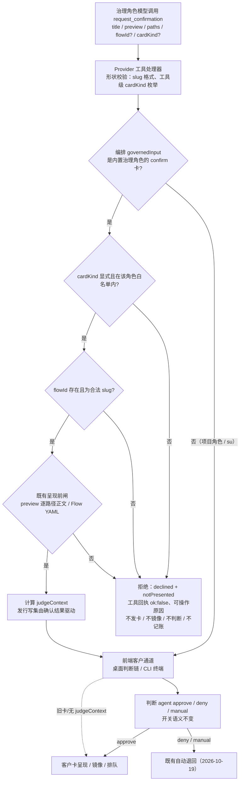

# 无效治理确认卡的应用侧守卫

**本轮性质：设计文档。** 客户已于 2026-10-22 确认按 N1–N5 严格口径实施、O1–O7 均不选；该确认是设计与实施范围确认，**不代表已实现、已测试或已验收**。本文后续只做文档修订，不改产品代码、测试或其他角色文件；未实施、未测试、未提交。下一步是按 §6.4 派发实施。

## 一、要解决的问题

### 1.1 真机现象（客户已选定方案 2）

在一个真实运行的五角色项目（todo-demo）里，Steward / 统筹（内置治理角色 `convener`）发了一张写工作记录 `docs/governance/convener/todo-list-webapp-flow-notes.md` 的 `request_confirmation` 卡（requestId op-14）。这张卡：

- 05:11:13 直接呈现给客户，一直等到 05:15:08 客户手动确认；
- 全程没有 `governance-judge.started`（判断 agent 根本没启动）；
- 紧随其后的 op-15（`appointment-write` 卡）才启动判断并被自动代批。

诊断表明该卡没有带齐 `flowId` + `cardKind`。客户认为这类**无效治理卡不应打扰客户手动审批**，并已明确选择：

> **方案 2——应用侧加守卫：对治理角色发来的无效 `request_confirmation`（缺 `flowId`/`cardKind`）直接拒绝并提示发起角色补齐重发，而不是呈现给客户手动确认。**

### 1.2 目标行为

1. 五个内置治理角色（`liaison` / `rapporteur` / `nominator` / `convener` / `verifier`）调用 `request_confirmation` 时，若不满足治理卡完整性（缺 `flowId`、缺 `cardKind`、或 `cardKind` 不在该角色合法集），应用在**触达客户通道之前**拒绝本次发卡，并在工具回执中给出明确、可操作的错误，要求补齐后重发。
2. 被拒绝的卡：**不生成客户卡、不镜像到主入口、不启动判断 agent、不写客户决定账本、不占「一项目一卡」队列**。
3. 合法治理卡（`write` / `appointment-write` / `schedule-write`，带合法 `flowId`）继续走既有判断链（approve / deny / manual 与开关语义不变）。
4. 普通项目角色的写确认、`single` 模型下的旧 `su` 确认卡**不受影响**。

### 1.3 非目标

- 不改变判断 agent 的判定规则与开关矩阵。
- 不改变合法卡的镜像、排队、下一步推导、账本与回放语义。
- 不新增角色、不放宽任何写权或边界。
- 不修复 todo-demo 项目本身，也不触碰它的目录与运行。
- 不在本轮增加 flow 文件/账本的存在性校验（见 §4.3）。

## 二、现状与根因

### 2.1 一张确认卡从模型到客户的路径

```text
模型调用 request_confirmation（Provider 工具处理器 src/provider/runtime/tools.ts）
  → Provider 做 shape 校验（flowId/stepId slug、cardKind 枚举），并入 CustomerInputRequest + metadata
  → 调用注入的 CustomerInputFn（Service 装配、编排 run-role 的 governedInput 包装器）
      → 编排做治理语义闸（角色 cardKind 白名单、preview 完整性、Flow YAML 校验、judgeContext 计算、账本）
      → 调用前端给的原始 customerInput（桌面 customer-input.ts 的通道 / CLI 终端通道）
          → 桌面 planJudge 决定「判断」还是「直接呈现」；镜像由 desktop session 的包装器计算
          → presenter 呈现客户卡
```

交互工具是**回调反转**：Provider 的 handler 调用编排实现的 `CustomerInputFn`，编排再调用界面通道。两条方向合起来看，仍在五层职责内，没有反向或跳层调用：

```text
正常调用方向：Interface（桌面/CLI）→ Pipeline（编排）→ Service（运行时核心）→ Provider（工具/适配器）→ 外部
交互回调方向：Provider handler → 注入的 CustomerInputFn（Pipeline::governedInput）→ 前端客户通道（Interface）
本守卫位置：Pipeline::governedInput —— 回调链上、Interface 呈现之前
```

注意「谁调用谁」：Provider 不直接依赖编排/桌面的实现，只调用注入的函数；编排也不反向调用 Provider 的 handler，而是在自己拥有的包装器里决定是否放行到前端。Model（`src/model/runtime.ts`）被四层共享，不参与调用链。

### 2.2 为什么无效卡会落到「客户手动确认」

桌面 `app/desktop/customer-input.ts::planJudge`（当前约 L489–L537）只有同时满足全部条件才启动判断：

1. 有 presenter、注入了判断函数；
2. `entry.metadata.judgeContext` 存在（应用事实包）；
3. `cardKind` 存在且能映射到判断分组；
4. 对应组的开关已开；
5. `governanceModel === "trio"`；
6. `flowId` 非空；
7. 本轮信号未中止。

任一条件不满足 → `planJudge` 返回 `undefined` → `presentEntry` 直接 `presentNow`，卡片按「旧卡」呈现并等待客户。**这就是 op-14 的路径。**

而 `judgeContext` 的唯一计算点在编排 `src/pipeline/orchestration/run-role.ts::governedInput`（当前约 L728–L907），它只在：

```text
isTrio（角色是五个内置治理角色之一）
&& cardKind 存在且在该角色的 TRIO_CARD_KINDS 白名单内
&& isGovernanceFlowId(flowId)   // 非空且匹配 ^[a-z0-9][a-z0-9-]{1,63}$
```

时才计算并注入。**缺 `flowId` 或 `cardKind` ⇒ 不计算 `judgeContext` ⇒ 桌面判断链不启动 ⇒ 客户被要求手动确认。**

### 2.3 现有的半守卫为什么没拦住

| 现有机制 | 位置 | 覆盖什么 | 缺口 |
| --- | --- | --- | --- |
| 治理元数据形状校验 | `src/provider/runtime/tools.ts::readGovernanceCardArgs`（约 L247–L258） | `flowId/stepId` 给出时校验 slug；`cardKind` 给出时校验**工具级**枚举 | 字段全部**可选**；缺席直接放行，Provider 不区分角色 |
| 角色级 cardKind 白名单 | 编排 `TRIO_CARD_KINDS`（约 L1952–L1961）与 `governedInput` 内的拒绝 | 显式给了 `cardKind` 但不属于该角色 → declined、不发卡 | 没给 `cardKind` 时该检查不触发（`cardKind !== undefined` 才判） |
| 2026-10-20 真机修复：confirm 卡缺 `cardKind` 时按角色/路径机械兜底 | 编排 `defaultGovernanceConfirmCardKind`（约 L1806–L1822） | 能推断时补成 `write` / `schedule-write` / `appointment-write` | 只补 `cardKind`，**从不补、也不要求 `flowId`**；推断不出来时仍放行 |
| 写卡呈现前完整性闸 | 编排 `validateConfirmPreviewCompleteness` | 声明了写入路径但 preview 缺逐路径正文 → 不发卡 | 只管 preview 内容，不管治理字段 |
| Flow YAML 写前校验 | 编排 `validateFlowYamlCard` | 声明写 `docs/flows/<id>.yaml` 时校验 YAML | 只管 YAML，不管字段 |
| 判断 manual/deny 自动退回 | 桌面 `customer-input.ts`（2026-10-19 客户总原则） | 判断**实际运行**后 manual/deny 不呈现客户卡 | 判断**根本没启动**时走不到这里 |

**核心缺口：编排的 `governedInput` 在 `flowId` 缺失、或 `cardKind` 缺失且无法兜底时，仍把卡片原样交给前端通道。** 前端按旧卡呈现，客户被迫手动审批。

### 2.4 对 op-14 字段缺口的诚实说明

本次只读了本仓代码与客户提供的诊断描述，**没有读取 todo-demo 的现场日志与卡片参数**（该目录不在本任务范围）。从症状（判断链完全未启动、随后 appointment-write 正常代批）可推断：事故卡至少缺一个必需字段；`flowId` 缺失是充分解释（无论 `cardKind` 是否被 2026-10-20 兜底补上，只要 `flowId` 为空判断就不会启动）。因此本设计**同时覆盖** `flowId` 与 `cardKind` 两类缺口，不依赖对单张卡具体参数的猜测。

## 三、判定归属：守卫放在哪一层

### 3.1 结论

**放在编排（Pipeline）`src/pipeline/orchestration/run-role.ts::governedInput`，作为「呈现前 fail-closed 闸」。**

理由：

1. **事实最全**：只有这里同时拥有治理角色身份（`setup.role.kind === "built-in-governance"` + `governanceRoleOf(id)`）、本会话治理规格、角色级 `cardKind` 白名单（`TRIO_CARD_KINDS`）、`flowId` 语义、`judgeContext` 计算、账本写入与写集发行。
2. **位置最靠前且唯一**：桌面与 CLI `ans govern` 两条前端**都经 `openRoleSession` → 同一个 `governedInput`**（CLI 的 `createCliCustomerInput` 只是原始通道，仍被同一包装器包住）。守卫放在这里一次覆盖两个入口。
3. **已有同层先例**：preview 完整性、Flow YAML、角色级 cardKind 白名单都已经是这一层的「呈现前拒绝」，回执形状与测试口径现成。
4. **拒绝发生在任何副作用之前**：尚未调用原始 `customerInput` → 没有 request id、没有 pending/queued、没有镜像、没有判断、没有账本；`issue(...)` 也不会执行，不发行任何写入路径。
5. **不动冻结契约**：若只做守卫本身，Provider/Service/桌面零改动；只有回执措辞改进需要一个小型可选 Model 字段（见 §4.6）。

### 3.2 候选层比较

| 层/位置 | 知道 `roleId` | 知道治理角色身份 | 知道角色级 `cardKind` 白名单 | 能在客户卡前拒绝 | 结论 |
| --- | --- | --- | --- | --- | --- |
| Provider 工具处理器 `tools.ts` | 是（`scope.roleId` 进 metadata） | **否**（不 import 其他角色私有 `common/门禁引擎/`；沿层规则不能调 Service） | **否** | 能 | 需要新增中立开关由 Service/编排透传，且会与编排的 cardKind 兜底/白名单逻辑分叉；Provider 应保持「只做形状校验」的既有分工 |
| Service 装配 `service/runtime/session.ts` | 是（`ResolvedRole`） | 是（`role.kind` / `governanceFunction`） | **否**（白名单在编排） | 能（建工具前） | 需要把编排的语义规则搬到 Service 或新建契约；同一事实会出现两个来源 |
| 桌面通道 `app/desktop/customer-input.ts` | 是（ctx.roleId） | 可判（`isBuiltInGovernanceRoleId`） | **否**（白名单未导出；导出会把编排私有规则变成桌面依赖） | 能（`presentEntry` 前拒绝） | 只覆盖桌面；CLI 无守卫；且在「一项目一卡」排队之后才到，界面可能已出现排队行；适合作为第二道防线而非主判定 |
| **编排 `run-role.ts::governedInput`** | 是（`setup.role.id`，不信任入参） | **是**（注册表 + `kind`） | **是**（`TRIO_CARD_KINDS` 就在本文件） | **是** | **采用** |

### 3.3 谁拥有什么（事实与契约）

| 事实 | 所有者 | 载体与说明 |
| --- | --- | --- |
| 会话 `roleId` | 运行时核心（Service） | Service 从 `ResolvedRole.id` 写入 `GovernedToolsOptions.roleId`，Provider 透传进 `CustomerInputMetadata.roleId`；编排的守卫使用 `setup.role.id`（与会话绑定同源，不采信模型入参） |
| 治理角色身份 | 门禁引擎 | 注册表 `BUILT_IN_GOVERNANCE_ROLES` / `governanceRoleOf` / `isBuiltInGovernanceRoleId`；经 `src/service/boundary/resolve-boundary.ts` 公共再导出供编排/桌面消费 |
| `cardKind` / `flowId` 的**形状** | 运行时核心（Model） | `src/model/runtime.ts` 的 `GovernanceCardKind`、`GOVERNANCE_SLUG_PATTERN`、`CustomerInputRequest/Metadata`；Provider 做形状校验 |
| `cardKind` 的**角色级合法集** | 编排 | `TRIO_CARD_KINDS`（私有表，未导出）；这是守卫必须放编排的最直接理由 |
| 客户卡呈现 / 镜像 / 排队 | 桌面窗口 + 桌面UI | `customer-input.ts`、`session.ts`（`mirrorRoleIdFor`）、`governance-advance.ts`（`isMirroredGovernanceCard`）、渲染层标签 |

## 四、精确规则

### 4.1 适用范围（哪些角色算治理角色）

守卫只对**五个 trio 内置治理角色**生效：

```text
liaison / rapporteur / nominator / convener / verifier
```

判据沿用编排现有 `isTrio`：`governanceRoleOf(setup.role.id) !== undefined`。它与 `.ans` 里 `governanceModel` 的取值无关——只要会话真的是这五个角色之一，确认卡就是治理卡；`single` 模型下的 `su` **不在守卫范围**，保持旧卡语义（历史调用不带 `flowId/cardKind` 是合法的）。

普通项目角色（包括在 `trio` 项目里的项目角色）一律不受影响：它们的确认卡没有 `judgeContext`，本来就走人工/其它既有路径。

### 4.2 `cardKind` 合法集

`request_confirmation` 的工具级枚举（`src/provider/runtime/schema.ts` 的 schema enum 与 `tools.ts` 的 `CONFIRM_CARD_KINDS` 同值）：

```text
write / appointment-write / schedule-write
```

角色级合法集（编排 `TRIO_CARD_KINDS`）：

| 角色 | 职能 | 允许的 `request_confirmation` cardKind | 允许的 `request_choice` cardKind（本轮不改） |
| --- | --- | --- | --- |
| `liaison`（Lead / 主理） | 沟通 | **无**（不使用 `request_confirmation` 做治理写盘） | `intent-confirm` |
| `rapporteur`（Draft / 提案） | 提案 | `write` | `proposal` |
| `nominator`（Crew / 组队） | 提名 | `write`、`appointment-write` | `appointment` |
| `convener`（Steward / 统筹） | 编排 | `write`、`schedule-write` | 无（不用 choice 出治理卡） |
| `verifier`（Proof / 验收） | 验收 | `write` | `acceptance` |

规则：`cardKind` 必须是**显式字符串**且同时属于工具枚举与该角色合法集；否则拒绝。`liaison` 的确认卡一律拒绝（无论是否带 `cardKind`）。

### 4.3 `flowId` 规则

- **必须显式存在且为非空字符串**。
- **格式**：匹配 `^[a-z0-9][a-z0-9-]{1,63}$`（与 Model `GOVERNANCE_SLUG_PATTERN`、编排 `isGovernanceFlowId` 同值）。大小写、下划线、首尾连字符、单字符、超长一律非法。
- **不做存在性校验**：
  - `schedule-write` 卡本身用于**创建** `docs/flows/<flowId>.yaml`，要求文件已存在会死锁；
  - `intent-confirm` 用 `intentId` 作 `flowId`，对应文件是 `docs/intents/` 而非 `docs/flows/`；
  - 物证是否存在、账本是否闭环由判断 agent 的证据门槛处理，不属于「字段完整性」；
  - 存在性检查要读盘，不该进入呈现前的纯形状闸。
- `stepId` 本轮**不强制**；给出时仍按既有 slug 校验（Provider）。

### 4.4 `write` 类普通写卡是否必须 `flowId`

**五个治理角色：必须。** 这些角色的日常写入目录（`docs/proposals/`、`docs/nominations/`、`docs/flows/`、`docs/governance/<role>/` 等）多数已在 `preauthorizedDirs` 中预授权，**不需要发卡**；仍然发 `request_confirmation` 的，都是跨边界/治理产物写入，本来就应从属于某个流程或意图。角色卡文本也已逐字要求「每次 `request_confirmation` 必须带 `flowId` + `cardKind`」。

**普通项目角色与 `single/su`：不要求。** 它们的写确认与流程无关，保持旧语义。

### 4.5 校验顺序；与 2026-10-20 兜底的关系

本设计采用**严格口径**（与客户所选方案 2 的字面一致）：

```text
if (isTrio && req.kind === "confirm") {
  1) cardKind 缺失        → 拒绝（新）
  2) cardKind 不在角色白名单 → 拒绝（既有文案）
  3) flowId 缺失/格式非法  → 拒绝（新）
  4) 既有 preview 完整性 / Flow YAML 校验 → 拒绝（既有）
  5) 计算 judgeContext → 交给客户通道（既有）
}
```

**2026-10-20 的 confirm `cardKind` 机械兜底（`defaultGovernanceConfirmCardKind`）被本规则取代并删除**：它能消掉「缺 cardKind」的客户打扰，但属于应用替角色猜意图；客户现在选择的是「退回补齐重发」。`request_choice` 的兜底（`defaultGovernanceChoiceCardKind`）本轮**保持不变**（见可选项 O1）。

> 这是一个**有意的行为变更**：此前缺 `cardKind` 但可从路径推断的卡会自动通过；此后会收到明确错误并要求重发。收益是口径确定、与角色卡纪律一致；代价是模型可能多一轮往返。保留机械兜底的做法见 O2；客户已于 2026-10-22 确认采用严格口径、不选 O2（见 §十.1）。

### 4.6 错误文案与回执形状

被治理守卫拒绝时，内部返回给工具处理器的结果沿用 `CustomerInputOutcome` 的 `declined` 分支（fail-closed），并新增可选标记，表示**卡片从未呈现给客户**：

```ts
// src/model/runtime.ts（运行时核心主属；可选、向后兼容）
| { outcome: "declined"; operatorId?: string; reason?: string; notPresented?: true }
```

工具处理器（`makeRequestConfirmationTool`）据此返回：

```ts
{ ok: false, message:
  "request_confirmation：治理确认卡未发出（未向客户呈现；原因：<具体缺项>）→ 未获任何同意；" +
  "请补齐后重新调用。不要写盘，也不要向客户声称其拒绝或同意。" }
```

- 若不加 `notPresented`（保持现有 `declined` 形状），工具现有文案会以「未获客户同意」开头，容易让模型误报「客户拒绝」。这是引入该字段的原因。
- 现有 `declined` 的其它生产者（桌面通道的客户拒绝、判断 manual 自动退回等）不设置该字段，文案逐字不变。
- 具体的 `<具体缺项>` 文案（可由实现方润色，但必须保留事实与可操作性）：

| 情形 | 原因文案（建议逐字采用） |
| --- | --- |
| 缺 `cardKind` | `缺少 cardKind。治理角色的 request_confirmation 必须同时携带 flowId 与 cardKind（本角色允许：<列表>）；本次未发行任何写入路径、未写入账本。请补齐后重新调用。` |
| 缺 `flowId` / 格式非法 | `缺少合法的 flowId（须为非空小写 slug，匹配 ^[a-z0-9][a-z0-9-]{1,63}$）。治理角色的 request_confirmation 必须同时携带 flowId 与 cardKind（本角色允许：<列表>）；本次未发行任何写入路径、未写入账本。请补齐后重新调用。` |
| 两者都缺 | 合并列出两项，不重复其余句子。 |
| `cardKind` 不属于该角色 | 沿用既有：`治理角色 <id> 不允许 cardKind=<kind>；允许：<列表>。本次未向客户发卡。` |
| `cardKind` 不属于工具枚举 | 沿用 Provider 既有：`request_confirmation: 参数 cardKind 非法（本工具允许：write / appointment-write / schedule-write）——未向客户发卡；请更正后重试` |
| `flowId` 给出但格式非法 | 沿用 Provider 既有：`参数 flowId 非法（须为匹配 ^[a-z0-9][a-z0-9-]{1,63}$ 的字符串）——未执行；请更正后重试` |

诊断（可选但推荐）：编排 `log.record("governance.card.rejected", { state: "not-presented", reasonCode: "missing-card-kind" | "missing-flow-id", ok: false })`。`roleId` 已在 logger 上下文中；`cardKind`/`flowId` 不在共享诊断 `FIELD_NAMES` 白名单内，**不要为此扩白名单**（属另一件共享组件变更）。

### 4.7 幂等与重发语义

- 守卫是**纯前置校验**，无任何持久状态：同一张无效卡重复调用得到同样错误；不生成 requestId、不占 pending/queued、不写账本、不发行写集。
- 不按标题/内容去重：补齐后重发就是一张**新卡**，走既有判断链；判断链本身仍保证每张卡只判断一次。
- 工具是 `executionMode:"sequential"`，模型可在同一轮内收到错误后立即重发，不存在同批并行抢跑。
- 会话中止/重启不需要恢复任何守卫状态。

### 4.8 单/三权差异

| 场景 | 行为 |
| --- | --- |
| `single` + `su` | 不受守卫影响；无 `flowId/cardKind` 的旧卡照旧 |
| `trio` + 五个内置治理角色 | 受守卫；确认卡必须齐全 |
| `trio` + 项目角色 | 不受守卫；普通写确认照旧（无 judgeContext） |
| 五个内置角色被误开在 `single` 项目 | 仍受守卫（判据是角色身份，不是配置值）；防止「配置漏写 trio 就退回不安全旧路径」 |
| `trio` + `su`（迁移后隐藏） | 不受守卫（`governanceRoleOf("su") === undefined`）；旧会话兼容 |

## 五、请求流程图



## 六、影响面与代码归属

### 6.1 必需改动（逐文件）

| ID | 角色 | 文件 | 改动 | Section 1 依据 |
| --- | --- | --- | --- | --- |
| **N1** | 编排 | `src/pipeline/orchestration/run-role.ts` | 在 `governedInput` 增加 §4.5 的呈现前守卫；删除 confirm 卡的 `defaultGovernanceConfirmCardKind` 及其调用与 `governance.cardKind.defaulted` confirm 分支；拒绝时返回 `declined + notPresented`（N2 已获批）；新增 `governance.card.rejected` 诊断 | 边界 Section 1 单文件 `src/pipeline/orchestration/run-role.ts` |
| **N2** | 运行时核心 | `src/model/runtime.ts` | `CustomerInputOutcome` 的 `declined` 变体新增可选 `notPresented?: true`（向后兼容，不影响既有生产者） | Section 1 单文件 `src/model/runtime.ts` |
| **N3** | 运行时核心 | `src/provider/runtime/tools.ts` | `makeRequestConfirmationTool` 在 `out.outcome === "declined" && out.notPresented === true` 时返回「卡片未发出」文案（§4.6），不再以「未获客户同意」开头；常规 declined 文案不变 | Section 1 单文件 `src/provider/runtime/tools.ts` |
| **N4** | 运行时核心 | `src/provider/runtime/schema.ts` | `request_confirmation` 的 `flowId`/`cardKind` 描述与工具说明：明确「五个内置治理角色必须始终同时携带；缺失会被应用拒绝且不会向客户发卡」；对普通角色仍说明可选 | Section 1 单文件 `src/provider/runtime/schema.ts` |
| **N5** | 门禁引擎 | `src/common/门禁引擎/governance-roles.ts` | 五张内置角色卡的「治理卡参数纪律」：把「缺任何一项＝会被当作旧卡、判断 agent 不介入并回落手动」改为「缺任何一项＝本次不发卡、直接退回并提示补齐重发；未向客户呈现」 | Section 1 目录 `src/common/门禁引擎/` |

**跨角色契约（N2 已随本次确认纳入）**：

- **契约 C1**：`CustomerInputOutcome` 的 `declined` 可选 `notPresented?: true`。
  - 提供方/主属：运行时核心（Model）；消费方：运行时核心 Provider（文案分支）、编排（置位）；桌面窗口只读类型、无行为变更。
  - 兼容性：可选字段；旧生产者不置位 → 旧文案逐字不变；无版本号变化、无迁移。
  - 需冻结的接口面：仅该可选字段与工具文案分支；`CustomerInputRequest` 不变。

### 6.2 测试改动（按角色归属）

| 角色 | 文件 | 改动 |
| --- | --- | --- |
| 编排 | `test/编排/governance-judge.test.ts` | 把 2026-10-20 的「缺 cardKind 兜底」4 个用例改为「缺 cardKind 拒绝」；新增 §7 矩阵的守卫用例；保留显式非法 cardKind、choice 不兜底、项目角色/su 零变化用例 |
| 运行时核心 | `test/runtime-core/governance-flow-metadata.test.ts`（或同目录新文件） | 钉住 `notPresented` 文案分支；钉住 schema 描述中的治理要求；保留 Provider 「字段可选、旧调用零变化」用例 |
| 门禁引擎 | `test/门禁引擎/governance-trio.test.ts` | 更新逐字卡文本断言（`/回落手动/` → 新文案），其余卡文本断言不动 |
| 测试 | `test/测试/governance-e2e-auto/`（新增用例文件或并入现有场景） | 跨角色端到端：真实桌面 Interface + 真实 run-role/gate/issuer/channel + 脚本化模型；无效卡不发卡/不判断/不镜像/不记账；补齐后可代批 |

### 6.3 不需要改动的部分（及理由）

| 角色/文件 | 为什么不动 |
| --- | --- |
| 桌面窗口 `app/desktop/customer-input.ts`、`session.ts`、`interface.ts`、`operator-channel.ts` | 守卫在编排包装器内、调用原始通道之前返回；`planJudge`/`mirrorRoleIdFor`/presenter 都不会被调用。桌面的「无 cardKind 旧卡直接呈现」是**通道级兼容语义**，供非编排调用方与历史卡使用，保持不变 |
| 桌面UI `app/renderer/` | 合法卡与非法卡的呈现路径不变；非法卡根本不会到达渲染层（镜像标签问题另见 O5） |
| `src/service/runtime/session.ts` | `roleId` 已由 Service 从 `ResolvedRole.id` 正确注入；守卫不依赖新增 Service 字段 |
| `src/common/shared/*` | 不需要新字段/新诊断字段；不复用或修改共享组件 |
| 适配器（Pi / Codex / Claude） | 工具与通道契约不变，仅回执文案分支在 Provider |
| 装配 | 无构建/接线变化 |
| 普通项目角色 / single/su 的路径 | 守卫按 `isTrio` 短路，行为逐字不变 |

### 6.4 实施顺序

1. 运行时核心：N2（Model）+ N3（回执）+ N4（schema）+ 本角色测试。
2. 编排：N1（守卫/删兜底/诊断）+ 本角色测试（含 N2 已获批的 `notPresented` 置位）。
3. 门禁引擎：N5 + 测试。
4. 测试角色：跨角色端到端与回归（依赖前三步）。
5. `npm run typecheck` 与全量测试。

## 七、兼容与回归

### 7.1 行为兼容清单

| 场景 | 改前 | 改后 | 结论 |
| --- | --- | --- | --- |
| 合法 `write` / `appointment-write` / `schedule-write`（带 flowId+cardKind） | 判断链/镜像/账本 | 同左 | 不变 |
| 治理角色 confirm 缺 flowId | 呈现旧卡、客户手动 | 工具错误、补齐重发 | **有意变更**（本设计目标） |
| 治理角色 confirm 缺 cardKind（可兜底） | 自动补齐并通过 | 工具错误、补齐重发 | **有意变更**（严格口径；O2 可保留兜底） |
| 治理角色 confirm 缺 cardKind（不可兜底） | 呈现旧卡、客户手动 | 工具错误、补齐重发 | **有意变更**（目标） |
| 治理角色 confirm 给了越权 cardKind | 编排拒绝、不发卡 | 同左 | 不变 |
| 普通项目角色 confirm（任何形状） | 既有路径 | 同左 | 不变 |
| `single`/`su` confirm（任何形状） | 既有路径 | 同左 | 不变 |
| 判断 approve/deny/manual（合法卡） | 既有 | 既有 | 不变 |
| 镜像（合法卡） | 既有 | 既有 | 不变 |
| 队列/一项目一卡 | 既有 | 无效卡不占位 | 仅减少无效占位 |
| 账本/回放 | 既有 | 无效卡无账本条目；旧回放只读 | 不变 |

### 7.2 回归风险与处置

1. **模型习惯性漏字段**：以前靠兜底成功的卡现在会失败。处置：N4 schema 描述、N5 角色卡文本、错误文案三处同时把纪律说清；工具是顺序执行，模型可同轮重发。
2. **既有测试口径**：两处断言必须随行为更新（编排兜底用例、门禁卡文本），**不得**为了让测试通过而放宽其它断言。
3. **误伤项目角色/su**：守卫严格以 `isTrio` 短路；用 §7.3 的 T7/T8 钉死。
4. **诊断字段**：不扩 `FIELD_NAMES`；只使用 `state/reasonCode/ok` 等既有字段，避免共享组件变更。
5. **镜像/下一步**：拒绝路径不调用 `raw`，`mirrorRoleIdFor` 与 `deriveGovernanceNextStep` 都不会执行；用 T15/T17 断言。

### 7.3 测试矩阵（待实施后执行）

| ID | 层级/归属 | 场景 | 期望 |
| --- | --- | --- | --- |
| T1 | 编排单元 | `convener` confirm，`cardKind=write`，无 `flowId` | `declined`；客户通道调用 0 次；`judgeContext` 未产生；原因含 `flowId`；无账本条目 |
| T2 | 编排单元 | `rapporteur` confirm，有 `flowId`，无 `cardKind` | `declined`；通道 0 次；原因含 `cardKind` |
| T3 | 编排单元 | `convener` confirm，两者都缺 | `declined`；两项都列出；通道 0 次 |
| T4 | 编排单元 | 四个可发 confirm 的角色各一张合法卡（`rapporteur` / `verifier` 用 `write`；`nominator` 另测 `appointment-write`；`convener` 另测 `schedule-write`） | 全部到达通道；`judgeContext.flowId` 正确；`liaison` 的 confirm 拒绝由 T5 覆盖 |
| T5 | 编排单元 | `liaison` 发 confirm（有无 cardKind 各一） | `declined`；通道 0 次；文案说明不允许 |
| T6 | 编排单元 | `rapporteur` confirm `cardKind=schedule-write` | 既有拒绝文案；通道 0 次 |
| T7 | 编排单元 | 项目角色 confirm 无任何治理字段 | 原样到达通道；`judgeContext` 未注入（零变化） |
| T8 | 编排单元 | `single/su` confirm 无任何治理字段 | 原样到达通道（零变化） |
| T9 | 编排单元 | 直接调用包装器，`flowId` 为大写/空串/单字符 | `declined`；通道 0 次 |
| T10 | 编排单元 | 先发无效卡被拒，再补齐全字段重发 | 第二次到达通道；生成 `judgeContext`；无去重拦截 |
| T11 | 编排单元 | 无效卡被拒后检查账本/写集 | 无 `customer.decision`；写集未发行（后续 `write_file` 仍被 F4 拒） |
| T12 | 运行时核心 | `declined + notPresented:true` 走工具处理器 | 回执 `ok:false`；文案含「卡片未发出/未向客户呈现」；不以「未获客户同意」开头；常规 declined 文案不变 |
| T13 | 运行时核心 | schema 描述 | 含「治理角色必须同时携带 flowId + cardKind；缺失不发卡」；旧调用（无字段）仍被 Provider 接受 |
| T14 | 门禁引擎 | 五张角色卡文本 | 新文案逐字断言；不再出现「回落手动」 |
| T15 | 测试（跨角色） | 脚本化 `convener` 发缺 `flowId` 的 confirm（开关全开） | `presented=0`、`judgeRows=0`、无 `governance-judge.started`、无镜像/排队行；工具回执 `ok:false` 且可操作；无账本决定 |
| T16 | 测试（跨角色） | 上例同一轮补齐全字段重发 | 判断启动；开关开时自动代批；账本 `decisionEvidence.kind="judge"`；恰一条结果行 |
| T17 | 测试（回归） | 五角色合法卡、项目角色手批、single/su、镜像/下一步/回放 | 与改前一致 |
| T18 | 静态 | `npm run typecheck` | 0 错 |

> 设计阶段只列待验证用例；以上均**未运行**。

## 八、可选项（客户 2026-10-22 已确认 O1–O7 均不实施）

- [ ] **O1：把同一守卫扩展到治理角色的 `request_choice`。**
  好处：提案/任命/验收/需求确认卡缺 `flowId` 或 `cardKind` 时同样不会打扰客户（同类缺陷的另一半）。
  代价：改动同一包装器的 choice 分支；需同步取舍 choice 的机械兜底；测试面扩大；`intent-confirm` 的 `flowId=intentId` 语义需写清。
- [ ] **O2：保留 confirm 卡的 `cardKind` 机械兜底，仅对「兜底后仍缺」与缺 `flowId` 拒绝。**
  好处：模型漏 `cardKind` 时自动通过，少一轮往返；沿用 2026-10-20 已落地行为与测试。
  代价：与客户所选「缺 cardKind 直接拒绝」的字面口径不同；应用继续替角色猜意图（`write` vs `schedule-write` 判错会影响判断证据）。**与 N1 的严格口径二选一。**
- [ ] **O3：桌面第二道防线。** 在 `planJudge` 对内置治理角色缺 `flowId/cardKind` 时直接自动退回而不是呈现。
  好处：防未来有入口绕过编排包装器。
  代价：桌面需知道角色级白名单（导出编排私有表或复制规则），产生第二份判定来源；当前所有前端都经 `openRoleSession`，收益主要是理论防御。
- [ ] **O4：把「未发卡」回执口径扩展到既有 app-side 拒绝。** 给 preview 不完整、Flow YAML 非法、越权 cardKind 等拒绝也设 `notPresented:true`。
  好处：统一「系统拒绝 ≠ 客户拒绝」的文案。
  代价：触及既有拒绝路径的文案与测试，属于额外行为变更，与本缺陷无直接必要关系。
- [ ] **O5：修正镜像/卡片标签。** `isMirroredGovernanceCard` 把普通 `write` 也镜像，渲染层 `governanceMirrorSourceLabel` 统一写「来自 X 的治理决定 · 客户最终批准」。
  好处：普通写入确认不再被显示成“治理决定”，减少客户误解。
  代价：桌面UI 文案与测试改动；需与 UIUX 口径协调；不影响本次守卫。
- [ ] **O6：拒绝时在发起角色聊天流落一条系统行。** 现在只有工具回执给模型。
  好处：客户切到该角色时能看到“曾有一张无效治理卡被退回”。
  代价：桌面窗口新增事件/呈现面与测试；属于可见性增强，不是必需。
- [ ] **O7：校验 `flowId` 对应流程/意图是否存在（读盘或读账本）。**
  好处：更早发现“编造的 flowId”。
  代价：`schedule-write` 创建前流程不存在、`intent-confirm` 文件在 `docs/intents/`，存在性规则要把卡种/目录关系全部写死；把证据问题提前成字段问题，易误杀。**建议不纳入。**

## 九、验证计划（待验证，设计阶段未运行）

实施后按以下顺序验证（命令用仓库既有口径）：

1. 静态：`npm run typecheck`（0 错）。
2. 编排：`node --test "test/编排/governance-judge.test.ts"`（含 T1–T11）。
3. 运行时核心：`node --test "test/runtime-core/governance-flow-metadata.test.ts"`（含 T12–T13）。
4. 门禁引擎：`node --test "test/门禁引擎/governance-trio.test.ts"`（含 T14）。
5. 跨角色：`node --test "test/测试/governance-e2e-auto/*.test.ts"`（含 T15–T17）。
6. 全量：`node --test "test/**/*.test.ts"`（沿仓库惯例，记录基线红；不得把既有失败算作本改动通过）。
7. 真机（由客户运行）：在真实项目里让治理角色故意发一张缺 `flowId` 的确认卡，确认客户端不出现卡、无 `governance-judge.started`、角色收到可操作错误并能补齐重发；再验证合法卡仍按开关代批。

通过判据：无效卡零呈现、零镜像、零判断、零客户决定账本；合法卡与项目角色/single 语义逐字不变；测试证据记录实际命令、环境与结果。**以上均待实施后验证，本文不声称已通过。**

## 十、开放问题与范围缺口

1. **严格 vs 兜底（已拍板：严格）**：客户 2026-10-22 已确认按 N1–N5 严格口径实施，**不选 O2**；N1 取代 2026-10-20 的 confirm `cardKind` 兜底，缺 `cardKind` 一律拒绝并退回补齐重发。O1–O7 均不实施。该确认是设计与实施范围确认，不等于实现、测试或验收结论。
2. **`notPresented` 字段命名与形状**：本文建议 `notPresented?: true`；最终命名由运行时核心主属在 C1 内定，必须保持可选与向后兼容。
3. **`request_choice` 是否同期治理**：本文只做 confirm；同类缺陷在 choice 卡仍存在（O1）。
4. **op-14 的确切缺失字段**：本文未读取 todo-demo 现场；守卫覆盖两种缺口，不影响结论，但若客户希望精确归因需另行只读诊断。
5. **普通 `write` 镜像标签**：O5 是可见文案问题，不阻塞本守卫。
6. **文档/角色卡历史表述**：`角色卡/项目管理/docs/design/2026-10-18_design_judge-governance-cards-review.md` 等历史文档中的「回落手动」描述是当时事实，按仓库惯例不追改，仅由 N5 更新现行内置角色卡文本。

## 十一、状态

- **已做的**：只读调查代码与既有设计/角色卡，完成本设计文档；客户 2026-10-22 确认按 N1–N5 严格口径实施、O1–O7 不选（设计与实施范围确认）。
- **未做的**：未改任何产品代码、测试、其他角色文件；未运行测试/typecheck；未 git 提交；未触碰 todo-demo；未读 `.env`、未跑凭据/网络/真实模型；**未实施、未验证**。
- **下一步**：按 §6.4 顺序派发实施；实施后再执行 §九 的验证并记录实际证据。
