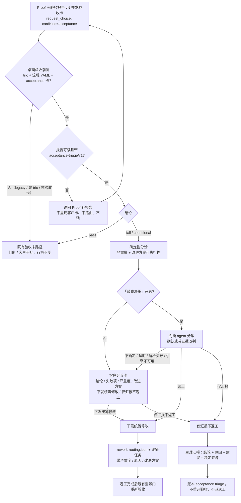

# 验收分诊：独立验收报告后的返工 / 仅汇报决策

**本轮性质：设计文档（proposed，待客户确认）。** 本文只记录方案与代码事实，**未改任何代码、测试、角色卡或共享 i18n**；未实施、未运行测试、未提交。按项目规则「方案确认不等于实施授权」，客户确认后仍需另行走团队计划、闸门 2 与实施授权。

## 一、要解决的问题

### 1.1 客户需求（原话要点）

> 审核完成后要走一个决策，判断是否继续下发给统筹。有些可能是吹毛求疵的事情，没有必要返工。独立验收之后需要说明验收结果、不通过的原因、以及改进方案。然后弹出决策：如果决策觉得有道理，就进入统筹修改；如果决策觉得可以了，就直接把验收报告让主理汇报，就行了。

拆成可执行的行为：

1. Proof（验收 / `verifier`）完成独立判定并交付验收报告后，**先做一次「验收分诊」**，判断报告里的失败项是否值得返工；
2. 验收报告必须机器可读地写清：**结论（pass / fail / conditional）、逐项失败原因、每项严重度（blocker / major / minor / nit）、每项改进方案（文件 / 模块 / 验收标准指针）**；
3. 决策主体：**「替我决策」开启时由判断 agent 先分诊**；判断关闭、无法判断或失败时，**弹客户决策卡**；
4. 决策卡展示：结论摘要、失败项与原因、改进方案，以及两个选择：**「下发统筹修改」/「仅汇报不返工」**；
5. 两种结果：
   - **下发统筹修改**：沿用 2026-10-23 已落地的返工路由（`rework-routing.json` + 统筹任务 + 返工后重新验收），并把改进方案随任务带上；
   - **仅汇报**：不重开验收、不派返工；由主理向客户汇报「验收结论 + 不通过原因 + 改进建议 + 本次不返工的决定来源」；
6. 分诊结果必须可审计、可幂等、可重启恢复，**不重复弹卡**，且**不伪造客户决定**。

### 1.2 目标行为（一句话）

在 Proof 的验收报告与现有验收卡 / 返工路由之间，插入一个**应用级分诊闸**：先按可核对的默认规则给出「返工 / 仅汇报」建议，再按「替我决策」开关决定由判断 agent 确认（或带证据改判）还是由客户点卡；两种结果都复用现有收口 / 返工 / 系统行与账本机制，不改变 Proof 的独立验收权，也不改变客户的最终决定权。

### 1.3 非目标

- 不改变 Proof 的独立判定：分诊不重新验收、不修改报告、不把 `fail` 改成 `pass`。
- 不改变客户最终决定权：分诊只决定「是否返工」，不替客户接受交付、不伪造 `customer.decision`。
- 不新增角色、不新增 `cardKind` / `FlowStepKind` / `GovernancePower` / `GovernanceDecisionKind`，不新增验收保留步骤 id。
- 不改变验收收口语义：仍只有最新 `accepted` 才收口（`latestAcceptanceDecision` + `completeAcceptanceStep`）。
- 不改变 legacy Markdown 流程的既有行为（见 §十一）。
- 本轮不做 CLI、发布配置、打包或版本号变更。

## 二、现状核对（代码事实，2026-10-25 只读）

> 行号为当前工作树快照；实施以符号名为准。

### 2.1 验收派发链路

- 流程完成 / 证据齐备后，桌面自动向 Proof 派一条验收复核任务：`app/desktop/interface.ts::dispatchAcceptanceForFlow`（约 L3478），触发面为 settle / 回交 / 账本追加 / 导入 / `request_acceptance`；报告约定路径 `docs/acceptance/<flowId>-report-v1.md`（`app/desktop/governance-advance.ts::governanceAcceptanceReportPath`，L107）。
- 派发去重：运行期按 flow YAML mtime（`acceptanceDispatchedFlows`）+ 账本 `dispatch.accepted{targetRoleId:"verifier", stepId:"verification"}` 的 `acceptanceLastDispatchAtMs` 比较；flow 更新才允许重派（约 L3810–L3855）。
- Proof 的验收卡由 `request_choice` 发起，`cardKind=acceptance`，选项固定 `accept` / `reject`；角色卡要求「写报告并发验收卡」（`src/common/门禁引擎/governance-roles.ts` 约 L696）。
- 判断上下文 `judgeContext` 只在编排 `src/pipeline/orchestration/run-role.ts::governedInput` 计算；`cardKind=acceptance` 时物证包含 `acceptanceCriteriaPath` / `acceptanceReportPath` / `changePackagePath` / `flowPath`（`judgeArtifactsForCard`，约 L2782–L2789）。报告按 `docs/acceptance` 下最新版本定位。

### 2.2 验收卡与判断代批

- 桌面通道 `app/desktop/customer-input.ts`：`planJudge`（约 L575）在开关、`judgeContext`、`governanceModel === "trio"`、`flowId` 等全部满足时启动判断；`presentEntry`（约 L911）是「判断 / 直接呈现」的分叉点；`settleJudgeOutcome`（约 L682）把判断结果结算为 `answered`（approve）或 `declined`（deny / manual）。
- 判断裁决只有 `approve | deny | manual`（`src/common/编排/governance-judge-verdict.ts` 页首硬口径）：**decision 组（proposal / appointment / acceptance）不得 deny**；`approve` 表示「可以替客户接受 / 任命 / 验收」，`manual` 表示判断无法完成。
- 验收卡的判断有机械门槛：`src/common/编排/governance-judge.ts::verifyAcceptanceMechanics`（约 L333）核对流程 YAML / 收尾门 / 标准 / 报告首行五项 / 变更包档位；但**不读报告的结论、严重度或改进方案**——报告仍只有人读文本。
- 判断 `manual` / 防御性 `deny` 的验收卡会以 `declined`（`operatorId:"judge:<engine>"`）结算，并经 `onAutoRework` 回调（`customer-input.ts` 约 L467–L509；`app/main.ts` 约 L511；`app/desktop/interface.ts::routeAcceptanceAutoRework` 约 L6223）触发 2026-10-23 的返工路由。
- 判断 `approve` 时验收卡按 `answered selected:["accept"]` 结算并写 `customer.decision`（`decisionEvidence.kind:"judge"`）；该路径**不检查报告结论是否 fail**，只要机械门槛通过即可代批接受（现存风险，见 §2.4 R5）。

### 2.3 2026-10-23 验收返工路由（已落地）

- 返工路由：`routeAcceptanceRework`（`interface.ts` 约 L2445，核心 `routeAcceptanceReworkUnsafe` 约 L2284）；读最新验收报告 → `parseAcceptanceReworkReport` → 校验 owner → 写 `.ans/governance/acceptance/<flowId>/rework-routing.json`（schema `acceptance-rework-routing/v1`，约 L1994–L2022）→ 向主理 / 统筹发唯一一条任务 → best-effort 账本审计。
- 报告结构：`src/common/编排/acceptance-rework.ts` 只认恰好一个 fenced YAML `schema: acceptance-rework/v1`，items 字段仅 `id / owner / action / evidence`；**没有结论、严重度、失败原因、改进方案指针**。缺段 / 坏段只走「报告不完整」兜底，不生成返工项。
- 路由后：`redispatchAcceptanceRework`（约 L2484）在 rejection 后 flow 有实质更新、执行步骤全 done、验收步骤可重开时**恰好重派一次** Proof；`reopenAcceptanceStepForRework`（`src/common/编排/flow-service.ts` 约 L1260）是 app-only 重开助手。
- 收口：`latestAcceptanceDecision`（`src/common/编排/flow-state.ts` 约 L1037 / L1092）只看该 flow 最后一条 `customer.decision{decisionKind:"acceptance"}`；只有最新 `accepted` 收口（`completeAcceptanceStep`，`flow-service.ts` 约 L874）。`rejected` 是待返工，不是 closed。
- 报告版本：`findLatestVersionedArtifact`（`interface.ts` 约 L1147）定位最新 `report-vN.md`；重派任务要求写 `vN+1`，不覆盖被拒报告。

### 2.4 缺口总结

| 编号 | 缺口 | 后果 |
| --- | --- | --- |
| R1 | 验收只有「通过 / 拒绝」两扇门，没有「是否值得返工」的判断步骤 | 吹毛求疵的失败项也会触发整包返工；客户只能二选一 |
| R2 | 报告没有机器可读的结论 / 严重度 / 失败原因 / 改进方案 | 应用无法区分 blocker 与 nit；返工任务只有 owner/action/evidence |
| R3 | 没有分诊决策主体、决策卡、分诊记录 | 「仅汇报」无法表达；判断与客户都没有可操作的中间选项 |
| R4 | `rejected` 一律进入返工路由；`accepted` 一律收口 | 没有「验收未通过但不返工、只汇报」的状态 |
| R5 | 判断 approve 验收卡不核对报告结论 | fail 报告存在被自动代批接受的风险；分诊可补上这一层 |
| R6 | 分诊结果没有耐久记录 / 幂等键 / 重启恢复 | 重复弹卡、重复路由、审计缺失 |

## 三、方案总体

### 3.1 一句话

**在桌面客户通道收到 `cardKind=acceptance` 的验收卡、且报告结论为 `fail` / `conditional` 时，先拦截该卡，跑一次「验收分诊」（确定性规则 + 可选判断 agent 确认），再按分诊结果决定：走既有返工路由，或只汇报不返工。** 报告结论为 `pass` 时不分诊，走既有验收卡路径；报告缺分诊结构时退回 Proof 补报告，不猜。

### 3.2 触发点与放置层

**推荐：放在桌面客户交互通道（`app/desktop/customer-input.ts`）的「呈现前闸」**，在 `presentEntry` 分叉之前、任何客户验收卡呈现或判断代批之前。理由：

1. 验收卡的到达与呈现都在这里；可以在**客户看到任何卡之前**决定「换成客户分诊卡 / 直接由判断分诊 / 退回 Proof」。
2. 不改 Proof 的判定：报告与卡片仍由 Proof 产生，分诊只消费报告与卡事实。
3. 不把客户交互塞进编排：编排仍只负责 `judgeContext` 与判断驱动；分诊的记录、路由、系统行属于桌面窗口（与 2026-10-23 返工路由同一归属）。
4. 与既有 `onAutoRework`、`presentEntry`、一项目一卡队列同址，复用队列 / 幂等 / 重启语义。

候选层比较：

| 位置 | 能看到报告物证 | 能在客户卡前拦截 | 能弹客户卡 | 能路由返工 | 结论 |
| --- | --- | --- | --- | --- | --- |
| 编排 `run-role.ts::governedInput` | 是（`judgeContext`） | 是 | 否（编排不呈现客户卡） | 否（路由在桌面） | 需新增回调反转，层级变复杂；只作为备选 |
| 桌面 `customer-input.ts` 呈现前闸 | 是（`metadata.judgeContext.artifacts`） | 是 | 是（既有 presenter） | 通过注入回调交 Interface | **推荐** |
| Proof 增加第三张「分诊请求」卡 | 是 | 是 | 是 | 否 | 新增 cardKind / 角色纪律，违背「不改变 Proof 独立判定」；不推荐 |
| 报告文件 watcher / 定时扫描 | 是 | 否（拦不住验收卡） | 是 | 是 | 会与验收卡竞争、时序不可控；不推荐 |

### 3.3 与现有链路的关系

- **Proof**：仍独立写报告、发验收卡；不新增工具、不新增卡种，只在角色卡与验收任务文案里要求报告带 `acceptance-triage/v1` 段。
- **判断 agent**：新增一个**分诊判断**模式（与治理卡判断共用适配器 / 超时 / 只读纪律），只在「替我决策」开启时运行；它不审批验收卡，只确认或带证据改判分诊建议。
- **返工路由**：分诊结论为「返工」时，复用 `routeAcceptanceRework`、`rework-routing.json`、统筹任务、`redispatchAcceptanceRework`；分诊只负责把严重度 / 失败原因 / 改进方案带进任务。
- **收口**：仍由账本最新 `accepted` 驱动；分诊结论本身不写 `customer.decision`，客户在分诊卡上的选择经既有验收卡结算路径写入（见 §7.3）。
- **判断开关**：复用「替我决策」的 decision 组开关（`ui.judge.decisionOn/Off`，`app/main.ts` 约 L518），**不新增第二个开关**（备选见 §十五）。

### 3.4 流程图



## 四、验收报告必备结构：`acceptance-triage/v1`

### 4.1 为什么是新 schema

现有 `acceptance-rework/v1` 是 2026-10-23 返工路由的机器可读清单，只有 `id / owner / action / evidence`，**没有 conclusion / severity / reason / improvement 指针**；它是严格 schema，未知字段直接报错。直接改 v1 字段会破坏既有报告与测试，也无法表达「结论 pass 时 items 为空」。因此推荐新增**恰好一个** fenced YAML 段 `schema: acceptance-triage/v1`，items 是 `acceptance-rework/v1` 的超集；返工路由在分诊决定返工后**消费同一份 items**，不维护两份清单。`acceptance-rework/v1` 解析器保留（历史报告 / legacy 兜底），但**不能满足分诊要求**（缺结构 ⇒ 退回 Proof，见 §4.4）。

### 4.2 schema

````markdown
```yaml
schema: acceptance-triage/v1
conclusion: fail            # pass | fail | conditional
coordinator: convener       # 可选，兼容 acceptance-rework/v1 的建议字段
items:
  - id: F1                  # 必填、唯一
    severity: blocker       # blocker | major | minor | nit
    owner: platform-foundation
    reason: 干净安装 npm ci 退出码非 0，安装步骤未完成
    action: 在干净环境执行 npm ci 并保留完整日志，修复依赖锁定问题
    targets: [package-lock.json, docs/verification/x/npm-ci.log]  # 可选，文件/模块指针
    criteria: docs/acceptance/ai-governance-pipeline-criteria-v1.md#C3  # 可选，验收标准指针
    evidence: docs/verification/x/npm-ci.log                     # 可选，证据指针
```
````

字段规则：

| 字段 | 必填 | 规则 |
| --- | --- | --- |
| `schema` | 是 | 固定 `acceptance-triage/v1`；其他版本 `unsupported`，不按 v1 猜 |
| `conclusion` | 是 | `pass` / `fail` / `conditional` 三选一 |
| `coordinator` | 否 | 仅作报告建议；实际接收方仍由应用按治理模型决定（trio = 主理 / Lead） |
| `items` | 是 | 数组；`pass` 允许为空；`fail` / `conditional` 必须非空；≤64 项 |
| `items[].id` | 是 | 非空、唯一；`^[A-Za-z0-9][A-Za-z0-9._-]{0,31}$` |
| `items[].severity` | 是 | `blocker` / `major` / `minor` / `nit` |
| `items[].owner` | 是 | 恰好一个角色 id token；形状校验由解析器，存在性/可派发性由桌面用项目 listing + 内置治理角色校验 |
| `items[].reason` | 是 | 失败原因；非空，≤1000 字符 |
| `items[].action` | 是 | 改进方案；非空，≤2000 字符 |
| `items[].targets` | 否 | 文件/模块指针；字符串或字符串数组，≤10 条，每条 ≤500 字符 |
| `items[].criteria` | 否 | 验收标准指针；≤500 字符 |
| `items[].evidence` | 否 | 证据指针；字符串或字符串数组，≤10 条，每条 ≤500 字符 |
| 未知字段 | — | 整段 `invalid`（与 flow YAML / rework v1 的严格口径一致） |

其他约束：

- 恰好一个候选 fenced 块；多个 ⇒ `invalid`；块总大小 ≤32KB；YAML 解析沿用 `{ uniqueKeys: true, maxAliasCount: 100 }`。
- 报告首行五项（风险档位 / 判定依据 / 选定检查 / 复用证据 / 全量回归）仍按既有 `verifyAcceptanceMechanics` 要求；分诊不替代它。
- 解析是纯确定性函数：不读文件、不调模型、不做 IO（与 `acceptance-rework.ts` 同层同风格）。

### 4.3 严重度定义（写进 verifier 角色卡与验收任务）

| 严重度 | 含义 | 默认处置 |
| --- | --- | --- |
| `blocker` | 交付不可用 / 安全 / 数据损坏 / 验收标准的关键项未满足 | 返工 |
| `major` | 关键功能或契约不满足，但可通过返工修复；不修复不能视为达标 | 返工 |
| `minor` | 非关键缺陷 / 一致性问题，可后续修复 | 仅汇报 |
| `nit` | 风格 / 措辞 / 个人偏好，不影响验收结论（吹毛求疵） | 仅汇报 |

### 4.4 缺结构 / 旧报告：退回 Proof，不猜

当验收卡到达但报告：

- 文件缺失 / 不可读；
- 没有 `acceptance-triage/v1` 段；
- 段坏（YAML、未知字段、重复 id、空 owner/action/reason、未知 severity、`fail` 却没有 items、`pass` 却带 blocker/major 等矛盾）；
- 只有旧的 `acceptance-rework/v1` 段（没有 triage 段）；

⇒ **不进分诊**：不弹客户卡、不调判断 agent、不写返工路由、不写 `customer.decision`。应用以 `declined + notPresented:true` 结算该验收卡，回执写明具体缺项，要求 Proof 补齐报告后重新发卡（不猜结论、不解析自由文本）。分诊记录写 `status:"returned-to-verifier"`，供审计与去重。**注意**：当前 `request_choice` 的 declined 分支不识别 `notPresented`（只有 `request_confirmation` 识别），实施时需同步该回执分支（§12.1）。

> 兼容代价：升级后第一次验收，旧报告会被退回一次，Proof 需要补 triage 段。这是客户「缺结构 ⇒ 退回补报告、不猜」要求的直接结果；备选（旧报告退回旧验收卡路径）见 §十五。

## 五、判定规则（默认规则与例外）

### 5.1 机械可核对的默认规则

分诊只读报告结构 + 项目 listing，不读报告文风、不评价「报告写得好不好」。

| 规则 | 条件 | 建议 |
| --- | --- | --- |
| **R1** | `conclusion = pass` 且 items 为空 | **不分诊**，走既有验收卡路径（判断 / 客户手批） |
| **R2** | `conclusion = fail / conditional`，且存在 `blocker` / `major` 项，且这些项**全部可执行**（owner 可解析、action 非空、至少有一个 `targets` 或 `criteria` 指针） | **建议下发统筹修改** |
| **R3** | `conclusion = fail / conditional`，且没有 `blocker` / `major`，至少有一个 `minor` / `nit` | **建议仅汇报不返工**（吹毛求疵不返工） |
| **R4** | 存在 `blocker` / `major`，但任一项不可执行（owner 未知/不可派发、action 为空、无 targets/criteria 指针） | **结构不足**：退回 Proof 补报告（§4.4），不做自动建议 |
| **R5** | 矛盾：`pass` 却带 `blocker`/`major`；`fail`/`conditional` 却没有 items；未知 conclusion/severity | **结构非法**：退回 Proof（§4.4） |
| **R6** | 报告文字写得完整、排版漂亮，但存在 blocker/major | **不得判 pass / 不得建议仅汇报**；按 R2 返工 |
| **R7** | 只有 `minor`/`nit`，但措辞严厉 / 篇幅很长 | **不得判返工**；按 R3 仅汇报 |

### 5.2 「可执行」的机械定义

- `owner`：在项目 listing 中枚举到且非内置治理角色（可派发），或是内置治理角色（治理文档/变更包项，不派产品返工）；`app` / `customer` / 多 owner / 未知 owner ⇒ 不可执行。
- `action`：trim 后非空且 ≤2000 字符。
- 指针：`targets` 或 `criteria` 至少一个非空；只有 `evidence` 不算改进方案指针（证据不是改进计划）。
- listing 不可用 / 账本不可读：不做自动建议（见 §5.4），转客户卡。

### 5.3 例外与覆盖

- **客户**可以在决策卡上选择任一选项，覆盖默认建议；覆盖记录 `override:true` + 原建议。
- **判断 agent** 可以确认默认建议，或**带证据改判**：
  - 默认「返工」改「仅汇报」：必须逐项给出 blocker/major 被误判的证据（例如验收标准实际满足、证据路径不存在等）；否则 `manual` → 客户卡。
  - 默认「仅汇报」改「返工」：必须引用至少一个具体项及其影响证据；否则 `manual` → 客户卡。
- 判断 agent 不得因为报告文风、篇幅、语气改判；不得把「报告写得好」当通过（R6/R7）。
- 客户覆盖 blocker 建议为「仅汇报」时，决策卡显示醒目提示（「报告含阻断项，仅汇报将不修复」），但不阻断客户选择。

### 5.4 不确定 / 基础设施失败

- 判断关闭、判断超时、解析失败、引擎不可用、账本不可读、项目 listing 不可用 ⇒ **弹客户决策卡**（带默认建议或「无法自动建议」说明）。
- 不允许「判断失败就默认通过」或「默认返工」；必须让客户看到事实后再决定。

## 六、决策主体与判断代批

### 6.1 开关与主体

- 复用现有「替我决策」decision 组开关（`main.ts` 的 `decisionJudgeSwitch`；UI `ui.judge.decisionOn/Off`）。
- 开关开：判断 agent 先做分诊；开关关：直接弹客户分诊卡。
- 判断 agent 的输出**不是**验收批准，只是「返工 / 仅汇报」的分诊结论；它没有权力写 `customer.decision`、没有写盘权、没有派发权。

### 6.2 分诊判断的契约（新增 app 内部能力）

建议新增一个与 `createGovernanceJudge` 并列的 **`createAcceptanceTriageJudge`**（编排私有，经 Pipeline 公共出口供桌面注入；不是角色工具）：

- 复用：runtime adapter 工厂、deny-all 写门禁、不持久化会话、超时（driver 120s + 通道 15s 余量）、诊断白名单、证据包只读纪律。
- 输入：流程 id、报告路径/版本/sha、`acceptance-triage/v1` 解析结果、验收标准/变更包/流程 YAML 指针、确定性建议与依据、项目角色清单（只读事实）。
- 输出（专用工具 `report_acceptance_triage`，或等价的结构化消息）：
  ```ts
  {
    disposition: "rework" | "report-only" | "manual";
    confidence?: "high" | "medium" | "low";
    reasonCode?: string;
    reason?: string;                 // ≤2KB，人话
    evidence?: string[];             // ≤10 条，≤512B/条
    itemOverrides?: Array<{ id: string; severity?: "blocker"|"major"|"minor"|"nit"; reason: string; evidence: string[] }>;
  }
  ```
- 约束：`manual` / 未知值 / 缺字段 ⇒ 客户卡；不得输出 approve/deny 语义；不得引用未读文件；改判必须带 itemOverrides + evidence；reason/evidence 有界；审计字段只进 triage 记录与账本 `acceptance.triage`，不进模型上下文。
- 判断失败（超时 / 解析失败 / 引擎不可用 / 证据不可读）⇒ 客户卡，不自动执行任何处置。

### 6.3 判断与既有验收判断的关系

- 现有 `verifyAcceptanceMechanics`（报告首行五项、档位、流程完成度）仍是验收卡合法性的机械门槛；**分诊补充的是报告结论与严重度**，不替代既有门槛。
- 当报告 `conclusion = pass` 时，不走分诊判断；既有 acceptance 判断路径（approve / manual）保持不变。
- 当报告 `fail` / `conditional` 时，**不再让既有 acceptance 判断代批 accept**：分诊结论（判断或客户卡）决定后续，避免「fail 报告被自动接受」（R5）。

### 6.4 不写 `customer.decision`

- 判断 agent 的分诊结论**不写** `customer.decision`；只写 `.ans` 分诊记录 + 账本 `acceptance.triage`。
- 客户在分诊卡上的选择，若存在活的验收请求，按既有结算路径写成 `customer.decision`（accept / reject，`decisionEvidence.kind:"customer-input"`）；若没有活请求（重启后），只写分诊记录与执行处置，不伪造客户决定（§九）。

## 七、决策卡

### 7.1 卡的形态

复用既有 operator request 的 `choice` 卡与 `session:operator-request` / `session:operator-response` IPC；**不新增 cardKind**。分诊卡是应用自有卡（不是角色工具请求），建议：

- 稳定 id：`triage-<flowId>-<reportSha 前 8 位>`；
- 呈现面：主入口主理（`listing.primaryRoleId`）的聊天流；同时在验证者流落一条普通系统行（不镜像成第二张可作答卡）；
- 与既有「一项目一卡」队列同槽：分诊卡占据被拦住的验收卡的位置，客户在同一时刻只会看到一张卡；
- 标题 / 问题 / preview 走 i18n 与有界摘要（§十三）；报告全文仍按路径可查。

### 7.2 卡必须展示的内容

1. **结论摘要**：`pass / fail / conditional` + 报告路径/版本；
2. **失败项与原因**：逐项 `id | severity | reason`（超过 10 项时显示前 10 项 + 「另有 N 项见报告」）；
3. **改进方案**：逐项 `action` + 指针（targets / criteria）；
4. **默认建议与依据**：例如「建议下发统筹修改（存在 2 个 blocker、1 个 major，且改进方案可执行）」或「建议仅汇报不返工（均为 minor/nit）」；判断代批时注明「判断代批（替我决策）」及改判理由；
5. **两个选项**：`下发统筹修改` / `仅汇报不返工`（单选，必须明确作答）；
6. 覆盖警示：若客户选择与建议相反且报告含 blocker/major，显示提示（不阻断）。

### 7.3 客户作答的映射

| 客户选择 | 有活体验收请求时 | 无活请求（重启后） |
| --- | --- | --- |
| 下发统筹修改 | 以 `reject` 结算被拦住的验收卡（`customer.decision{acceptance, rejected}`），走既有返工路由 | 只写分诊记录 `disposition:rework`，由桌面按 `source:customer, sourceDetail:triage-customer` 路由；不伪造 `customer.decision` |
| 仅汇报不返工 | 以 `accept` 结算被拦住的验收卡（`customer.decision{acceptance, accepted}`），走既有收口 + 主理汇报 | 只写分诊记录 `disposition:report-only`，主理汇报；不伪造 `customer.decision`（见 §8.4 待确认） |

- 若验收卡实际选项不含 `accept` / `reject`（异常卡），不猜：以 `declined`（客户本人操作、原因「分诊选择：…」）结算，并按分诊记录执行处置；不写 `customer.decision` 的 accept/reject。
- 卡回执要区分「客户在分诊卡上的选择」与「客户在验收卡上选了 accept/reject」：`CustomerInputOutcome` 增加可选 `triage?: { disposition; source; conclusion; triageId }`（向后兼容），工具层据此写准确回执（不得把「仅汇报」说成「客户选择了 accept」）。

### 7.4 幂等 / 重推

- 分诊卡 id 稳定；同一 `flowId + reportSha256` 只呈现一次、只接受一次作答。
- 客户未作答时，窗口重载 / focus 可重推同一张卡（既有 replay 语义）；应用重启后由分诊记录重推一次（§九）。
- 新报告（新 sha）到达时，旧分诊卡作废（过期系统行），新报告重新分诊；不继承旧结论。

## 八、两种结果的落地

### 8.1 下发统筹修改

沿用 2026-10-23 返工路由，不新增第二套派发：

1. 分诊结论 `rework`（客户点击或判断代批）→ 写分诊记录 → 读最新报告 / triage items → 写 `rework-routing.json`（`source: "customer" | "judge"`，`sourceDetail: "triage-customer" | "triage-judge"`）→ 向主理 / 统筹发唯一一条任务。分诊结算的 declined **不得再触发 `onAutoRework`**（避免同一决定两条任务）：triage 结算与既有 auto-rework 二选一，由 `CustomerInputOutcome.triage` 标记分流。
2. 任务文本在既有内容上追加：每项 `severity`、`reason`、`action`（改进方案）、`targets` / `criteria` 指针；`minor` / `nit` 项标为「非阻断，可选后续」，避免统筹把它们当阻断项返工。triage items 到既有返工任务项的映射：`id` / `owner` / `action` 原样；`evidence` = `evidence` ∪ `targets`；`severity` / `reason` 作为附加上下文；`criteria` 作为验收标准指针保留。
3. 返工完成后仍走既有 `redispatchAcceptanceRework` 重派门（flow 有实质更新 + 执行步骤全 done + 验收步骤 pending + 同内容未派 ⇒ 恰好重派一次 Proof）。
4. 失败如实：记录写失败 ⇒ 不发送；发送失败 ⇒ `status:"failed"` + 主理系统行 + 下一次真实事件重试；运行引擎无法确定 ⇒ 不派、如实说明；**不假装已返工**。

### 8.2 仅汇报不返工

1. **不重开验收步骤、不派返工、不创建 flow 步骤**。
2. 主理（Lead / `liaison`）向客户汇报一条系统行（确定性文本，不调用模型、不编造）：
   - 验收结论（pass / fail / conditional）；
   - 不通过原因（逐项 severity + reason，bounded）；
   - 改进建议（逐项 action + 指针，bounded）；
   - 本次不返工的决定来源：**判断代批（替我决策）** 或 **客户选择**；
   - 报告路径 / 版本。
3. 账本追加 `acceptance.triage`（`disposition:"report-only"`，来源、报告 sha、triageId、决定时间）；**不写 `customer.decision`**（客户点击路径按 §7.3 走既有结算，不在此重复）。
4. 抑制重派：`dispatchAcceptanceForFlow` / `runAcceptanceCheck` 在读取账本 / 最新验收决定之后、任何 artifact 补登 / wake / 派发之前，读到该 flow 的分诊记录为 report-only 且报告 sha 相同 ⇒ 不再派 Proof、不再分诊、不再弹卡，返回「已汇报，未返工」的明确结果；新报告（新 sha）才允许新一轮。

### 8.3 状态表

| 结论 | 失败项 | 默认建议 | 判断（开关开） | 客户卡 | 落地 |
| --- | --- | --- | --- | --- | --- |
| pass | 无 | 不分诊 | 既有验收判断不变 | 既有验收卡 | 既有收口/拒绝路径 |
| fail / conditional | 有 blocker/major 且可执行 | 返工 | 确认或带证据改判；manual ⇒ 卡 | 建议返工 | 返工路由 |
| fail / conditional | 只有 minor/nit | 仅汇报 | 确认或带证据改判；manual ⇒ 卡 | 建议仅汇报 | 主理汇报 + triage 记录 |
| fail / conditional | 有 blocker/major 但不可执行 | 无自动建议 | 不调用（结构不足） | 不弹 | 退回 Proof 补报告 |
| 结构缺失 / 坏 / 矛盾 | — | 无 | 不调用 | 不弹 | 退回 Proof 补报告 |
| 判断失败（超时/解析/引擎/账本/listing） | — | 按报告规则（若有） | manual | 弹卡 | 客户决定 |
| 已 report-only | — | — | — | 不再弹 | 抑制重派，等待新报告 |

### 8.4 「仅汇报」是否收口（推荐 + 待确认）

- **客户点击「仅汇报」**：推荐按既有 `accepted` 结算（`customer.decision{acceptance, accepted}`），`completeAcceptanceStep` 收口；账本同时留 `acceptance.triage{disposition:"report-only"}`。语义是「客户接受现状、不返工」；报告结论仍是 fail，主理汇报里如实写明。
- **判断代批「仅汇报」**：按客户要求**不写 `customer.decision`**；流程保持验收未收口（acceptance 步骤 pending），但分诊记录将其标记为「已汇报、不返工」，应用不再自动派 Proof / 弹卡。若客户希望此时也自动收口，需要二选一：允许判断写 `decisionEvidence.kind:"judge"` 的 accepted（与「不写 customer.decision」冲突），或新增 app-only 收口路径（新增契约，超出本设计默认范围）。**见 §十六 Q1，待客户确认。**

## 九、账本、分诊记录与恢复

### 9.1 `.ans` 分诊记录

路径：`.ans/governance/acceptance/<flowId>/triage-v1.json`（与 `rework-routing.json` 同目录；`.ans/` 是 app-only 写域，角色不可写）。

```json
{
  "schema": "acceptance-triage-record/v1",
  "flowId": "ai-governance-pipeline",
  "reportPath": "docs/acceptance/ai-governance-pipeline-report-v1.md",
  "reportVersion": 1,
  "reportSha256": "…",
  "conclusion": "fail",
  "recommendation": "rework",
  "recommendationBasis": "blocker-major-feasible",
  "severityCounts": { "blocker": 2, "major": 1, "minor": 2, "nit": 3 },
  "itemsDigest": "…",
  "itemCount": 8,
  "status": "pending-judge | awaiting-customer | decided | returned-to-verifier | failed | superseded",
  "disposition": "rework | report-only | null",
  "source": "judge | customer | null",
  "override": false,
  "requestId": "op-…",
  "triageCardId": "triage-…",
  "judge": { "engine": "…", "reasonCode": "…", "reason": "…", "evidence": [] },
  "decidedAt": "…",
  "error": null,
  "at": "…"
}
```

- 原子写（临时文件 + rename），非法 JSON / 未知 schema 读取时按 `corrupt` 处理，**不猜、不自动执行**（降级见 §十）。
- 覆盖写：同一 flow 新报告到达时写新记录；旧记录的关键事实已在账本与旧卡/系统行留痕；记录里保留 `previousReportSha256`（可选）供审计。

### 9.2 账本 `acceptance.triage`

- 在 `GovernanceLedgerEntry.kind` 中新增 `"acceptance.triage"`（编排 `src/common/编排/governance-ledger.ts` L83–L92 的联合类型；这是跨角色契约变更）。
- 条目形状（复用既有字段 + 新增可选 `acceptanceTriage`）：
  ```json
  {
    "at": "…",
    "kind": "acceptance.triage",
    "flowId": "ai-governance-pipeline",
    "actorRoleId": "app",
    "power": "app",
    "messageSummary": "验收分诊：下发统筹修改（blocker 2 / major 1；来源 judge）",
    "acceptanceTriage": {
      "schema": "acceptance-triage-decision/v1",
      "triageId": "triage-…",
      "reportPath": "docs/acceptance/…-report-v1.md",
      "reportSha256": "…",
      "conclusion": "fail",
      "disposition": "rework",
      "source": "judge",
      "recommendation": "rework",
      "recommendationBasis": "blocker-major-feasible",
      "requestId": "op-…"
    }
  }
  ```
- `acceptance.triage` **不是** `customer.decision`：`latestAcceptanceDecision`、`evaluateFlowCompletion`、收口门**不读**它；它只用于审计、幂等与汇报。
- 追加时机：分诊处置已写记录并准备执行之后；best-effort（失败只诊断 + 主理系统行，不伪造账本、不翻转已执行的处置）。追加前按 `triageId` 扫描账本，已有同 id 条目则不重复写。

### 9.3 幂等键

- 分诊：`flowId + reportSha256`（同一报告只分诊一次；报告变了才重新分诊）。
- 分诊卡：`triageCardId`（稳定 id）；同一 id 只接受一次作答。
- 返工路由：沿用 `reworkIdentityKey`（source + decisionAt/requestId + reportSha256）。
- 账本：`triageId` 扫描去重。
- 系统行：沿用 `noteReworkOnce` / `acceptanceBlockedNotified` 的去重风格，按 `flowId + triageId + 消息种类`。

### 9.4 重启恢复

应用启动 / 导入项目后扫描 `.ans/governance/acceptance/<flowId>/triage-v1.json`：

| 记录状态 | 恢复动作 |
| --- | --- |
| `pending-judge` | 若开关开：重跑一次分诊判断（有界，超时 ⇒ 客户卡）；开关关 ⇒ 直接进入客户卡 |
| `awaiting-customer` | 以同一 `triageCardId` 重推一次分诊卡（自带报告摘要，不依赖 Proof 活会话）；客户作答后按 §7.3 执行 |
| `decided` + `rework`（路由未 sent） | `dispatchAcceptanceForFlow` 按记录重试返工路由（与 auto-rework 记录同一重试口径） |
| `decided` + `report-only` | 若 `reportedAt` 为空 ⇒ 补一条主理汇报（一次）；抑制重派 |
| `returned-to-verifier` | 不重推卡；等 Proof 补报告后重新发卡（新报告 sha ⇒ 新分诊） |
| `failed` | 主理一条如实系统行；不自动重试循环；下一次真实事件 / 导入可再评估 |
| `superseded`（新报告已到） | 不执行旧处置；按新报告分诊 |

### 9.5 避免重复弹卡

- 分诊卡只在三种时机呈现：验收卡到达且需要客户决定、`awaiting-customer` 重启恢复、窗口重载重推同一 id；其他任何事件都不重新生成新 id。
- 同一项目一项目一卡队列仍在：分诊卡占据被拦验收卡的槽位，不额外占槽。
- 分诊已 `decided` 的记录不再弹卡；report-only 抑制重派；rework 由返工路由记录接管去重。

## 十、失败与降级

| 场景 | 行为（fail-closed，不伪造） |
| --- | --- |
| 报告缺失 / 不可读 / 缺 triage 段 / 段坏 / 矛盾 | 退回 Proof 补报告（`declined + notPresented`，具体缺项）；不弹卡、不路由、不写 `customer.decision` |
| 项目 listing 不可用 / 角色清单读不到 | 不做自动建议；转客户卡（若卡片可呈现）；卡片说明「无法核对 owner 可执行性」 |
| 判断超时 / 解析失败 / 引擎不可用 / 证据不可读 | 客户分诊卡（带默认建议或「无法自动建议」）；不自动执行 |
| 分诊记录读损坏 | 不自动执行；主理如实系统行「分诊记录损坏，按原验收卡人工处理」，并回落到原验收卡路径（presentNow）；不猜旧结论 |
| 分诊记录写失败（首次） | 不自动执行判断结论；回落到原验收卡路径 + 主理系统行；避免「无记录却已路由」 |
| 分诊记录写失败（客户作答后） | 卡保持可重试（不结算）；不执行处置；客户可重试 |
| 分诊卡呈现失败（窗口关闭 / presenter 抛错） | 既有通道 fail-closed：原验收卡也未呈现 ⇒ 按通道语义 `declined/unavailable`；主理系统行；不伪造同意 |
| 返工路由记录写失败 | 不发送统筹任务；主理系统行；下一次真实事件重试（沿用既有语义） |
| 统筹任务发送失败 / 引擎无法确定 | `rework-routing.json` 记 `failed`；主理系统行；不派 Proof、不假装已返工 |
| 账本 `acceptance.triage` 追加失败 | 诊断 + 主理系统行；分诊记录仍是事实来源；不翻转处置 |
| 主理汇报系统行发送失败 | 诊断；记录 `reportedAt` 不置位；下一次真实事件 / 导入补一次 |
| 判断代批「仅汇报」但无 `customer.decision` | 流程保持未收口；分诊记录标记「已汇报不返工」；不伪造 accepted |

## 十一、兼容与迁移

### 11.1 兼容边界

- **legacy Markdown 流程**（无 `docs/flows/<flowId>.yaml`）：分诊不生效，保持既有验收卡 / 终态语义；主理一条一次性的「legacy 流程不支持自动分诊，建议迁移 YAML」提示（去重）。
- **YAML 流程的旧报告**（只有 `acceptance-rework/v1` 或没有结构化段）：按 §4.4 退回 Proof 补 `acceptance-triage/v1`；这是一次性成本，不重写历史报告。
- **已 accepted / rejected 的历史流程**：不回溯分诊、不重开、不重派；`latestAcceptanceDecision` 语义不变。
- **在途验收卡**：升级 / 重启后挂起请求清空（既有语义）；下一次验收卡触发分诊。
- **旧 `acceptance-rework/v1` 解析器**：保留，供历史报告与 legacy 兜底；分诊路径优先读 `acceptance-triage/v1`，两者同时存在时以 triage 段为准（返工任务消费 triage items，不维护两份清单）。
- **契约兼容**：新增 `CustomerInputOutcome` 可选 `triage` 字段、新增账本 `kind` 与可选 `acceptanceTriage` 字段、新增 triage 记录文件；旧生产者 / 旧读取方不受影响（账本读取原样保留未知字段）。不新增 cardKind / FlowStepKind / Power / DecisionKind / 保留 id。
- **判断开关**：复用 decision 组开关；不新增开关，不影响 approval 组。

### 11.2 行为变化清单

| 场景 | 改前 | 改后 | 性质 |
| --- | --- | --- | --- |
| trio + YAML + acceptance 卡 + `pass` 报告 | 既有判断 / 客户 accept/reject | 同左 | 不变 |
| trio + YAML + acceptance 卡 + `fail/conditional`，判断开 | 既有 acceptance 判断可 approve accept，或 manual/deny → 返工路由 | 分诊判断（返工 / 仅汇报 / manual → 客户卡）；**不再代批 accept** | **有意变更**（补 R5） |
| trio + YAML + acceptance 卡 + `fail/conditional`，判断关 | 客户 accept/reject 卡 | 客户分诊卡（返工 / 仅汇报） | **有意变更**（客户需求） |
| 仅 minor/nit 的 fail 报告 | 客户 reject → 整包返工 | 默认建议仅汇报；客户可覆盖 | **有意变更**（吹毛求疵不返工） |
| 报告缺 `acceptance-triage/v1`（YAML 流程） | 客户 accept/reject（旧报告） | 退回 Proof 补报告，不弹卡 | **有意变更**（缺结构不猜） |
| legacy Markdown / 非 trio / 非验收卡 | 既有行为 | 既有行为 | 不变 |

### 11.3 残余风险

- **报告版本竞态**：分诊按 `docs/acceptance` 最新 `report-vN` 读取；若 Proof 在发卡后又写新版本，以最新版本 + sha 记录为准，旧 sha 的分诊记录不继承；报告内容与卡片文字可能短暂不一致（与既有返工路由同一风险口径）。
- **严重度依赖 Proof 自报**：默认规则只核对结构与可执行性，不能判断 Proof 是否把 blocker 写成 nit；判断 agent 的带证据改判与客户覆盖是纠偏手段；两者都不可用时以客户卡为准。
- **判断代批「仅汇报」不正式收口**：按客户要求不写 `customer.decision`，流程保持 pending（Q1）；这是有意的不对称，需客户确认。
- **旧报告一次性退回**：升级后旧报告会被退回 Proof 补结构，可能多一轮往返；不接受该成本的客户可选择 Q5 的回落旧路径备选。

## 十二、影响面与边界

### 12.1 必需改动（按角色，逐项；本任务不实施）

| 角色 | 文件 / 符号 | 改动 |
| --- | --- | --- |
| 编排 | `src/common/编排/acceptance-triage.ts`（**新增**） | `acceptance-triage/v1` 纯解析 / 严格校验 / 默认规则分类器（输入含 knownRoleIds）；不 IO、不调模型 |
| 编排 | `src/pipeline/orchestration/flow-state.ts` | 公共出口再导出 triage 解析 / 类型（桌面只经此消费） |
| 编排 | `src/common/编排/acceptance-triage-judge.ts`（**新增**，若保留判断代批分诊） | 分诊判断 prompt / 专用输出工具 / 超时 / 审计；复用 adapter 工厂与 deny-all 门禁 |
| 编排 | `src/common/编排/governance-ledger.ts` | `GovernanceLedgerEntry.kind` 增 `acceptance.triage`；可选 `acceptanceTriage` 字段 |
| 运行时核心 / Model | `src/model/runtime.ts` | `CustomerInputOutcome` 可选 `triage`（answered/declined 均可）；若需要，`CustomerInputMetadata` 透传 triage 事实 |
| 运行时核心 | `src/provider/runtime/tools.ts` | `request_choice` 的 declined 分支识别 `notPresented` 与 `triage`：退回补报告 / 分诊返工 / 分诊仅汇报三种回执文案；旧 declined 文案逐字不变 |
| 桌面窗口 | `app/desktop/customer-input.ts` | 验收卡呈现前闸；持有被拦验收卡（新状态 `triaging`）；分诊卡合成 / 作答 / 重推；`triage` 结算；抑制 auto-rework 重复回调 |
| 桌面窗口 | `app/desktop/interface.ts` | 分诊记录读写；`triageAcceptance` / `resolveAcceptanceTriage` 方法；返工路由 sourceDetail；`dispatchAcceptanceForFlow` 增加 report-only 抑制与 triage 重试分支；主理汇报系统行；重启恢复扫描 |
| 桌面窗口 | `app/desktop/governance-advance.ts` | `buildAcceptanceTaskMessage` ⑨ 改为要求 `acceptance-triage/v1`；返工任务追加 severity/reason/improvement；主理汇报文案构造 |
| 桌面窗口 | `app/main.ts` | 分诊判断 / 分诊卡 / 路由回调接线（与 `advanceGovernanceFlow`、`onAutoRework` 同模式） |
| 桌面窗口 | `app/desktop/session.ts` | 每会话注入分诊判断闭包（若采用会话级注入）；分诊卡的重推 / 队列视图 |
| 桌面UI | `app/renderer/src/**` | 复用既有 choice 卡渲染；新增分诊卡文案 / 严重度标签（i18n key 见 §十三）；可选 severity 视觉；不新增 cardKind |
| 项目管理 | `src/common/shared/i18n/messages/{zh-CN,en-US}.ts` | 新增 §十三 key 与 parity 测试；**本任务不写** |
| 门禁引擎 | `src/common/门禁引擎/governance-roles.ts` | verifier 角色卡：报告必须带 `acceptance-triage/v1`；严重度定义；验收卡仍 accept/reject |
| 测试 | `test/编排/acceptance-triage.test.ts`（新增）；`test/桌面应用/acceptance-triage.test.ts`（新增或并入 `acceptance-dispatch`）；`test/runtime-core/tools.test.ts`；`test/测试/governance-e2e-auto/`（新增分诊场景） | 见 §12.4 |
| 装配 | `app/main.ts`、`app/preload.cjs`、`app/desktop/interface.ts` 类型 | 如需暴露分诊卡状态 / 重推接口（优先复用既有 operator IPC，不新增通道） |

**默认不新增角色**；分诊判断是应用内部能力（不是新角色），分诊卡是应用自有卡（不是角色工具）。

### 12.2 明确不改

- Proof 的验收权、报告内容、accept/reject 卡选项；不新增 Proof 工具。
- **不新增角色工具**：分诊判断的输出工具只属于判断会话（与 `report_governance_judgement` 同类，不进角色 `AdapterCapabilities`、不暴露给项目角色 / 治理角色）；分诊卡不是角色工具。
- 客户最终决定权；不自动 accept / 不自动 reject（除既有判断代批语义与客户点击分诊卡）。
- 收口门 `latestAcceptanceDecision` / `completeAcceptanceStep` 的 accepted-only 语义。
- rework-routing 的既有 schema / 发送 / 重派门（只增加 sourceDetail 与任务内容）。
- CLI、发布配置、打包、角色边界、`.ans` 之外的写权。
- 共享 i18n 的实际写入（本任务只列 key）。

### 12.3 新增跨角色契约

| 契约 | 主属 | 消费方 | 兼容性 |
| --- | --- | --- | --- |
| `CustomerInputOutcome` 可选 `triage`（disposition/source/conclusion/triageId） | 运行时核心（Model） | 桌面通道（置位）、Provider 工具（回执措辞） | 可选字段；旧生产者不置位 ⇒ 旧文案逐字不变 |
| 账本 `kind:"acceptance.triage"` + 可选 `acceptanceTriage` | 编排（governance-ledger） | 桌面（追加 / 读取）、独立验收 | 只增；旧读取方忽略未知字段；`latestAcceptanceDecision` 不读它 |
| `.ans/.../triage-v1.json`（app 私有状态） | 桌面窗口 | 桌面窗口自身 | 新文件；角色不可写；损坏 fail-closed |
| `acceptance-triage/v1` 报告段 | 编排（解析器）/ 门禁引擎（角色卡） | Proof（写）、桌面（读）、统筹（任务） | 新 schema；旧 `acceptance-rework/v1` 保留 |

### 12.4 测试清单（待实施后执行）

- 解析器：合法 / 缺段 / 坏 YAML / 未知字段 / 重复 id / 空 reason/action / 未知 severity / `fail` 空 items / `pass` 带 blocker / 多段 / 超限 / 旧 rework v1（`missing`）。
- 分类器：R1–R7 全矩阵；owner 可执行/不可执行；targets/criteria 指针缺失；listing 不可用。
- 判断：确认 / 改判带证据 / 无证据改判 ⇒ manual / 超时 / 解析失败 / 引擎不可用；确认不写 customer.decision。
- 通道：验收卡被拦不呈现；分诊卡生成/作答/重推；一项目一卡；窗口关闭；重启恢复；新报告作废旧卡。
- 落地：返工路由（sourceDetail triage-customer/judge、任务含 severity/reason/improvement、失败如实）；report-only（不重开、不派、主理汇报、抑制重派、客户点击 accepted 收口、判断代批不收口/不写决定）。
- 账本：`acceptance.triage` 追加 / 去重 / 失败；`latestAcceptanceDecision` 不受影响。
- 兼容：legacy 不变；旧报告退回 Proof 一次；历史 accepted/rejected 不变；无新枚举。
- 回归：`test/桌面应用/acceptance-dispatch.test.ts`、`test/编排/flow-state.test.ts`、`test/编排/flow-service.test.ts`、`test/runtime-core/tools.test.ts`、`test/测试/governance-e2e-auto/`、全量 T3 回归；真实 Electron 冒烟（分诊卡呈现 / 汇报文案 / 既有卡不回归）。

## 十三、i18n key 清单（只列 key 与中文语义；本任务不写）

> 归属：项目管理（`src/common/shared/i18n/messages/`），桌面UI / 项目管理后续实施。所有 key 中文语义如下；en-US 逐 key 对齐。

| key | 中文语义 |
| --- | --- |
| `main.acceptanceTriage.cardTitle` | 「验收分诊 · 流程 {flowId}」 |
| `main.acceptanceTriage.cardQuestion` | 「验收未通过。请选择：下发统筹修改，还是仅汇报不返工？」 |
| `main.acceptanceTriage.conclusion.pass` | 「验收结论：通过」 |
| `main.acceptanceTriage.conclusion.fail` | 「验收结论：不通过」 |
| `main.acceptanceTriage.conclusion.conditional` | 「验收结论：有条件通过」 |
| `main.acceptanceTriage.severity.blocker` | 「阻断（blocker）」 |
| `main.acceptanceTriage.severity.major` | 「重要（major）」 |
| `main.acceptanceTriage.severity.minor` | 「次要（minor）」 |
| `main.acceptanceTriage.severity.nit` | 「吹毛求疵（nit）」 |
| `main.acceptanceTriage.itemLine` | 「{id}｜{severity}｜{reason}｜改进：{action}」 |
| `main.acceptanceTriage.moreItems` | 「另有 {count} 项，详见报告」 |
| `main.acceptanceTriage.reportPath` | 「验收报告：{path}（版本 v{version}）」 |
| `main.acceptanceTriage.recommendRework` | 「建议：下发统筹修改（存在阻断/重要问题，且改进方案可执行）」 |
| `main.acceptanceTriage.recommendReportOnly` | 「建议：仅汇报不返工（均为次要/吹毛求疵问题）」 |
| `main.acceptanceTriage.recommendNone` | 「无法自动给出分诊建议，请阅读报告后选择」 |
| `main.acceptanceTriage.optionRework` | 「下发统筹修改」 |
| `main.acceptanceTriage.optionReportOnly` | 「仅汇报不返工」 |
| `main.acceptanceTriage.overrideWarning` | 「报告含阻断/重要问题；仅汇报将不修复这些问题」 |
| `main.acceptanceTriage.judgeSource` | 「判断代批（替我决策）：{reason}」 |
| `main.acceptanceTriage.customerSource` | 「客户选择」 |
| `main.acceptanceTriage.reworkRouted` | 「验收分诊：已下发统筹修改（来源：{source}）；报告：{path}」 |
| `main.acceptanceTriage.reportedOnly` | 「主理汇报：验收结论 {conclusion}；不通过原因：{reasons}；改进建议：{suggestions}；本次不返工（决定来源：{source}）；报告：{path}」 |
| `main.acceptanceTriage.returnedToVerifier` | 「验收报告缺少 acceptance-triage/v1 结构（{detail}）；已退回验收补报告，未弹客户卡、未返工」 |
| `main.acceptanceTriage.invalidReport` | 「验收报告分诊结构非法：{detail}；已退回验收补报告」 |
| `main.acceptanceTriage.judgeFallback` | 「判断无法完成（{reason}）；已转客户分诊决策」 |
| `main.acceptanceTriage.recordFailed` | 「验收分诊记录写入失败：{detail}；已回落原验收卡路径，请人工核对」 |
| `main.acceptanceTriage.auditFailed` | 「验收分诊已执行，但账本审计写入失败：{detail}」 |
| `main.acceptanceTriage.legacyHint` | 「该流程使用 legacy Markdown 状态，不支持自动分诊；建议迁移 docs/flows/<flowId>.yaml」 |
| `ui.operator.result.acceptanceTriageRework` | 「已选择：下发统筹修改」 |
| `ui.operator.result.acceptanceTriageReportOnly` | 「已选择：仅汇报不返工」 |
| `ui.judge.headline.acceptanceTriage` | 「验收分诊：{disposition}」 |

## 十四、验收标准 A1–A8（可核对；实施后独立验收引用）

> 每行判定 `pass` / `fail` / `insufficient evidence` / `not applicable`（N/A 写依据）；全适用行 pass 且证据对应当前候选才通过。

| ID | 标准 | 需要的证据 | 负例（应判 fail） |
| --- | --- | --- | --- |
| **A1 触发边界** | 仅对 trio + YAML 流程 + `cardKind=acceptance` + `fail/conditional` 报告进入分诊；`pass` 走既有验收卡；legacy / 非 trio / 非验收卡零变化 | 通道/编排单测；legacy 回归；e2e | 对 pass 报告弹分诊卡；legacy 被分诊；普通写卡被拦截 |
| **A2 结构强制** | 报告缺失 / 不可读 / 缺 `acceptance-triage/v1` / 段坏 / 矛盾 ⇒ 不进分诊，`declined + notPresented` 退回 Proof 补报告；不弹卡、不路由、不写 `customer.decision` | 解析器负例；通道单测；账本/记录断言 | 缺段仍弹卡/路由；自由文本猜 F-item；退回时写客户决定 |
| **A3 默认规则** | R1–R7 可核对：blocker/major + 可执行 ⇒ 建议返工；仅 minor/nit ⇒ 建议仅汇报；报告文风不影响结论；矛盾/不可执行 ⇒ 退回 | 分类器矩阵单测；任务文本；triage 记录 | nit 报告被建议返工；写得好的 blocker 报告被判通过/仅汇报；不可执行项被猜 owner |
| **A4 判断代批** | 开关开：判断确认或带证据改判，输出有界审计；关闭/超时/解析失败/引擎不可用/证据不可读 ⇒ 客户卡；判断不写 `customer.decision`、不代批 accept | 分诊判断单测；通道结算；账本无 customer.decision；审计 | 判断失败后默认通过/默认返工；判断写 customer.decision；无证据改判 blocker 为 nit |
| **A5 客户决策卡** | 卡展示结论摘要、逐项 severity+reason、改进方案、默认建议与依据、两个选项；客户可覆盖（含 blocker 警示）；一项目一卡；稳定 id；重启不重复弹卡 | 真实 Electron / 渲染快照；通道测试；重启测试 | 卡缺失败原因/改进方案；只能选一项或自动代选；重启后重复弹两张卡 |
| **A6 下发统筹修改** | 复用 `rework-routing.json` + 统筹任务 + 既有重派门；任务含 severity/reason/improvement 指针；minor/nit 标非阻断；失败如实（不假装已返工）；判断来源不写 customer.decision | 集成测试；routing 记录；任务文本；账本；失败注入 | 分诊直接派项目角色/建步骤；任务丢改进方案；发送失败仍称已返工；judge 路径写客户拒绝 |
| **A7 仅汇报不返工** | 不重开验收、不派返工、不建步骤；主理汇报含结论+失败原因+改进建议+决定来源+报告路径；账本 `acceptance.triage`；同报告抑制重派；客户点击按既有 accepted 收口；判断代批不写 `customer.decision` | 集成测试；系统行原文；账本；重派门断言 | 仅汇报后仍派 Proof/统筹；汇报缺原因或建议；判断代批伪造 accepted；重复派发 |
| **A8 账本/幂等/降级/兼容** | `triage-v1.json` 原子写、schema 校验、损坏 fail-closed；`acceptance.triage` 追加/去重；重启恢复按 §9.4；记录/卡/路由失败如实降级；legacy 与历史 accepted/rejected 不变；不新增 cardKind/FlowStepKind/角色 | 记录/账本测试；故障注入；重启测试；兼容回归；diff/枚举检查 | 记录损坏后猜结论；重复账本条目；重启重复路由；legacy 行为漂移；新增枚举/角色 |

**「吹毛求疵不返工」专项负例（A3/A7 必含）**：一份 `fail` 报告，items 全部为 `nit` / `minor`（例如命名偏好、注释措辞、排版），改进方案可执行但非阻断 ⇒ 默认建议「仅汇报」；客户/判断确认后 **零统筹任务、零 rework-routing、零新 flow 步骤、零 Proof 重派**，只有主理汇报 + `acceptance.triage`。反过来，同一份报告写得再漂亮，只要含一个 `blocker` 且可执行 ⇒ 必须建议返工（A3 正例）。

## 十五、备选方案与推荐

| 决策点 | 备选 | 推荐 | 理由 |
| --- | --- | --- | --- |
| 分诊放置层 | 编排 `governedInput` 前闸 / 桌面通道前闸 / Proof 新增卡 / 文件 watcher | **桌面通道前闸** | 能在客户卡前拦截、能弹卡、记录/路由同层；不把交互塞进编排 |
| 报告 schema | 新 `acceptance-triage/v1` / `acceptance-rework/v2` / 两份清单 | **新 `acceptance-triage/v1`（items 为 rework 超集）** | 不改坏 v1 严格解析；一份清单同时服务分诊与返工 |
| 判断主体 | 确定性规则 + 判断确认/改判 / 仅确定性 / 判断优先 | **确定性 + 判断确认/改判** | 默认规则可核对、可测试；判断只做有证据的例外；客户要求「替我决策」有主体 |
| 客户卡形态 | 复用 choice 卡 / 新 UI 组件 / 给 Proof 卡加第三选项 | **复用 choice 卡 + i18n** | 不改 Proof 卡选项与冻结契约；复用 IPC / 队列 / 重推 |
| 分诊开关 | 复用「替我决策」/ 新开关 | **复用 decision 组开关** | 客户语义就是「替我决策」；少一个状态 |
| 仅汇报收口 | 客户点击 accepted 收口 / 一律不收口 / 判断也写 accepted | **客户点击 accepted；判断代批不写决定、流程保持未收口** | 尊重客户最终决定权与「不写 customer.decision」要求；代价是判断路径流程不正式收口（Q1 待确认） |
| 旧报告 | 退回 Proof 补报告 / 回落旧验收卡 | **退回 Proof**（按客户要求「缺结构不猜」） | 一次性成本换口径确定；legacy 另走旧行为 |
| 分诊记录 | `.ans` JSON + 账本 `acceptance.triage` / 只用 `.ans` / `artifact.observed` | **两者都要** | 记录做幂等/恢复；账本做审计；不新增客户决定语义 |

## 十六、开放问题（待客户确认，Q1–Q10）

> 以下不替客户拍板；推荐项是方案建议。方案确认不等于实施授权。

1. **Q1 判断代批「仅汇报」是否收口？** 推荐：不写 `customer.decision`，流程保持验收未收口但标记「已汇报不返工」；客户可后续另行走接受。备选：允许判断写 `decisionEvidence.kind:"judge"` 的 accepted 自动收口（与「不写 customer.decision」冲突），或新增 app-only 收口（新契约）。
2. **Q2 报告 schema / 严重度定义 / 上限**：是否接受 `acceptance-triage/v1`（blocker/major/minor/nit、64 项、32KB、targets/criteria 指针）？是否同意 `pass` 报告 items 可为空、`fail/conditional` 必须非空？
3. **Q3 客户点击「仅汇报」是否写 `customer.decision{accepted}`**（推荐是，按既有收口）？还是只写 `acceptance.triage`、不收口？
4. **Q4 分诊卡呈现面**：推荐主入口主理（`primaryRoleId`）一张卡 + 验证者流一条系统行；是否需要镜像到验证者流成第二张卡？（不推荐，避免双卡/双答）
5. **Q5 旧报告兼容**：升级后旧报告缺 triage 段 ⇒ 退回 Proof 补报告一次（推荐）；还是旧报告回落既有 accept/reject 路径（不满足「缺结构不猜」，但零打断）？
6. **Q6 legacy Markdown 流程**：是否确认保持旧行为 + 一次性迁移提示（推荐），还是本次一并接入分诊？
7. **Q7 判断改判边界**：是否接受「判断可带证据把 blocker/major 改判为仅汇报」？推荐接受但必须逐项证据；否则一律 manual → 客户卡。
8. **Q8 仅汇报后的再次决定**：客户/判断选择仅汇报后，若之后改变主意想返工，是否需要提供「重新发起验收/分诊」入口？（推荐：新报告或新的验收周期自然触发；不在本轮加按钮）
9. **Q9 分诊判断的开关**：确认复用「替我决策」decision 组开关（推荐），还是新增独立开关？
10. **Q10 风险档位 / 验收方式**：本变更触及验收行为、账本、判断与桌面交互，建议按 T3 处理、独立方案 / 独立验收、不与 i18n / 目录 v3 等其他变更合并验收。是否确认？

## 十七、状态与下一步

- **已做的**：只读核对现有验收派发、验收卡、判断代批、2026-10-23 返工路由、收口门与相关测试；完成本设计（proposed）。
- **未做的**：未改任何产品代码、测试、角色卡、边界、共享 i18n；未运行测试 / typecheck；未 commit / push；未实施、未验证。
- **下一步**：客户闸门 1 确认本方案（尤其 Q1–Q10）→ 若确认，统筹写团队计划 → 闸门 2 确认参与角色 / 写集 → 独立验收实施前写正式标准 → 实施 → 测试与 T3 全量回归 → 独立验收。
- **版本**：`2026-10-25 v1`（本文件写盘即冻结为待确认版本；实质变更递增版本并重新确认）。
