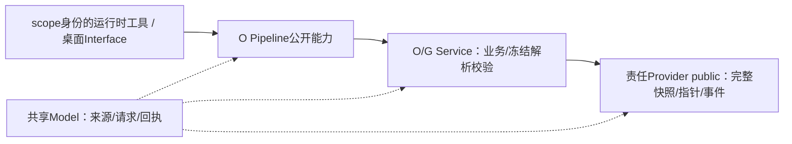

# 角色直接能力实现合同 C0-P1

- 日期：2026-11-05；作者/固定角色：项目管理；状态：交实现者采用的技术合同，未实施、未测试、非验收。
- 场景：产品提交升级后直接得到生效/拒绝/待恢复回执，旧 run 继续按旧物证执行；只细化根 P3.1，不改其保证。
- 上位：根 `docs/planning/2026-11-05_design_direct-role-capabilities.md` P3.1 SHA256 `3A0650FC14298DC5A3DFAE40D2723386FDD810747692C34FFE9AFB2710C6A73C`；团队 T1 `CAEDDA31B12F38ED63811D6ABFDB7A6CF39447ABA614E10A88158B7E52A14F12`；B1 `24FC2F60BB72779FDF897E6AFC890C486B2833A54D4A626BA50AC04F075DF161`。这些文件在根检出，不在候选复制维护。
- 候选：`C:/Users/51054/Desktop/work/ans-studio/.claude/worktrees/trunk-amendment`，`feat/plan-escalation-card`，HEAD `77945d943ed3c7fdcd9097df2b7bb8d49f8cc5e3` 加全部既存差异。统筹转来客户“旧任务已停，可以保留现状继续编辑”，根 I3 末节为释放依据；不清理或归本轮成果。
- 主动白名单仅本合同、同日本人 change、本人 api-spec/memo；角色卡旧调度描述不赋予本上下文派发权。工程法案实际为 `角色卡/项目管理/docs/project-rules.md`，非根 `docs/project-rules.md`。

## 1. 真实入口与合法调用边

| 所有者 | 只读现状 → 本轮提供/消费 |
| --- | --- |
| R | `src/model/runtime.ts:1750–1773` 已有 `SubmitVersionChangeInput/Fn/Result`；工具从 scope 取身份。保留 `submit_version_change` 和 `SubmitVersionChangeFn(input,signal?)`，扩直接回执，不新增相同提交工具。另注入下表窄能力，工具输入不得含可自报 actor/source。 |
| O | `version-change-runtime.ts:531,548,681` 为 submit/present/逐项 apply；`trunk-runtime.ts:116,246` 为公开 runtime/applyApproved。直接分支改走同一提交/恢复服务，不进 present、不调用旧 approve，不传旧 run repin；历史批准 API 仅兼容真实历史记录。 |
| W | `session.ts:3235` 角色门控→`desktop/version-change.ts:1220`→runtime；后者现自动 present 且 Interface 直用 trunkService（既有跳层）。本轮受影响业务查询/提交下沉 O Pipeline，W只注入真实会话身份、传参/展示，不再在 Interface 组装提交业务。 |
| G | `resolveRole(roleId,project)`、`resolveBoundary(roleId,project)` 当前经 boundary-core 读 live 卡；新增冻结解析参数见§2，缺物证拒绝，不回落 live。写卡复用 `validateBoundaryYamlText` 与原 D3/路径检查。 |
| W/O | `session.ts:6525–6550` closeTask 固定 `by:chief` 且缺报告/原创建者核验；`interface.ts:3111` 只转 manager。窄收口必须走 O Pipeline→Service 校验→Provider事件追加，W不得手写 closed。 |
| U/W | 复用 `decision:judge-get/set/state`、preload `getDecisionJudgeState/setDecisionJudgeEnabled/onDecisionJudgeState` 和 confirm-store；U移勾选到 ChatHeader，不能本地合成可信 enabled/revision 或来源。 |

## 2. 冻结签名与数据语义（拟实施，不声称已有）

下列新名字/形状为拟议消费锚点，尚未经owner实现核定；R/O/G/W须在实现前返回真实冻结签名，后继不得把本表当已存在API。现有SubmitVersionChangeFn和IPC方法名保留。R拥有中立请求/来源/回执 Model，O/G各自在公开入口实现。可选字段仅为历史兼容，直接能力必需字段不得省略。

| 能力/稳定签名 | 输入、信任与回执 |
| --- | --- |
| `SubmitVersionChangeFn(input,signal?)` | 沿用原字段；增加 `operationId`、`baseTrunk:{version,digest}|null`、每目标期望原字节 hash；applicationId由应用产生/绑定。scope身份再次与W会话核对，仅 product升级/rapporteur整单修正。 |
| `DirectActionSource` | 判别字段 `kind`：`customer-decision` 带真实decisionId；`role-direct` 带应用actorRoleId/action/operationId/applicationId、base/target摘要、at及适用journalId/runId；`chief-delegated` 带可信chief、originRoleId、requestId/baseDigest、delegationRevision、selected/reason。禁止填假customer/approved/confirmed。 |
| `DirectActionReceipt` | `ok`、`operationId`、`status: applied|no-op|rejected|committed-pending-recovery|blocked`、必要applicationId/journalId、base/target摘要、errorCode/message。提交后失败必须返回已提交待恢复；no-op不升版。R在既有结果中增字段/联合，保留必要旧字段兼容。 |
| `SelectRunChangeFn(input,signal?)` / `select_run_change` | 模型仅给 `operationId,runId,expectedPinDigest,targetTrunk:{version,digest},mode,reason`；rapporteur身份由scope取得。continue仅登记；restart/stop核实际停稳，未停稳不新派。O公开runtime承接，禁止复用客户选择凭据。 |
| `CompleteTeamPlanFn(input,signal?)` / `complete_team_plan` | convener/schedule；`operationId,flowId,runId?,baseDigest,plan:{path,sha256,version}`。应用读取校验分工/属主/写集/依赖，不把完成计划当D3；回DirectActionReceipt。 |
| `ActivateRoleDocumentsFn(input,signal?)` / `activate_role_documents` | nominator；`operationId,flowId,planRef,d3DecisionId,rosterRef,targetRoleId,documents`，documents必须含card/md/yaml三路径hash。草稿可分别写，激活只切完整版本；应用自产内容绑定回执含activationDigest，失败保留旧有效卡。 |
| `CloseCreatedTaskFn(input,signal?)` / `close_created_task` | 模型仅给 `operationId,taskId,runId,basisDigest,reportRef,outcome,note?`；chief/convener可信身份必须等于task.created.from；应用读当前报告/合法状态/依据，收口后才释放依赖，回真实事件/状态。 |
| `FrozenRoleEvidence` / G解析 | `runId,pinDigest,roleId,rosterRef,planRef,d3Ref,activationRef,cardRef,boundaryMdRef,boundaryYamlRef,authorizationRef`；每ref是不可变snapshotId/path/sha256。O核完整快照，G的 `resolveRole/resolveBoundary` 接同一可信冻结上下文（可放ProjectConfig可选字段）；返回普通解析结果，不返回Provider对象。只有无run的查询才读有效trunk。 |
| O Provider public存储 | 在已有trunk public暴露 `prepareSnapshot(input):Promise<StoreRead<SnapshotRef>>`、`readSnapshot(ref):Promise<StoreRead<CompleteSnapshot>>`、`compareAndSwapManifest(expected:{version,digest}|null,next):Promise<StoreWrite或conflict>`；完整字节及ref摘要纳Model。Provider只做存储/锁/CAS，Service判断内容/权限；不做公共Service locator。 |
| chief实际决策接缝 | W把有效保留卡作为真实chief会话请求，chief经注入 `DecidePendingRequestFn({requestId,baseDigest,delegationRevision,selected?,reason,disposition},signal?)` 回答；disposition为select/reject/revise，select须合法选项。应用复核主进程状态/rev、可信chief、origin/请求/依据及未决CAS，工具不准自报来源或开启委托。无修订选项则保留请求并反馈退修，不写已批准。 |
| 顶部IPC | 旧方法/频道名保持；权威状态响应及push扩 `revision:number`。每次开启/关闭/重载撤代选均使旧rev失效；人工响应按当前模式重核。chief忙/失败/缺证据保留原因/接管入口；同request只结算一次。U只消费响应，不调用chief执行或旧judge兜底。 |

通知键固定 `operationId + committedDigest + eventType + recipientRoleId`；文档更新与run择时分事件。D3、验收、运营decision保留原发起者/回报链；五取消卡不换名恢复。shell/下载/stable专门执行审批不由chief业务决定替代。

主chief回合可能等待worker，而worker等待运营业务卡；代决策须使用真实chief身份、当前目标及证据的有界独立执行上下文（同role、无生产写权），不能再等待同一忙chief，也不能由推荐项/普通judge冒名。W/Q须真实验证该等待场景、有限预算及关闭后的人工接管，Model结构检查不证明无循环等待。

## 3. 必须补证与最小范围增量

- **提交缺口**：`TrunkStore` 现仅read/writeManifest、journal、history；`apply-journal.ts:287–308`只核散文件并写journal，310–325先repin，393后写manifest。manifest中引用path/hash不等于持有不可变完整字节，现有atomicWrite仅单文件。S1须实现§2完整目标/CAS＋重读＋所有本轮读者解引用；之前阻断直接提交，不能弱化P3.1整单可见保证。
- **旧run缺口**：`run-manifest.ts:67–106`只有文档/计划refs、roles及D3，未见完整卡/md/yaml/授权字节快照；`resolve-role.ts`仍读live。旧run不能从现在文件补造历史，缺物证必须blocked；新run先冻结完整依据，G解析/dispatch/权限/contract/验收同次使用同一pin。
- **已证冻结来源缺口**：G `versioned-doc-guard.ts:306–316`只接受origin customer/application及customer decidedBy；role-direct新Model不能仅靠编译放行。O `guard-freeze-registry.ts:21–30`、`fs-freeze-cache.ts:15–18`、`freeze-migration.ts:17–20`及 `common/编排/run-manifest.ts:30–39`直依赖G私有helper，前者还调用其I/O；本轮来源/冻结读触及，必须修真实边。
- **最小遗漏路径细化**：T1表外增加 O `src/provider/version-change/impl/guard-freeze-registry.ts`；G `src/common/门禁引擎/versioned-doc-guard.ts`；G现有 `test/门禁引擎/versioned-doc-guard.test.ts`。三者均已有各自§1目录覆盖；据统筹转达根最新裁定，role-direct已批准契约必需的现owner目录内遗漏由统筹记必要细化，无需为清单遗漏另问。并复用已授O/G direct-role-capabilities测试，不要求另造测试文件。
- **合法修边建议/须统筹判定责任**：优先由O既有Provider abstract/public/impl承载所需冻结持久化操作 `readFreezeEvidence(ref)` / `appendFreezeRecords(records)` / `readFrozenRoleEvidence(runRef)`；G Service→O Provider public取得普通数据，再用G私有纯解析/校验；O Service→O Provider public，O Provider不再导入G私有I/O或向上调用G Service。上面O三既有caller及run-manifest（后四已在T1）须同步改入口；common不能包Provider回调执行I/O，应由其Pipeline/Service调用后传普通数据。
- **责任/边界停点**：既有冻结语义搬回O已授Provider公开入口可作为正确分层的候选，不在此引入新业务语义；现权威R9锁/追加在G私有common，长期责任是否改变仍需O/G按实际抽取范围确认，不能默默移交。仅现owner既有范围展开由统筹记细化；真改变公共契约/层边界/权限则回具体团队delta，必要时人事更新。若必须新增G Provider，其§1无Provider路径，须另给精确路径。不得用Service再导出冒充合法Provider。尚未实施，未覆盖caller不宣称全仓修复。
- **统筹续派裁定补充**：根已确认P3.1既定Provider持久化原归O、G保解析/校验；本轮上述必要旧私有I/O边修正仅为既有责任落到正确入口。三遗漏源测在原§1内细化，不改文件owner/Section1，不新建Provider源文件或共享服务，不新增用户行为；后继若越出这项解释再交具体delta。本条澄清前条责任疑问，不倒填已完成修边。
- **旧任务证据口径**：W `docs/change/2026-11-05_plan-escalation-report-card.md` §七仅“实现与定向测试完成；无独立验收结论”；P `docs/change/2026-11-05_change_plan-escalation-i18n-verify.md`为implemented-unverified；R memo未见本任务完成段，O memo末记录为权力矩阵C3。报告本身不能证明writer释放；实际释放采用根I3客户新确认，旧证据不当本轮测试。

## 4. 推进与复核

- R可先做来源/回执/窄能力Model及schema，G可先更新角色提示/纯校验；提交、冻结持久化/读取子项等范围和责任落实，不阻塞不相交工作。
- O交S1时必须提供唯一提交点、完整快照/CAS、提交前后恢复状态和旧run读法的实际签名/hash；G交同pin正反例；W交真实身份/创建者收口/chief rev及结算；U等权威IPC冻结后消费。
- 后续owner最小提案在本人change/api-spec注明与本合同差异，P只读短审核，经统筹安排；实质改变P3.1保证返回沟通/策划。
- 本轮仅文档核对：对照实际入口、边界§1与工程法案；未启动应用、模型、类型检查或测试；未commit/merge/push。行为验证按B1 A01–A33及T1各owner责任执行，本合同不作通过结论。

## 5. P2同对象批量审结与复用范围

- 2026-11-05：核O本人S1提案22行、U0提案12行、R本人最终修正及runtime实际声明，结论均 **recommend approval**；G1沿用P1建议。R收口已复用TaskClosedOutcome（accepted/rework/rejected），cancelled编译负例关闭P1唯一需修项。
- O S1正式消费签名：`prepareSnapshot(CompleteSnapshot):Promise<StoreRead<SnapshotRef>>`、`readSnapshot(SnapshotRef):Promise<StoreRead<CompleteSnapshot>>`、`compareAndSwapManifest(TrunkCommitRef|null,TrunkManifest,SnapshotRef):Promise<StoreWrite|conflict>`；完整当前trunk全部refs及新目标字节闭包，CAS锁内核version/digest，manifest为唯一提交点。Provider可选方法仅兼容旧替身，直接Service缺能力fail-closed；前后故障/no-op/冲突重放和旧pin缺物证按本合同取证。
- 本审结复用至同签名/来源的O1 Pipeline→同Service→Provider public、R五Fn对应schema/tools与注入透传（严格参数，未知actor/source拒绝，按可信角色注入才注册）、U该reason单映射及后继既有IPC/confirm-store消费W权威revision；均限已授原owner路径，不新增角色/权限/行为。普通实现细化无需重述提案独占review槽，实施证据仍逐节点产生。
- W沿C0的可信身份、D3/激活、创建者收口、独立有界chief及revision/CAS普通接线同样复用；尚未知的具体宿主技术设计未被假定评估。只有新实质接口/来源/层边界/权限分歧再作最小delta核。建议通过不等于运行/测试通过或独立验收，仍由统筹核依赖并派发。

## 6. P3两项同范围合同差异审结

- 2026-11-05现时点核R3实际Model与本人证据、根dispatch“首建真实workflow缺失合同差异”及纯结构归一裁定：均 **recommend approval**，不倒填实施前已审。
- 规划trunk允许`artifacts.workflow`诚实缺失；`ExecutionTrunkManifest`与`hasExecutionWorkflow`仅收窄真实kind/path/hash结构前提，不授执行权。真实run创建/派发仍须真实workflow与D3/完整激活/授权闭包；不得造默认ref/文件/空hash、宽cast或过滤undefined掩盖执行缺失，不增第二阶段账本。O/W/Q条件消费与执行缺失拒绝负例是本合同普通后继，无需另占审核节点。
- 纯`DocFreezeRecord`不变量唯一由R `src/model/version-change.ts::isValidDocFreezeRecord`提供；O/G只导入或保同函数纯兼容出口，不复制规则，不把当前开关、业务授权或I/O放Model。合法已提交chief-delegated历史物证在关闭委托后仍有效，当前新提交的开关/revision/CAS由业务链另核。
- R3三源测聚合`C89F819AC54FAB8B7871DFB246BF17E5638BA4334F51C7486D096A301118A66D`、owner报告10/10及diff检查通过；40条O/W/Q workflow消费类型诊断仍是真实后继缺口，未证全类型通过。建议只覆盖这两项差异，不把规划可用冒称执行就绪或跨层消费已完成。

## 7. P5三个真实缺口的最小内部合同（待原owner实现）

### 团队计划内容

定点事实：`run-manifest.ts:45,538–541`仅核`schema: teamPlanSchema:3`；`test/编排/fixtures/trunk-project.ts:210`只有schema与demo正文。当前convener提示只要求模块属主/写区/分工/依赖，无字段；workflow-preconditions只解析现权威project-modules/v2与project-roster/v3。旧2026-10-22/23团队记录确有roleRows/modules/writesets/dependsOn字段沿革，但当前没有该解析器，历史文档不充当前实现证据。

最小候选表示：现YAML frontmatter保`schema: teamPlanSchema:3`，加`flowId:string, version:positive-int, modules:{path,sha256}, roster:{path,sha256}, roleRows:[{roleId:string,modules:string[],writesets:string[],dependsOn:string[]}]`。Service解析成普通TeamPlanFacts；引用必须是应用当前有效完整snapshot中的真实模块/名单摘要，不读latest猜版本。模块owner唯一来自已解析roster，roleRows只能安排/收窄该owner，不能重新任命；每模块恰一owner，roles/modules逐项与适用名单一致，写集必须在模块授权根与角色激活边界交集内，不能跨owner或重叠并发writer。依赖引用本计划roleId、显式空数组表示无依赖，去重/无自依赖/无环；不引入新的task/阶段账本。

拒绝：缺机器字段/坏YAML/重复角色或模块、错flow/version/hash、未知role/module、路径逃逸/通配扩大/越边界、owner漂移/重叠写集、缺失或未知依赖/环。相同path/hash/version却不同解析内容亦拒绝。旧schema-only文档可保历史只读，不能直接complete或自动补造字段；G生产提示与O解析须同字段。规划合法计划不伪造D3，执行派发另核真实D3/激活/授权。上述字段是沿既有职责的候选实现表示，尚未声称产品已有；若根判断表示/历史兼容是产品合同新决定，只将本段精确字段与拒绝/只读口径交策划，不另造研究方案，不用自造schema先放行。

### 首run前激活与双维度CAS

R拟新增`ActiveRoleEvidence = Omit<FrozenRoleEvidence,"runId"|"pinDigest">`；仍含roleId、自身snapshotRef及八个内容refs，激活结果改用此DTO。只有真实pin时应用绑定`FrozenRoleEvidence={...active,runId,pinDigest}`；不得造run、假pin。manifest现`frozenRoles`仅保历史兼容/真实run物证，新`activeRoles`存ActiveRoleEvidence。

复用原manifest存储可加入`activeRevision`/`activeDigest`/`activeRoles`独立维度；其digest覆盖激活记录及各角色快照refs，不混doc digest。Provider同一现有锁内重读`doc(version,digest)`与`active(revision,digest)`，每次变更以期望双维度CAS，从锁内当前值合并只改本维度；另一维度有变则冲突重读，不以旧整对象覆盖。role-only激活不升文档trunkVersion、不调用history-vN归档，现journal按operationId记录kind=role-activation及active before/target；doc提交保当前active，不自动激活新卡。现Provider CAS签名需原O最窄加期望active身份，R/G/O本人改Model/消费者，不在P代写。

doc snapshot与active-role snapshot独立校验自己的字节/摘要；不得强等snapshotId。旧run持原FrozenRoleEvidence不可改写，后续激活不渗透；新run冻结所选完整有效doc＋active依据闭包，缺八refs/授权或损坏拒绝。这里只规定数据与CAS边界，不自产可执行权。

### 真实停稳生命周期

已证：`common/编排/run-manifest.ts::applyRunChange`只close manifest/ensureDraft，未停会话；O`openRoleSession`有真实handle，但abort只转Service并报告已请求。R Service已有active turn/terminalPromise、事件settled、后台管理器；其abort目前不await terminalPromise，dispose可关闭队列且已dispose时list返回[]，均不能自动证明活动同步工具/进程已退出。W`terminateRoleRun`用abort.ok和后台计数判停稳，缺list时`??[]`、list异常路径仍可能继续，不能作为run停止证明。

最窄拟由R在原Model RoleSession与原Service session增加`stopAndInspect({expectedSessionId,expectedTurnId?,timeoutMs},signal?)`及普通生命周期事实：session/role/turn绑定、`stopRequested`、真实`settledAt/turnId`、`activeTools`、`processes[{id,state,exitCode?,signal?}]`、`status:quiescent|stopping|unknown`/原因；R Provider原工具进程管理必须贡献事实，abort请求/已dispose空表不算quiescent。同步工具未知、后台kill-timeout、缺settled、session/run归属不明或任何清理超时均unknown/blocked。

O Pipeline在创建Service公开handle时登记runId→session/turn关联并封住该run新的send/派发，使用该同源handle请求stop，等待真实settled与已跟踪工具/进程全终止后生成绑定operation/run/pin的停稳事实；W只消费同handle，不向Pipeline注入Interface回调或自报布尔停稳。确认停稳后才close旧manifest，核部分产物原字节hash/合法授权及新依据，再建/冻结新run；迟报归旧run、无自动删产物/回滚doc。重启丢失进程事实不能以‘无内存会话’当已停。continue-frozen与独立direct不依赖尚未实现stop能力，可先行。

最小R后继须回答三问题：①现terminalPromise是否覆盖工具清理完成，如何避免dispose合成settled；②同步run_shell与后台进程能否完整列举并证明退出，缺失如何unknown；③O创建handle登记如何与W已有会话共享，进程重启后何种真实物证能证明旧链停止。现尚无可证stopAndInspect实现，不宣支持；优先原R `src/model/runtime.ts`/`src/service/runtime/session.ts`、O `run-role.ts`/本次Pipeline及W `session.ts`内落实，若真需原Provider额外路径先报精确原owner/§1细化。禁止新增通用进程服务或假停止receipt。
